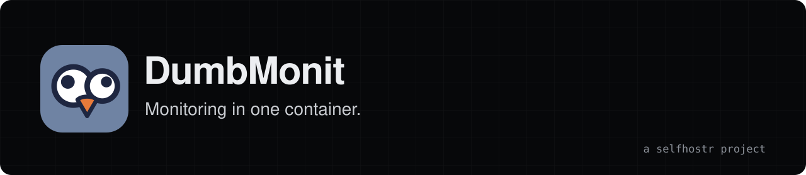

<div align="center">

<a href="https://dumbmonit.selfhostr.io"></a>

<h3>Self-hosted monitoring for homelabs, small teams and mid-sized companies.</h3>

<a href="https://dumbmonit.selfhostr.io"></a>
<a href="https://dumbmonit.selfhostr.io/docs/"></a>
<a href="https://dumbmonit.selfhostr.io/demo/"></a>
<a href="https://github.com/selfhostr/dumbmonit/releases"></a>

[](https://github.com/selfhostr/dumbmonit/actions/workflows/ci.yml)
[](https://www.bestpractices.dev/projects/15486)
[](https://scorecard.dev/viewer/?uri=github.com/selfhostr/dumbmonit)
[](LICENSE)

</div>

Screenshots: [screenshots/](screenshots/)

## Overview

DumbMonit watches servers, network gear, hypervisors, storage, applications and websites from a single console. No Zabbix to operate, no Prometheus, Grafana and Alertmanager to assemble.

- **Fast to set up.** Pick a type, read what to prepare on the device, fill the few fields that matter. SNMP profiles are detected automatically.
- **Quiet by default.** Useful rules from the start, and one notification instead of thirty when a switch goes down.

Free, for good. MIT licence, no paid edition.

## Quick start

```bash
mkdir dumbmonit && cd dumbmonit
curl -fsSLO https://raw.githubusercontent.com/selfhostr/dumbmonit/main/docker-compose.yml
docker compose up -d
```

1. Open https://localhost:8080. DumbMonit only speaks HTTPS, with a certificate it creates itself: the browser warns once that it does not know it. Accept the exception, or see [HTTPS and encryption](https://dumbmonit.selfhostr.io/docs/install/https/).
2. Create the first admin account with the one-time code printed by `docker compose logs dumbmonit`.
3. Add a monitor, connect a notification channel, send a test message.

Back up *Settings → Backup* **and** `/data/secret.key`. Updating, ports, lost password: see the
[installation guide](https://dumbmonit.selfhostr.io/docs/install/docker/).

## Features

### What it watches

Over 100 integrations (monitor types), each with its own page in [the documentation](https://dumbmonit.selfhostr.io/docs/devices/):

- **Network and servers**: SNMP, firewalls (OPNsense, pfSense, FortiGate, MikroTik, UniFi…), Redfish, Active Directory, and an **agent** for Linux, Windows, macOS and FreeBSD. The agent also finds the databases on a machine and checks that they are backed up, and can be deployed to a whole Windows domain with one group policy.
- **Virtualisation and storage**: Proxmox (VE, Backup Server, Datacenter Manager, Mail Gateway), vSphere, Synology (DSM, plus an agent package for DSM 7 and a **NAS fleet** view of all your NAS at once), TrueNAS, Unraid, Veeam.
- **Apps and services**: Nextcloud, Immich, Jellyfin, GitLab, Kubernetes, databases, HTTP/TCP/DNS/ping/TLS checks, heartbeats, **mail server and IP range blocklists** (Spamhaus, Barracuda, SpamCop…, with delisting links), and **website health and SEO** (blank page, `noindex`, title or canonical changes, redirects, slowness) with bulk CSV import sorted by platform.
- **Anything else**: network discovery (one-off or **scheduled**, with an inventory that flags new devices and ports) and YAML **integration packs**, no release needed.

### What it does

- **Alerting that does not cry wolf**: a parent that is down hides its children, maintenance windows and silences (recoveries stay quiet too), forecasts, a seasonal baseline, and a bell on each monitor counting its active alerts.
- **38 notification channels**: Discord, Slack, Telegram, Matrix, ntfy, email, PagerDuty, webhook and more.
- **Public status pages** with history, incidents, email subscribers, badges and four night cities (Paris, Tokyo, New York, Dubai).
- **Wall mode**: the console's board full screen for a room monitor, with an optional night city behind it, and an optional **security score** next to the main products (hosts, Proxmox, Synology, OPNsense, websites, Active Directory).
- **API and MCP server** (28 tools): ask Claude or ChatGPT "is everything fine?", or read it from Prometheus and Grafana.
- **HTTPS only**, with an encrypted agent channel (TLS 1.3, client certificates) and approval of new agents before they enrol.
- **A sentinel agent** that warns you from inside your network when DumbMonit itself stops answering.
- **Encrypted backup**, accounts with TOTP and passkeys, OIDC and SAML single sign-on, **LDAP / Active Directory** sign-in, an installable phone app (PWA), and remote sites through an outbound-only relay agent.

## Architecture

One Rust binary with the UI embedded, VictoriaMetrics started by it, SQLite for configuration.

## Limits

Some integrations have only met test instances, not years-old production hardware. Validate DumbMonit in your own environment before you rely on it.

## Status

It runs daily on the author's own network. Before 1.0 the HTTP API and the database schema can still change between minor versions (the [changelog](CHANGELOG.md) lists every change and how to upgrade).
Formerly called EzyMonit; the old `EZYMONIT_*` variables are still accepted.

## Contributing

Bug reports, device profiles and integrations are welcome: see [CONTRIBUTING.md](CONTRIBUTING.md) (Docker only, no Rust toolchain needed).
The interface and the [documentation](https://dumbmonit.selfhostr.io/docs/) come in English, French, German, Spanish, Italian, Portuguese (Portugal and Brazil), Russian and Simplified Chinese. To fix or add a translation, open a pull request: see [Translating DumbMonit](CONTRIBUTING.md#translating-dumbmonit).
Security issues: [SECURITY.md](SECURITY.md). Roadmap: [public project](https://github.com/users/laupernoe/projects/2).

## License

MIT, see [LICENSE](LICENSE). DumbMonit is free and will stay free.

DumbMonit is provided "as is", without warranty of any kind. The author and contributors accept no liability for any damage, undetected failure or unsent alert; validating it in your own environment is up to you.

## Support DumbMonit

DumbMonit is free and has no company behind it. If it saves you time, you can [sponsor us on GitHub](https://github.com/sponsors/selfhostr), recurring or one-off.

Bug reports, translations and device profiles help just as much.
