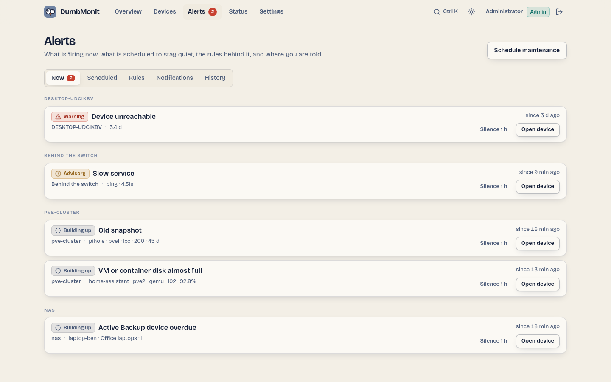

# Como funciona a alertagem {#how-alerting-works}

Regras úteis estão ativas logo após a instalação; nada precisa de
ajuste. O que faz a diferença no uso diário é o que mantém o ruído
baixo: supressão por dependência, agrupamento por anfitrião, janelas de
manutenção, e uma linha de base que aprende antes de falar.

{ loading=lazy }

## Severidades {#severities}

A interface fala a escala do boletim meteorológico. A API e o editor de
regras guardam os mesmos três níveis sob os nomes internos do motor.

| Na interface | Na API (`severity`) | Significado |
|---|---|---|
| Info | `info` | Útil de saber, nenhuma ação esperada. Usado pela regra de linha de base. |
| Advisory | `warning` | Precisa de atenção em breve: CPU alta, disco quase cheio, serviço lento. |
| Warning | `critical` | Precisa de si agora: dispositivo inacessível, serviço em baixo, verificação de cópia de segurança falhada, certificado expirado. |

O escalonamento sobe a severidade de uma regra um nível depois de
`escalate_after` se o alerta continuar a disparar (Info → Advisory →
Warning; Warning permanece).

## Fases {#phases}

Todo alerta é uma máquina de estados, avaliada a cada 30 segundos
(`DUMBMONIT_ALERT_INTERVAL_SECS`).

| Fase | Na interface | Significado |
|---|---|---|
| `ok` | — | A condição é falsa. |
| `pending` | Building up | A condição é verdadeira mas a retenção da regra (`for`) ainda não passou. Nada é enviado. |
| `firing` | Firing | A condição manteve-se o tempo suficiente. A primeira notificação sai, depois lembretes a cada `repeat_interval` (6 horas por predefinição para a maioria das regras incorporadas), depois um escalonamento se configurado. |
| `resolved` | Resolved | De volta ao normal. Uma notificação de resolução só é enviada se o disparo tivesse sido anunciado. |
| `suppressed` | Suppressed by parent | O alerta está ativo, mas um dispositivo pai, ou o próprio dispositivo, está inacessível: ver abaixo. |

`phase` é o estado do motor; `effective_phase` é o que lê. Um alerta
cujo `effective_phase` é `suppressed` mantém `phase = firing` por
baixo, por isso não é notificado de novo quando o pai recupera.

Um alerta também pode ser **confirmado** (`acked`, com `acked_by`,
`acked_until` e `ack_note`): a fase não se move, os lembretes e
escalonamentos pausam até `acked_until`, a resolução continua a ser
notificada e limpa a confirmação. **Adiar** (snooze) um alerta funciona
da mesma forma por baixo mas através de uma janela de manutenção
limitada às etiquetas exatas desse alerta (`silenced: true`), em vez de
todo o dispositivo: uma regra irmã no mesmo dispositivo continua a
falar. Ver [Livrar-se de um alerta](../using/alerts.md#getting-rid-of-an-alert).

## Supressão por dependência {#dependency-suppression}

Qualquer dispositivo pode declarar um **dispositivo pai**. Quando um
dispositivo está inacessível (a regra «Device unreachable» dispara
nele), todo alerta nos seus descendentes é marcado *Suppressed by
parent* em vez de ser enviado: um comutador a cair produz uma
notificação, não trinta. O ancestral inacessível mais próximo é
nomeado como a causa (`suppressed_by`), e a cadeia é seguida até 64
níveis.

O mesmo se aplica ao próprio dispositivo inacessível: os seus outros alertas
(disco cheio, CPU, etc.) são suprimidos pela sua própria falha, com
`suppressed_by` a indicar o próprio dispositivo, pois os seus valores estão
desatualizados e são apenas um sintoma da mesma falha. Só o seu alerta «Device
unreachable» nunca é ocultado pela própria falha, pelo que é avisado uma vez.

Defina o pai no formulário do dispositivo. Na página Devices, os
filhos empilham-se sob o seu pai e esbatem-se quando está inacessível.

Um [agente relay](../install/remote-site.md) conta como pai de todo
dispositivo que sonda (*Reached through* no formulário do dispositivo),
além do pai definido explicitamente: quando o relay está inacessível,
os seus dispositivos são suprimidos com o relay nomeado como a causa.
A distâncias iguais, o pai explícito ganha.

Um pai também conta como inacessível assim que a sua própria
verificação o diz (o estado *Timed out* / *Device unreachable* na sua
página), sem esperar que o seu alerta «Device unreachable» dispare: um
agente que deixa de enviar leva os seus dispositivos consigo um ou dois
minutos antes do seu próprio alerta, e caso contrário cada um
notificaria primeiro.

## Agrupamento, deduplicação, lembretes {#grouping-deduplication-reminders}

Sem agrupamento, um NAS cujo RAID degrada enviaria uma mensagem por
disco, por ciclo. O DumbMonit envia no máximo uma mensagem por
anfitrião e por ciclo, mesmo que contenha cinco linhas. Cada alerta é
notificado uma vez quando começa a disparar (`firing`), depois só como
um lembrete (`reminder`, a cada `repeat_interval`), um escalonamento
(`escalation`) ou uma resolução (`resolved`). O histórico de alertas
regista cada transição com se foi notificada e, se não, porquê
(aprendizagem, suprimida, silenciada, confirmada).

## Janelas de manutenção {#maintenance-windows}

Um silêncio suspende notificações sem suspender a avaliação: no fim de
uma janela, um alerta ainda ativo é notificado uma vez, em vez de
«nascer» depois de duas horas de existência. As janelas são pontuais ou
semanais, por dispositivo ou para toda a instância. Ver
[Janelas de manutenção](maintenance.md).

## Aprendizagem da linha de base {#baseline-learning}

A regra «Unusual CPU» não precisa de nenhum limiar. Para cada série
mantém 168 compartimentos, um por (dia da semana, hora), e compara cada
ponto com o que é geralmente observado *nesse momento*. A pontuação é
robusta (mediana e MAD, uma EWMA por compartimento com `alpha = 0.05`),
por isso um único incidente não reescreve a linha de base, e derivas
sazonais são seguidas.

A regra fica **silenciosa durante os seus primeiros catorze dias** de
aprendizagem: cada compartimento tem de ter sido visto pelo menos duas
vezes para distinguir «inusual» de «nunca observado». Entretanto é
mostrada com uma marca *learning* e só diz o que teria disparado. As
linhas de base de séries que desapareceram são esquecidas depois de 60
dias.

## Previsões {#forecasts}

Dois tipos de alerta preveem em vez de reportar, e a visão geral
lista-os sob *Forecasts*: a anomalia da linha de base, e as regras
`predict` que extrapolam uma série com `predict_linear()` do lado da
VictoriaMetrics («Filesystem almost full» dentro de quatro dias). A
estimativa de datastore do PBS é um limiar simples sobre a própria
previsão do PBS.

## Para onde vão as notificações {#where-notifications-go}

As regras incorporadas não têm nenhum canal associado, o que significa
**todo canal ativado**. Uma regra que edita pode nomear canais
específicos. Os canais são configurados em Alerts → Notifications; ver
[Canais de notificação](../notifications.md).

## Notificações inteligentes {#smart-notifications}

Tudo o que foi dito acima decide *se* um alerta pode falar. Uma segunda
etapa, a política de notificação, decide *quando* e *em qual canal*,
para que ninguém seja inundado. O caminho completo de um alerta, por
ordem:

1. **Avaliar** — limiar, pontuação de anomalia ou previsão, com a
   retenção da regra (`for`) e, quando definido, o seu **limiar de
   limpeza** (histerese: disparar acima de 90%, limpar só sob 85%) e
   qualquer **substituição por dispositivo**.
2. **Deduplicar** — uma impressão digital por (regra, série), indexada
   pelo id do dispositivo (`target`) em vez do seu nome: renomear um
   dispositivo ou editar as suas etiquetas não cria um segundo alerta,
   e uma série que resolve para a mesma chave duas vezes produz um
   alerta. As séries de um dispositivo que foi eliminado ou pausado são
   descartadas: os seus alertas limpam-se de imediato, sem nenhuma
   notificação, e o histórico regista `device removed or disabled`.
3. **Suprimir por dependência** — os descendentes de um dispositivo
   inacessível ficam silenciosos.
4. **Silenciar** — as janelas de manutenção silenciam o que cobrem.
5. **Agrupar por dispositivo** — uma mensagem por dispositivo por
   ciclo, lembretes e escalonamento incluídos.
6. **Retenção de oscilação** — uma impressão digital que dispara e
   limpa 4 vezes em 30 minutos envia um único aviso de «flapping»,
   depois nada durante 30 minutos.
7. **Filtros por canal** — severidade mínima, «avise-me quando se
   resolver» ativo/inativo, e um intervalo mínimo entre duas mensagens
   sobre o mesmo alerta.
8. **Horas de silêncio** (por canal) — só os alertas de nível Warning
   passam; o resto espera por um resumo quando as horas de silêncio
   terminam (um alerta que se resolve entretanto só é mencionado como
   «resolved during quiet hours»).
9. **Agrupamento em lote** — alertas dentro da janela de lote (60 s por
   predefinição) saem como uma mensagem por canal: «3 alerts on 2
   devices, 1 resolved».
10. **Limite horário** — passado `max_per_hour` mensagens num canal, os
    alertas esperam e chegam como um único resumo («…and 7 more
    alerts»).
11. **Enviar** — com uma ligação «Open in DumbMonit» por dispositivo
    quando um URL público é conhecido.

Os passos 6 a 10 são configurados em Alerts → Notifications →
Notification policy (global) e em cada canal (Delivery options). Ver
[Política de notificação](notifications.md).
