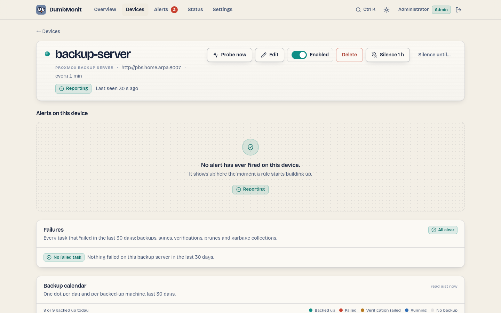

# Proxmox Backup Server {#proxmox-backup-server}

Servidor de backup: um calendário de backup de trinta dias por máquina,
tarefas com falha com seus logs, jobs agendados (sync, verify, prune,
coleta de lixo), datastores, discos e pools ZFS, atualizações pendentes,
os serviços e versões de pacote do próprio servidor, e o nível de fita
quando houver um.

## A página do dispositivo {#the-device-page}

{ loading=lazy }

Além dos gráficos genéricos, um dispositivo PBS mostra seis painéis,
lidos do que a sondagem armazenou — abrir a página nunca consulta o
próprio PBS:

* **Falhas** — toda tarefa que falhou nos últimos 30 dias (backup, sync,
  verify, prune, GC), mais recente primeiro, com seu tipo, o que
  alvejava, quando começou e a própria mensagem de erro do PBS. *Mostrar
  log* busca as últimas linhas do log da tarefa do PBS sob demanda
  (`/nodes/localhost/tasks/{upid}/log`).
* **Calendário de backup** — uma linha por máquina com backup
  (datastore, namespace, `type/id`, e o nome do guest quando o PVE o
  escreveu nas notas do snapshot), um ponto por dia: verde-água quando um
  backup teve sucesso aquele dia (uma tarefa terminou `OK`, ou um
  snapshot existe — grupos sincronizados não têm tarefa local), vermelho
  quando uma tarefa de backup falhou e nenhuma teve sucesso, amarelo
  quando o backup está lá mas sua verificação falhou, azul enquanto um
  está em execução, cinza quando nada aconteceu. A dica de cada ponto dá
  a hora, tamanho, duração e trecho do erro; a linha diz quando foram o
  último sucesso e a última falha, a contagem de snapshots, o tamanho do
  snapshot mais recente e a retenção do job de prune que se aplica. Uma
  máquina cujos backups todos falham não tem snapshot alguma e ainda
  aparece — a partir de suas tarefas.
* **Jobs** — cada job de sync, verify e prune e o GC de cada datastore,
  com programação, última execução, resultado, próxima execução; uma
  última execução com falha recebe uma placa vermelha e o texto do erro,
  falhas vêm primeiro na ordenação.
* **Fita** — só quando o servidor tem um nível de fita. Jobs de backup em
  fita com seu pool, drive, o rótulo da próxima fita esperada, a última
  execução e seu erro; pools de mídia com suas políticas de alocação e
  retenção, quantas fitas contêm, quantas expiraram e se são
  criptografadas; drives e changers; e as próprias fitas com seu status,
  conjunto de mídia, localização e bytes gravados.
* **Datastores e discos** — barra de uso, a própria previsão de
  esgotamento do PBS, fator de deduplicação, último GC; pools ZFS com sua
  saúde; discos físicos com o veredito SMART e desgaste de SSD, e a
  tabela SMART completa sob demanda (`/nodes/localhost/disks/smart`). Por
  datastore também mostra uma placa de manutenção ou "Não montado", uma
  placa "Ocupado: n escritas, n leituras", o crescimento medido por dia
  e por quantos dias de histórico, quantas máquinas de cada tipo contém,
  quanto tempo o último GC levou, e uma linha de aviso quando esse GC
  encontrou chunks ilegíveis.
* **Servidor** — as unidades systemd, com as que o servidor não pode
  passar sem destacadas; as versões de pacote Proxmox (instalada,
  disponível, em execução), com uma placa "Reinício pendente" quando o
  daemon está atrás de seu pacote; o certificado e sua expiração; e as
  regras de controle de tráfego com seus limites e o que estão
  carregando.

O calendário divide os dias na meia-noite local do navegador. Seu
histórico vem da lista de tarefas: a primeira sondagem depois de um
início lê os últimos 30 dias
(`/nodes/localhost/tasks?since=…&limit=5000`), sondagens posteriores só a
janela de tarefas, e o servidor mantém a união em SQLite
(`pbs_task_history`, 35 dias, no máximo 10.000 tarefas por dispositivo)
então o calendário sobrevive a reinícios.

## O que ele observa {#what-it-watches}

Todas as métricas têm o prefixo `dumbmonit_pbs_`.

| Família | Métricas | Rótulos |
|---|---|---|
| Nó | `node_cpu_percent`, `node_cpu_count`, `node_iowait_percent` (tempo de CPU esperando por E/S — em um servidor de backup isso diz que os discos estão saturados), `node_load1/5/15`, `node_memory_used/total/free_bytes`, `node_memory_used_percent`, `node_swap_used/total_bytes`, `node_rootfs_used/total/avail_bytes`, `node_rootfs_percent`, `node_uptime_seconds`, `node_kernel_info`, `version_info` | |
| Datastores | `datastore_available`, `datastore_bytes_used/total/avail`, `datastore_used_percent`, `datastore_estimated_full_seconds` (própria estimativa do PBS; ausente enquanto falta dados ou o uso está diminuindo), `datastore_dedup_factor`, `datastore_removable_unmounted` (1 quando um datastore removível está `notmounted` — não é um erro, simplesmente não está conectado; rótulo `mount_status`), `datastore_backend_info` (rótulo `backend`, `filesystem` ou `s3`), `datastore_maintenance` (1 quando o datastore é retido para manutenção; rótulo `mode`, `offline`, `read-only`…), `datastore_groups` e `datastore_snapshots` (rótulo `type`, `vm`/`ct`/`host`/`other`), `datastore_active_reads`, `datastore_active_writes` (o que está retendo o datastore agora — isso explica uma coleta de lixo que não vai terminar), `datastore_growth_percent_per_day`, `datastore_growth_bytes_per_day`, `datastore_history_days` | `datastore` |
| Coleta de lixo | `gc_last_removed_bytes`, `gc_last_pending_bytes`, `gc_last_run_ok` (PBS 3.3+), `gc_last_success_age_seconds`, `gc_last_duration_seconds`, `gc_disk_chunks`, `gc_last_pending_chunks`, `gc_last_removed_chunks`, `gc_bad_chunks` (chunks que o GC achou ilegíveis e deixou no lugar — corrupção, não espaço a recuperar: um backup que os referencia não pode mais ser restaurado), `verify_last_success_age_seconds`, `sync_last_success_age_seconds` | `datastore` |
| Grupos de backup | `backup_count`, `backup_last_timestamp_seconds`, `backup_last_age_seconds`, `backup_last_size_bytes`, `backup_last_verified` (1 verificado, 0 falhou, ausente se nunca verificado) | `datastore`, `namespace`, `backup_type`, `group` |
| Namespaces | `namespace_groups`, `namespace_snapshots` (namespace raiz é `namespace=""`) | `datastore`, `namespace` |
| Tarefas na janela | `tasks_running`, `tasks_ok`, `tasks_failed` | `worktype` (`backup`, `verificationjob`, `garbage_collection`, `prune`, `syncjob`…) |
| Jobs | `job_enabled`, `job_last_ok` (1 para `OK` ou `WARNINGS: n`, 0 caso contrário, ausente se o job nunca rodou), `job_never_run` (1 quando um job está ativado, tem uma programação e nunca rodou — não tem nem falha nem sucesso, então é invisível em todo lugar mais), `job_last_run_age_seconds`, `job_next_run_seconds` (negativo quando atrasado), `sync_jobs_total`, `verify_jobs_total`, `prune_jobs_total`; alias `sync_job_last_ok` para a regra | `job`, `datastore`, `kind` (`sync`, `verify`, `prune`); `remote` (`remote:remote-store`, ou `local`) em jobs de sync — o alias carrega `job`, `datastore`, `remote` |
| Fita (opção `tape`, desligada por padrão, cinco chamadas) | `tape_backup_job_last_ok`, `tape_backup_job_never_run`, `tape_backup_job_last_run_age_seconds`, `tape_backup_job_next_run_seconds`, `tape_backup_jobs_total`; `tape_drive_info` (série de presença), `tape_drives_total`, `tape_changers_total`, `tape_media_pools_total`; `tape_media_total`, `tape_media_writable`, `tape_media_expired`, `tape_media_bytes_used` | `job`, `datastore`, `pool`, `drive` nos jobs; `drive`, `vendor`, `model`, `changer` em `tape_drive_info`; `pool` nas contagens de mídia |
| Discos (mesmos nomes do Proxmox VE) | `node_disk_size_bytes`, `node_disk_smart_failed` (0 `passed`, 1 `failed`; ausente quando SMART não deu veredito), `node_disk_health_info` (série de presença; rótulos `health`, `serial`, `used`), `node_disk_wearout_percent` (resistência usada, apenas SSD, como o PBS exibe: `100 − wearout`) | `disk` (`/dev/sda`), `model`, `type` |
| Pools ZFS (mesmos nomes do Proxmox VE) | `node_zfs_pool_degraded` (0 `ONLINE`, 1 caso contrário), `node_zfs_pool_health_info` (rótulo `health`), `node_zfs_pool_size_bytes`, `node_zfs_pool_alloc_bytes`, `node_zfs_pool_free_bytes`, `node_zfs_pool_used_percent`, `node_zfs_pool_fragmentation_percent` | `pool` |
| Atualizações | `node_updates_pending` (número de pacotes com atualização disponível) | |
| Versões (opção `updates`, de `/nodes/localhost/apt/versions`) | `node_package_upgradable` (1/0), `node_package_info` (série de presença; rótulos `installed`, `available`, `running`), `node_running_version_stale` (1 quando o pacote `proxmox-backup-server` instalado não é mais o daemon em execução — o pacote foi atualizado, os serviços não foram reiniciados) | `package`, restrito a `proxmox-backup`, `proxmox-backup-server`, `proxmox-backup-client`, `proxmox-kernel-helper` |
| Serviços (opção `services`, uma chamada) | `node_service_active` (1 em execução, 0 não), `node_service_enabled` (ausente para uma unidade `static`, que outra unidade carrega e que portanto não está nem ativada nem desativada), `node_services_total` | `service`, `expected` (`"1"` para `proxmox-backup`, `proxmox-backup-proxy` e `proxmox-backup-banner`, as unidades que o servidor não pode passar sem; toda outra unidade ainda recebe sua série, com `expected="0"`, e nunca gera um alerta) |
| Certificado (opção `certificates`, desligada por padrão) | `node_certificate_expires_seconds`, negativo uma vez expirado | `certificate` (o nome do arquivo), `issuer` |
| Controle de tráfego (opção `traffic_control`) | `traffic_rate_in_bytes`, `traffic_rate_out_bytes` (medido no instante da sondagem), `traffic_limit_in_bytes`, `traffic_limit_out_bytes` (o limite configurado, analisado das strings decimais do PBS como `100 MB`; ausente quando essa direção não tem limite, em vez de um zero que seria lido como "tudo está bloqueado"), `traffic_rules_total` | `rule` |
| Limites e coleta | `backup_groups_total`, `backup_groups_dropped`, `up`, `scrape_errors`, `scrape_duration_seconds` | |

Uma tarefa que termina em `WARNINGS: n` conta como bem sucedida. Chamadas
por datastore são limitadas a quatro em paralelo: listar snapshots lê os
índices do datastore, e uma explosão desaceleraria o backup em
andamento.

As listas de jobs não são limitadas à janela de tarefas: um job de sync
que está falhando há três semanas ainda é reportado como falhando. Um
job que nunca rodou não tem série `job_last_ok`, mas tem
`job_never_run`, e a regra "PBS job never ran" dispara exatamente nesse
caso.

A coleta de lixo é lida com uma única chamada `/admin/gc` cobrindo todo
datastore de uma vez, onde antes levava um `/admin/datastore/{store}/gc`
por datastore; essa chamada por datastore permanece como fallback quando
`/admin/gc` não está disponível — um PBS mais antigo, ou um privilégio
faltando — e não é contada como um erro. `/admin/gc` também carrega a
duração da execução e os contadores de chunk que a chamada por datastore
não tem. `gc_last_run_ok` vem de `last-run-state` no PBS 3.3 e
posteriores; em versões mais antigas recorre à tarefa de coleta de lixo
mais recente da janela. As contagens por tipo vêm de
`/admin/datastore/{store}/status?verbose=1`: sem `verbose`, o PBS
retorna só os tamanhos, que `/status/datastore-usage` já dava.
`/admin/datastore/{store}/namespace` retorna toda a árvore de namespace,
então nada se perde em sub-namespaces — `pve/site-a/rack1` é contado
como a raiz. Discos e pools vêm de `/nodes/localhost/disks/list` e
`/nodes/localhost/disks/zfs` (opção `disks`; um 403 é tolerado, assim
como o 400 que um servidor sem ZFS responde: nenhuma série de pool,
nenhum erro de coleta).

`datastore_growth_percent_per_day` é um ajuste de mínimos quadrados sobre
o histórico de uso que o próprio PBS retorna com
`/status/datastore-usage`: uma *fração* de uso entre 0 e 1, um ponto a
cada trinta minutos no último mês, com lacunas `null` que são puladas em
vez de preenchidas — um servidor que estava desligado não cresceu
enquanto estava desligado. Esses são os mesmos números detrás da própria
previsão "cheio em N dias" do PBS. Ao menos oito pontos medidos são
necessários antes de qualquer coisa ser publicada, e
`datastore_history_days` diz quanto histórico a inclinação cobre. Um
valor negativo não é uma falha: o prune está recuperando mais que os
backups adicionam.

Nada de forma alguma é publicado para fita quando o servidor não tem
drive, changer, pool nem job de fita — uma instalação sem fita não deve
crescer uma dúzia de séries zero que parecem um nível de fita com
problemas. Uma fita que não pertence a nenhum pool, mídia em branco ou
mídia retirada de um pool, não está em nenhuma contagem de pool.

## Dispositivos {#devices}

Toda máquina com backup — host, VM ou contêiner — também é publicada sob
a família genérica compartilhada por toda integração do DumbMonit que
rastreia dispositivos protegidos — `dumbmonit_client_device_*`, com
prefixo sem `pbs`, documentada completamente em
[Dispositivos clientes](../alerting/rules.md#client-devices). Nada novo
é pedido ao PBS: é a mesma data do último snapshot já detrás de
`backup_last_timestamp_seconds`, republicada sob a família compartilhada
para que uma regra e uma tabela sirvam o PBS junto com toda outra
integração que protege um dispositivo.

| Métrica | O que é | Rótulos |
|---|---|---|
| `last_backup_timestamp_seconds` | Mesmo instante que `backup_last_timestamp_seconds` para esse grupo | `device`, `type`, `os`, `user`, `kind` |
| `stale_seconds` | Positivo uma vez que um grupo passou `device_stale_days` (3 por padrão) sem um novo snapshot; aciona a regra [Dispositivo cliente desatualizado](../alerting/rules.md#client-devices) | `device`, `type`, `os`, `user`, `kind`, `signal` (sempre `backup`) |

**Limitação que vale a pena conhecer**: o PBS não registra uma "conexão"
separada para uma máquina com backup, só backups —
`last_seen_timestamp_seconds` e o sinal `connection` nunca são publicados
aqui; um dispositivo mostra `last_connection` como "—" na tabela da
página do dispositivo. O dispositivo nomeado no alerta é o nome do guest
das notas do snapshot quando o PVE escreveu uma, senão `type/id`, como o
calendário de backup.

Regras integradas que se aplicam: Device unreachable, PBS datastore
almost full, PBS datastore filling up, PBS backup too old (por grupo de
backup: nenhum snapshot novo por dois dias — edite o limite da regra para
uma janela mais longa), PBS backup verification failed, PBS task failed,
PBS garbage collection too old, PBS garbage collection failed, PBS corrupt
chunks found, PBS sync job failed, PBS prune job failed, PBS verification
job failed, PBS job never ran, PBS datastore not mounted, PBS service
down, PBS restart pending after upgrade, PBS certificate expiring, PBS
tape backup failed, PBS disk SMART failure, PBS SSD worn out, PBS ZFS
pool degraded, PBS updates pending, Client device stale. Notificações
nomeiam o job, datastore ou grupo de backup envolvido.

## O que preparar no PBS {#what-to-prepare-in-pbs}

Os passos abaixo são os que o aviso ao lado do formulário mostra. O
princípio: um usuário reservado para monitoramento, um token com um
papel somente leitura — nunca a conta com a qual você entra.

1. Abra um shell no servidor de backup (na interface web:
   Administration → Shell; ou SSH) e crie um usuário reservado para
   monitoramento. Não precisa de senha: o token é o que entra.

    ```
    proxmox-backup-manager user create dumbmonit@pbs --comment "DumbMonit monitoring"
    ```

2. Crie o token de API do usuário. O comando imprime o id do token e seu
   secret: copie ambos agora, o PBS nunca mostra o secret de novo.

    ```
    proxmox-backup-manager user generate-token dumbmonit@pbs monitor
    ```

3. Dê o mínimo somente leitura, por caminho — ao token e ao usuário que
   o possui. Os privilégios efetivos de um token são a interseção de
   sua própria ACL e a de seu usuário: concedidos apenas ao token, eles
   não valem nada, e o PBS não reporta isso em lugar nenhum. Toda linha
   é portanto escrita duas vezes. `DatastoreAudit` em `/datastore`
   (`Datastore.Audit`) lê os datastores, snapshots, jobs de verify e
   prune e GC; `Audit` em `/system` (`Sys.Audit`) lê o status do nó, a
   lista de tarefas e logs de tarefa, os serviços, as regras de controle
   de tráfego, os discos e pools ZFS.

    ```
    proxmox-backup-manager acl update /datastore DatastoreAudit --auth-id 'dumbmonit@pbs'
    proxmox-backup-manager acl update /datastore DatastoreAudit --auth-id 'dumbmonit@pbs!monitor'
    proxmox-backup-manager acl update /system Audit --auth-id 'dumbmonit@pbs'
    proxmox-backup-manager acl update /system Audit --auth-id 'dumbmonit@pbs!monitor'
    ```

    Opcional, e também duas vezes. `RemoteAudit` em `/remote`
    (`Remote.Audit`) mostra os jobs de sync que buscam de um remote: o
    papel integrado `Audit` cobre só `Sys.Audit` e `Datastore.Audit`, e
    sem `Remote.Audit` tal job não é recusado, simplesmente fica ausente
    da lista de jobs. `TapeAudit` em `/tape` (`Tape.Audit`) lê o nível de
    fita. `Audit` em `/` (`Sys.Audit` no nível raiz) lista atualizações
    de pacote pendentes, e também cobre `/datastore` e `/system` se você
    preferir menos linhas. Sem eles esses itens são pulados
    silenciosamente, nada mais muda. Nada aqui pode escrever: o coletor
    só faz `GET`s.

    ```
    proxmox-backup-manager acl update /remote RemoteAudit --auth-id 'dumbmonit@pbs'
    proxmox-backup-manager acl update /remote RemoteAudit --auth-id 'dumbmonit@pbs!monitor'
    proxmox-backup-manager acl update /tape TapeAudit --auth-id 'dumbmonit@pbs'
    proxmox-backup-manager acl update /tape TapeAudit --auth-id 'dumbmonit@pbs!monitor'
    proxmox-backup-manager acl update / Audit --auth-id 'dumbmonit@pbs'
    proxmox-backup-manager acl update / Audit --auth-id 'dumbmonit@pbs!monitor'
    ```

4. Antes de deixar o shell, verifique o que o token realmente pode ler.
   O comando imprime seus privilégios efetivos, caminho por caminho; um
   resultado vazio significa que o usuário não tem a ACL que o token
   tem — o caso onde o dispositivo parece perfeitamente vivo e não
   reporta nada.

    ```
    proxmox-backup-manager user permissions 'dumbmonit@pbs!monitor'
    ```

5. Copie o id do token para o campo Token ID do DumbMonit e o secret
   para seu campo Secret.

    ```
    dumbmonit@pbs!monitor
    ```

6. Prefere a interface web? Configuration → Access Control: Users → Add,
   depois API Tokens → Add, depois Permissions → Add. Adicione cada
   permissão duas vezes, uma vez como User Permission para
   `dumbmonit@pbs` e uma vez como API Token Permission para
   `dumbmonit@pbs!monitor`: com caminho `/datastore` e papel
   `DatastoreAudit`, depois de novo com caminho `/system` e papel
   `Audit`. Uma permissão de token por si só não concede nada.
7. No DumbMonit, informe o endereço do servidor, por exemplo "pbs.lan"
   ou "pbs.lan:8007".

!!! warning
    Não reutilize a conta com a qual você entra: um token exposto então
    gerenciaria todo backup. O papel Audit só pode ler. O PBS também usa
    um certificado autoassinado por padrão: se a conexão for recusada
    por esse motivo, marque "Aceitar um certificado não verificável" nas
    opções.

Documentação do fornecedor: [PBS API tokens](https://pbs.proxmox.com/docs/user-management.html#api-tokens).

## Credenciais {#credentials}

| Credencial | Campos |
|---|---|
| Token de API (recomendado) | **Token ID**: usuário, realm e nome do token como o PBS os mostra, `dumbmonit@pbs!monitor`. **Secret**: o UUID mostrado uma vez quando o token foi criado. O DumbMonit os envia como o cabeçalho `PBSAPIToken=user@pbs!name:secret` que o PBS espera. |
| Nome de usuário / senha | `user@pbs` (ou `@pam`) e a senha. Um ticket é obtido, armazenado em cache e renovado dez minutos antes de sua expiração de duas horas. |

A API aceita o token em duas partes (`token_id` + `secret`) ou, como
versões mais antigas faziam, como uma string
`token` = `user@pbs!name=secret`; ambos são armazenados da mesma forma.
Um token completo colado em Token ID é separado pelo formulário.

Direitos, somente leitura, e concedidos duas vezes: os privilégios
efetivos de um token são a interseção de sua própria ACL e a de seu
usuário, então cada papel abaixo precisa ser dado tanto a
`dumbmonit@pbs` quanto a `dumbmonit@pbs!monitor`. O mais simples: o papel
integrado `Audit` em `/`, mais `RemoteAudit` em `/remote` para jobs de
sync e `TapeAudit` em `/tape` para o nível de fita — `Audit` cobre só
`Sys.Audit` e `Datastore.Audit`, e esses dois papéis existem
precisamente porque ele não cobre. Por endpoint:

| Endpoint | Precisa de |
|---|---|
| `GET /version` | qualquer usuário autenticado |
| `GET /nodes/localhost/status`, `GET /nodes/localhost/tasks`, `GET /nodes/localhost/tasks/{upid}/log` | `Sys.Audit` em `/system` (`Audit` em `/system`) |
| `GET /nodes/localhost/disks/list`, `…/disks/smart`, `…/disks/zfs` | `Sys.Audit` em `/system` (`Audit` em `/system`); um 403 é tolerado: nenhuma série de disco, nenhum erro de coleta. `…/disks/zfs` responde 400 em um servidor sem ZFS, tolerado da mesma forma |
| `GET /nodes/localhost/services`, `GET /admin/traffic-control` | `Sys.Audit` em `/system` (`Audit` em `/system`); um 403 é tolerado: nenhuma série, nenhum erro de coleta |
| `GET /nodes/localhost/certificates/info` | `Sys.Modify` em `/system` — um privilégio de **escrita**, por isso a opção `certificates` está desligada por padrão e por isso um token de monitoramento não deve tê-la |
| `GET /status/datastore-usage`, `GET /admin/gc`, `GET /config/datastore`, `GET /admin/datastore/{store}/gc`, `…/status`, `…/active-operations`, `…/namespace`, `…/snapshots` | `Datastore.Audit` em `/datastore/{store}` (`DatastoreAudit` em `/datastore`) |
| `GET /admin/verify`, `GET /admin/prune` | listado para os datastores onde o token tem `Datastore.Audit`; outros jobs são omitidos silenciosamente |
| `GET /admin/sync` | `Datastore.Audit` no datastore **e** `Remote.Audit` em `/remote/{remote}` (`RemoteAudit` em `/remote`); outros jobs são omitidos silenciosamente |
| `GET /nodes/localhost/apt/update`, `…/apt/versions` | `Sys.Audit` em `/` (`Audit` em `/`); um 403 é tolerado: nenhuma série de atualização ou versão, nenhum erro de coleta |
| `GET /tape/backup`, `/tape/drive`, `/tape/changer`, `/config/media-pool`, `/tape/media/list` | `Tape.Audit` em `/tape` (`TapeAudit` em `/tape`); toda falha é tolerada, um PBS sem suporte a fita incluído: nenhuma série de fita, nenhum erro de coleta |

Note que `Audit` em `/system` por si só não cobre a lista de
atualizações, que o PBS verifica no caminho raiz. Um 403 nas listas de
job ou na lista de atualização é tratado como um privilégio opcional:
nada é produzido e nada é contado em `scrape_errors`. E um papel
faltando no *usuário* é pior que um 403: a chamada tem sucesso e retorna
uma lista vazia, então nada é produzido e nada reclama também.

Endereço: `10.0.0.20`, `pbs.lan`, `pbs.lan:8007`, `[fd00::2]` ou uma URL
completa. O esquema `https` e a porta 8007 são adicionados se faltando.

## Opções {#options}

| Chave | Rótulo | Padrão | Ajuda |
|---|---|---|---|
| `port` | Porta da API | `8007` | Usada se o endereço não der uma porta. |
| `insecure_tls` | Aceitar um certificado não verificável | `false` | O Proxmox Backup Server vem com um certificado autoassinado por padrão: ative isso se a conexão for recusada por esse motivo. |
| `request_timeout_seconds` | Tempo limite por requisição (segundos) | `15` | Tempo permitido para cada chamada de API, de 1 a 120. Listar os snapshots de um datastore grande pode levar vários segundos. |
| `task_lookback_hours` | Janela de tarefas (horas) | `24` | Tarefas mais antigas não são contadas entre as falhas, de 1 a 8760. |
| `datastores` | Datastores monitorados | *(vazio)* | Nomes dos datastores a monitorar, separados por vírgulas. Vazio: todo datastore. |
| `max_groups` | Limite de grupo de backup | `500` | Número máximo de máquinas com backup produzindo séries; além disso, as mais antigas são ignoradas. De 1 a 100000. |
| `jobs` | Observar jobs agendados | `true` | Lista os jobs de sync, verify e prune e sua última execução (`/admin/sync`, `/admin/verify`, `/admin/prune`). |
| `updates` | Observar atualizações pendentes | `true` | Conta os pacotes com atualização disponível (`/nodes/localhost/apt/update`). |
| `disks` | Observar discos e pools ZFS | `true` | Lê os discos físicos (veredito SMART, desgaste de SSD) e os pools ZFS (`/nodes/localhost/disks`). |
| `services` | Observar os serviços do servidor | `true` | Lê as unidades systemd e reporta se as que o servidor não pode passar sem estão em execução. Precisa de `Sys.Audit` em `/system`; pulado silenciosamente caso contrário. |
| `datastore_details` | Ler detalhe do datastore | `true` | Mais duas chamadas por datastore: quantas máquinas e snapshots contém, o que está lendo ou escrevendo nele agora, e se está retido para manutenção. |
| `traffic_control` | Observar limites de tráfego | `true` | Lê os limites de taxa e o que estão carregando agora. Precisa de `Sys.Audit`; pulado silenciosamente caso contrário. |
| `certificates` | Observar expiração de certificado | `false` | Desligado por padrão: o PBS protege essa única chamada detrás de `Sys.Modify`, um privilégio de escrita que um token de monitoramento não deveria ter. |
| `tape` | Observar backups em fita | `false` | Lê o nível de fita. Desligado por padrão, já que a maioria das instalações não tem hardware de fita. Precisa de `Tape.Audit` em `/tape`. |
| `device_stale_days` | Desatualização de dispositivo (dias) | `3` | Uma máquina com backup sem um novo snapshot por mais que isso é reportada como desatualizada. De 1 a 90. |

## Erros comuns {#common-errors}

| Sintoma | Causa provável |
|---|---|
| Erro de certificado | Certificado autoassinado: instale um confiável (ACME está embutido no PBS) ou ative `insecure_tls`. |
| Erro de autenticação | Secret colado em Token ID (ou o contrário), ou o token não tem permissão `Audit` — na maioria das vezes porque o papel foi concedido ao token mas não ao usuário que o possui, o que não falha: as chamadas têm sucesso e retornam listas vazias. Só `GET /version` falhando condena toda a sondagem; qualquer outra chamada falhando é contada em `scrape_errors`. |
| Tudo lê vazio mas o dispositivo está ativo | O usuário não tem a ACL que o token tem, e o PBS intersecta os dois: `proxmox-backup-manager user permissions 'dumbmonit@pbs!monitor'` não imprime nada. Conceda todo papel a `dumbmonit@pbs` também. |
| Nenhuma série `node_updates_pending` | O token não tem `Sys.Audit` em `/`: dê a ele o papel `Audit` em `/`, ou defina `updates` como `false` para parar de pedir. |
| Um job de sync está faltando | O token não tem `Remote.Audit` no remote do job: adicione o papel `RemoteAudit` em `/remote`. O job não é recusado, simplesmente fica ausente da lista. |
| Nenhuma expiração de certificado | A opção `certificates` está desligada, que é o padrão: o PBS exige `Sys.Modify` para essa chamada, um privilégio de escrita. |
| O painel Tape nunca aparece | A opção `tape` está desligada, que é o padrão, ou o servidor não tem drive, changer, pool ou job de fita. Nada é publicado quando não há nada. |
| Nenhum número de crescimento em um datastore | O histórico de uso do PBS tem menos de oito pontos medidos; se preenche nos primeiros dias. |
| "PBS datastore filling up" nunca dispara | `datastore_estimated_full_seconds` é calculado pelo PBS a partir de um mês de medições e está ausente até então. |
| Grupos faltando | Mais que `max_groups` máquinas com backup: `backup_groups_dropped` diz quantas foram deixadas de fora. |
| O calendário está vazio ou curto | Ele se preenche a partir da lista de tarefas na primeira sondagem depois de um início (últimos 30 dias); um PBS cujo arquivo de tarefas foi limpo mostra só o que resta. Uma máquina que nunca teve backup para este servidor e nunca teve uma tarefa não tem linha. |
| Uma máquina aparece como `vm/104` sem seu nome | O PVE escreve o nome do guest nas notas do snapshot só com o template de notas padrão (`{{guestname}}`); um template personalizado ou um PVE mais antigo deixa as notas vazias. |
| "Show log" falha | O token não tem `Sys.Audit` em `/system` para o log da tarefa, ou o PBS já rotacionou o log de uma tarefa antiga. |
