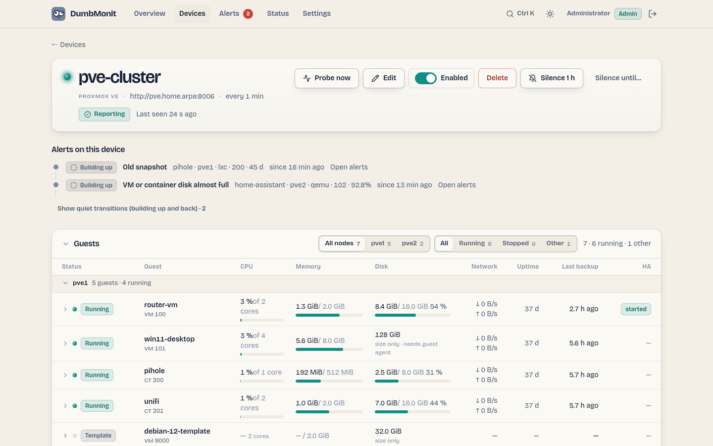

# Proxmox VE

Hypervisor: Knoten mit ihren Daemons und ihrem Netzwerk, virtuelle
Maschinen, Container, Storages, LVM-Thin-Pools, Backups,
Hochverfügbarkeit, Snapshots, Replikation, Ceph bis hinunter zum OSD,
physische Platten und ZFS-Pools, ausstehende Updates, Paketänderungen,
Abonnement und Zertifikate. Ein Gerät kann einen ganzen Cluster
abdecken.

## Das Knoten-Panel

Die Geräteseite öffnet sich mit einer Karte pro Knoten: CPU, Speicher
und Root-Dateisystem als drei Messgeräte, die Uptime und die auf
diesem Knoten installierte `pve-manager`-Version, dann nur, was nicht
stimmt — die nicht laufenden Daemons, die beim Boot deklarierten,
nicht up Schnittstellen — und der Füllstand jedes LVM-Thin-Pools und
jeder Volume-Gruppe. Ein Knoten, der aufgehört hat zu antworten,
behält seine Karte und liest sich *offline*.

Zwei Zeilen unter den Messgeräten, wenn der Knoten sie meldet: der
Anteil der CPU-Zeit, der auf Storage wartet (**I/O wait** — ein
Knoten bei 10 % CPU und 30 % I/O Wait hat keinen Spielraum mehr, und
keine andere Zahl sagt das) und der von **KSM** durch das Teilen
identischer Seiten zwischen Gästen zurückgewonnene Speicher, wie ein
Knoten mehr als sein RAM hostet.

Zwei weitere Einträge treten der "was nicht stimmt"-Liste bei, beide
in Worten:

* **Reboot required** — ein neuerer Kernel ist installiert als der
  laufende. Die Karte benennt beide Versionen, da der Knoten den
  alten weiter ausführt, bis er neu gestartet wird. Das kommt von
  `/nodes/{node}/apt/versions`, das nur `Sys.Audit` braucht;
* **Updates pending** — wie viele Proxmox-Pakete eine neuere
  Kandidatenversion haben, aus demselben Aufruf. Das ist nicht
  dasselbe wie `apt/update`, das jedes ausstehende Paket des Systems
  zählt, aber `Sys.Modify` braucht und meist abgelehnt wird.

Wenn der Cluster einen HA-Watchdog meldet (Proxmox VE 9 und später),
wird sein Zustand neben dem Panel-Titel genannt: *HA fencing armed*,
sobald Ressourcen an HA übergeben sind, *HA fencing standby*, während
keine es sind — in diesem Fall wird kein Knoten gefenced, was normal
ist, aber wissenswert, bevor man sich darauf verlässt.

Ein Knoten für Knoten aktualisierter Cluster zeigt das hier:
`/version` antwortet für den abgefragten Knoten, daher trägt jede
Karte ihre eigene Version, und ein Nachzügler ist sichtbar, ohne eine
Shell zu öffnen.

Die Daten kommen von `GET /api/targets/{id}/proxmox/nodes`, aus der
letzten Abfrage im Metrik-Store gelesen.

## Das Gäste-Panel

{ loading=lazy }

Unter den Knoten das **Guests**-Panel: eine Zeile pro virtueller
Maschine und Container, nach Knoten gruppiert, die die Fragen
beantwortet, die ein Administrator zuerst stellt — läuft es, ist es
beschäftigt, ist seine Platte voll, wann wurde es zuletzt gesichert.
Jede Zeile zeigt:

| Spalte | Quelle | Anmerkungen |
|---|---|---|
| Status | Wort + Anzeige: running, stopped, paused, suspended, template | Ein Template wird gelistet, zählt aber nie als "stopped". |
| Name, VMID, Knoten | das Inventar | |
| CPU | `guest_cpu_percent`, von den dem Gast zugewiesenen Kernen | Ein Balken plus die Anzahl der Kerne. |
| Memory | `guest_memory_used_bytes` / `guest_memory_total_bytes` | Die Ballon-Größe, wenn die VM eine hat. Eine zweite Zeile, *+N on host*, erscheint, wenn `guest_memory_host_bytes` merklich über dem liegt, was der Gast sieht: Ein QEMU-Prozess kostet den Hypervisor mehr als den Speicher, den er übergibt, und dieser Überschuss ist der Emulations-Overhead. Unter 64 MiB oder 5 % bleibt die Zeile weg. |
| Disk | `guest_disk_used_bytes` / `guest_disk_total_bytes` | Container: echte Nutzung. VMs: immer Größe; Nutzung nur, wenn der QEMU-Guest-Agent antwortet (siehe unten), sonst "size only". |
| Network | `rate(guest_network_in/out_bytes)` über die letzten Abfragen | |
| Uptime | `guest_uptime_seconds` | |
| Last backup | `backup_last_age_seconds` | Leer, wenn kein Backup bekannt ist. |
| HA | `ha_resource_state_info` | Nur für Gäste unter Hochverfügbarkeit. |
| Lock | `guest_locked` | Ein Badge, nur während ein Lock gehalten wird (`backup`, `migrate`, `snapshot`…). |

Die Liste sortiert nach jeder Spalte, filtert nach Knoten, Status
oder Pool, und jede Knotengruppe klappt sich zusammen. Das Klicken
einer Zeile öffnet ihre CPU und Speicher über den Zeitraum der Seite,
zusammen mit dem Betriebssystem und den von innen im Gast gesehenen
IP-Adressen. Die Daten kommen von `GET /api/targets/{id}/proxmox/guests`,
das die letzte Abfrage aus dem Metrik-Store liest — nichts wird vom
Hypervisor verlangt.

Ein Lock ist normal für die paar Minuten, die ein Backup, eine
Migration oder ein Snapshot brauchen. Von einem unterbrochenen Job
zurückgelassen, blockiert er jede Operation auf diesem Gast —
einschließlich des Backups der nächsten Nacht — bis `qm unlock`
(oder `pct unlock`) ihn löscht, weshalb "Guest locked" nach sechs
Stunden feuert.

Das Inventar kommt von `/cluster/resources`, dem eigenen Cache des
Clusters, daher werden die Gäste eines nicht mehr antwortenden
Knotens weiterhin gelistet — mit dem Status `unknown` und ihren
Größen, ohne Live-Messungen — statt in dem Moment aus dem Panel zu
verschwinden, in dem Sie nachsehen wollen. Es kostet auch zwei
API-Aufrufe weniger pro Knoten als das Durchgehen von
`/nodes/{node}/qemu` und `/nodes/{node}/lxc`, worauf die Option
`cluster_resources` zurückfällt, wenn sie ausgeschaltet ist.

### Plattennutzung innerhalb einer VM: der QEMU-Guest-Agent

Proxmox sieht die Platte einer VM als undurchsichtiges Volume:
`disk` ist für eine VM immer 0, nur ihre Größe ist bekannt. Um die
Nutzung von innen zu lesen, fragt der Collector den QEMU-Guest-Agent
(`agent/get-fsinfo`) für jede laufende VM, deren Konfiguration den
Agent aktiviert (Options → QEMU Guest Agent). Zwei Bedingungen:

* `qemu-guest-agent` innerhalb der VM installiert und laufend
  (Debian und Ubuntu: `apt install qemu-guest-agent`; Windows: die
  VirtIO-Treiber-ISO);
* das Token hält `VM.GuestAgent.Audit` auf der VM — `VM.Monitor`
  vor Proxmox VE 9 (die `DumbMonit`-Rolle unten gewährt es auf `/`).

Das Root-Dateisystem (`/`, oder `C:\` auf Windows; sonst das größte)
gibt `guest_disk_used_bytes` und `guest_disk_used_percent`, dieselbe
Zeitreihe, die ein Container hat, daher deckt die Regel "VM or
container disk almost full" beide ab. Jedes echte Dateisystem erhält
auch `guest_fs_total/used_bytes` und `guest_fs_used_percent` mit
einem `mountpoint`-Label; Pseudo-Dateisysteme (tmpfs, squashfs,
Snap-Mounts) und Medien ohne Kapazität werden übersprungen.
`guest_agent_enabled` sagt, ob die Konfiguration der VM den Agent
aktiviert, `guest_agent_running`, ob er antwortete. Ohne den Agent
oder das Recht behält die VM ihre Größe und hat einfach keine
Nutzung — nie ein irreführendes "0 %".

### Das Betriebssystem und die Adressen eines Gasts

Proxmox kennt nur die in der Konfiguration eines Gasts geschriebene
OS-Art (`l26`, `win11`), nicht, was tatsächlich läuft. Mit der
Option `guest_os` an fragt der Collector jeden laufenden Gast, was
er ist: `agent/get-osinfo` und `agent/network-get-interfaces` für
eine VM, `/nodes/{node}/lxc/{vmid}/interfaces` für einen Container,
was nichts installiert braucht. Das gibt `guest_os_info` (`Debian
GNU/Linux 12 (bookworm)`, seine id, seine Version, den Kernel) und
bis zu vier `guest_ip_info` — Loopback- und IPv6-Link-Local-Adressen
werden übersprungen, und eine Maschine mit Dutzenden virtuellen
Schnittstellen füllt nicht die Zeitreihen-Datenbank.

Beide werden **höchstens einmal pro Stunde pro Gast** gefragt und
dazwischen aus dem Speicher erneut veröffentlicht: Ein Betriebssystem
ändert sich zwischen zwei Abfragen nicht, und eine Adresse fast nie.
Auf einem Cluster mit fünfzig laufenden Maschinen ist das der
Unterschied zwischen zwei zusätzlichen Aufrufen pro Abfrage und zwei
pro Stunde.

Diese zwei Agent-Aufrufe brauchen `VM.GuestAgent.Audit`. Proxmox VE 7
hatte das nicht und nutzte `VM.Monitor`; Proxmox VE 9 entfernte
`VM.Monitor` und behält nur die Guest-Agent-Rechte. Ohne das, was
Ihre Version kennt, fehlen die zwei Zeitreihen einfach; nichts sonst
ändert sich.

## Das Ceph-Panel

Ein **Ceph**-Abschnitt erscheint auf der Geräteseite nur, wenn der
Cluster tatsächlich Ceph hat: Gesundheit und die Worte dahinter,
Gesamt- und genutzte Kapazität, wie viele OSDs up und in sind, eine
Tabelle der OSDs (Host, Geräteklasse, Nutzung, Apply- und
Commit-Latenz) und eine Tabelle der Pools (Nutzung, Size und Min
Size, Placement Groups gegen die vom Autoscaler gewählte Anzahl), die
CephFS-Dateisysteme, die gesetzten OSD-Flags und die derzeit
stummgeschalteten Health-Checks.

Die letzten beiden sind die, die ein Dashboard meist verbirgt.
`noout` zur Wartung gesetzt und nie gelöscht bedeutet, Ceph wird
einen toten OSD nicht wieder herausbalancieren, und ein
stummgeschalteter Check erscheint nicht mehr in `HEALTH_OK` — in
beiden Fällen sieht der Cluster gesund aus, während seine Redundanz
leise verschwindet.

`GET /api/targets/{id}/proxmox/ceph` antwortet mit
`available: false`, wenn der Cluster kein Ceph hat, was die UI wissen
lässt, den Abschnitt gar nicht zu zeichnen. Das Detail kostet drei
Aufrufe auf einem einzelnen Knoten plus zwei clusterweit, egal die
Größe des Clusters, und braucht die Option `ceph_detail` zusätzlich
zu `ceph`.

## Was beobachtet wird

Alle Metriken haben das Präfix `dumbmonit_proxmox_`.

| Familie | Metriken | Labels |
|---|---|---|
| Cluster | `cluster_quorate`, `cluster_nodes`, `cluster_nodes_online`, `cluster_member_online`; `version_info` (+ `version`, `release`, `repoid`) | `cluster`, `node` |
| Cluster-Inventar | `cluster_guests_total`, `cluster_guests_running`, `cluster_templates_total` (Templates separat gezählt, nie als "stopped"); `pool_guests`, eine pro Resource Pool | `pool` |
| Knoten | `node_up`, `node_cpu_percent`, `node_cpu_count`, `node_load1/5/15`, `node_memory_used/total_bytes`, `node_memory_percent`, `node_swap_used/total_bytes`, `node_rootfs_used/total/avail_bytes`, `node_rootfs_percent`, `node_cpu_iowait_percent` (auf Platten wartende Zeit — ein Knoten bei 10 % CPU und 30 % iowait hat keinen Spielraum), `node_ksm_shared_bytes` (durch Seiten-Deduplizierung zurückgewonnener Speicher), `node_uptime_seconds`, `node_version_info` | `node` |
| Knoten-Dienste | `node_service_running`, `node_service_state_info` (+ `state`), `node_services_failed`, `node_core_services_down`; `node_pve_version_info` (+ `version`, `release`) für den antwortenden Knoten | `node`, `service` |
| Knoten-Netzwerk | `node_interface_active`, `node_interface_exists`, `node_interface_autostart`, `node_interface_mtu`, `node_interface_offline`; Total `node_interfaces_offline` | `node`, `iface`, `type` (`bridge`, `bond`, `vlan`, `eth`…) |
| LVM, Thin Pools und Mounts | `node_lvm_vg_size/free_bytes`, `node_lvm_vg_used_percent`, `node_lvm_vg_physical_volumes` (Label `vg`); `node_thinpool_size_bytes`, `node_thinpool_used_bytes`, `node_thinpool_used_percent`, `node_thinpool_metadata_size_bytes`, `node_thinpool_metadata_used_percent` (Labels `vg`, `pool`); `node_directory_mount_info` (+ `path`, `device`, `fstype`), `node_directory_mounts` | `node`, `vg`, `pool` |
| Gäste (VMs und Container) | `guest_status_info` (+ `status`: `running`, `stopped`, `paused`, `suspended`, `template`), `guest_running` (nicht für Templates), `guest_cpu_percent` (von den zugewiesenen Kernen), `guest_cpu_count`, `guest_memory_used/total_bytes`, `guest_memory_host_bytes` (Proxmox VE 9: der Speicher, den die VM auf dem Host nutzt, Emulations-Overhead eingeschlossen), `guest_memory_percent` (aus der eigenen Sicht des Gasts; auf Proxmox VE 9 kommt es vom Ballon-Treiber, und eine VM ohne einen hat Bytes, aber keinen Prozentsatz statt eines Werts über 100 %), `guest_disk_total_bytes`, `guest_disk_used_bytes` und `guest_disk_used_percent` (Container; VMs nur über den Guest-Agent), `guest_disk_read/write_bytes`, `guest_network_in/out_bytes` (Zähler), `guest_uptime_seconds`; `guest_pool_info` (+ `pool`), `guest_locked` (+ `lock`; die Zeitreihe existiert nur, während der Lock gehalten wird, daher liest sich seine Dauer direkt vom Diagramm ab) | `node`, `vmid`, `name`, `type` (`qemu` oder `lxc`) |
| VM-Detail (laufende VMs) | `guest_agent_enabled`, `guest_agent_running`, `guest_balloon_bytes`, `guest_memory_guest_free_bytes` (freier Speicher von innen gesehen, Ballon-Treiber), `guest_running_qemu_info` (+ `version`: das QEMU, mit dem die VM gestartet wurde — nach einem Hypervisor-Upgrade bleibt es zurück, bis die VM gestoppt und neu gestartet wird, was eine Live-Migration nicht tut); pro Dateisystem `guest_fs_total_bytes`, `guest_fs_used_bytes`, `guest_fs_used_percent` | `node`, `vmid`, `name`, `type`; Dateisysteme: + `mountpoint`, `fstype` |
| Gast-System und Adressen | `guest_os_info` (+ `os`, `os_id`, `os_version`, `kernel`), `guest_ip_info` (+ `iface`, `ip`; höchstens vier routbare Adressen pro Gast). Stündlich aktualisiert | `node`, `vmid`, `name`, `type` |
| Gast-Netzwerkkarten | `guest_netdev_in_bytes`, `guest_netdev_out_bytes` (Zähler), ein Paar pro virtueller Schnittstelle, wo `guest_network_in/out_bytes` nur das Total des Gasts gibt | `node`, `vmid`, `dev` (`tap100i0`, `veth200i0`) |
| Storages | `storage_active`, `storage_enabled`, `storage_used/total/avail_bytes`, `storage_used_percent` (Kapazität wird nur veröffentlicht, wenn Proxmox eine meldet: ein inaktiver Storage, oder ein PBS-Datastore, dessen Größe PVE nicht liest, erhält keine statt null Bytes) | `node`, `storage`, `type` (`dir`, `lvmthin`, `zfspool`, `nfs`, `pbs`…), `shared` |
| Backups (pro Gast) | `backup_present`, `backup_last_timestamp_seconds`, `backup_last_age_seconds`, `backup_last_size_bytes`, `backup_count`; Totals `backup_guests_total`, `backup_guests_without_backup` | `vmid`, `name`, `node`, `type` |
| Backups (vzdump-Läufe, pro Knoten) | `backup_job_runs`, `backup_job_failures`, `backup_job_last_ok`, `backup_job_last_timestamp_seconds`, `backup_job_last_age_seconds`, `backup_job_last_duration_seconds` | `node` |
| Backup-Jobs (geplant) | `backup_job_enabled`, `backup_job_next_run_seconds`, `backup_job_last_ok`, `backup_job_last_run_age_seconds` (die letzten zwei nur, wenn ein `vzdump`-Task die Job-ID trägt, PVE 7.2+); Totals `backup_jobs_total`, `backup_guests_not_covered`; `backup_covered` pro Gast (0 für einen Gast, den kein Job abdeckt) | `job`, `storage`, `schedule`; `backup_covered`: `vmid`, `name`, `node`, `type` |
| Backup-Job-Abdeckung | `backup_job_guests`, `backup_job_volumes_included`, `backup_job_volumes_excluded`; `backup_job_guest_excluded_volumes` (+ `vmid`, `name`, `type`, `reason`), nur für einen *unerwarteten* Ausschluss veröffentlicht | `job` |
| HA | `ha_quorum_ok`, `ha_fencing_armed` (+ `state`: Proxmox VE 9 meldet, ob der Watchdog `armed` oder auf `standby` ist — auf standby wird nichts gefenced), `ha_master_active`, `ha_lrm_active` (`node`), `ha_resources_total`; pro Ressource `ha_resource_started`, `ha_resource_error` (1 im Zustand `error`, `fence` oder `recovery`), `ha_resource_state_info` (+ `state`) | `sid`, `node`, `vmid`, `type` |
| HA-Manager | `ha_node_online`, `ha_node_status_info` (+ `status`: `online`, `fence`, `gone`, `maintenance`), `ha_master_info` (der Knoten, der den CRM-Master hält), `ha_manager_age_seconds`; pro Knoten `ha_lrm_mode_info` (+ `mode`, `state`), `ha_lrm_age_seconds`, `ha_lrm_stale` (1, wenn der LRM seit mehr als zwei Minuten nicht geschrieben hat) | `node` |
| Snapshots | `guest_snapshot_count`, `guest_snapshot_oldest_age_seconds`, `guest_snapshot_newest_age_seconds` (Alter nur, wenn count > 0); `guest_snapshot_guests_skipped`, wenn `max_snapshot_guests` überschritten wird | `vmid`, `name`, `node`, `type` |
| Replikation | `replication_job_enabled`, `replication_job_error` (Fehlermeldung oder `fail_count` > 0), `replication_job_fail_count`, `replication_job_last_sync_age_seconds`, `replication_job_next_sync_seconds`, `replication_job_duration_seconds`; `replication_jobs_total` | `job`, `vmid`, `node` (Quelle), `to_node` |
| Ceph | `ceph_health` (0 OK, 1 WARN, 2 ERR, 3 unknown), `ceph_health_info` (+ `status`), `ceph_osds_total/up/in`, `ceph_bytes_total/used`, `ceph_used_percent`, `ceph_pgs_total`, `ceph_mons_total` | |
| Ceph-OSDs | `ceph_osd_up`, `ceph_osd_in`, `ceph_osd_used_percent`, `ceph_osd_used_bytes`, `ceph_osd_total_bytes`, `ceph_osd_apply_latency_ms`, `ceph_osd_commit_latency_ms`, `ceph_osd_reweight`, `ceph_osd_crush_weight`; Totals `ceph_osds_down`, `ceph_osds_out` | `osd`, `host`, `device_class` |
| Ceph-Pools und CephFS | `ceph_pool_used_percent`, `ceph_pool_used_bytes`, `ceph_pool_size`, `ceph_pool_min_size`, `ceph_pool_pg_num`, `ceph_pool_pg_num_optimal` (was der Autoscaler wählen würde), `ceph_pool_info` (+ `type`, `crush_rule`, `autoscale`), `ceph_pools_total`; `ceph_fs_info` (+ `metadata_pool`, `data_pool`), `ceph_fs_total` | `pool`; CephFS: `name` |
| Ceph-Flags und Mutes | `ceph_flag` (1, während das Flag gesetzt ist), `ceph_flags_set`; `ceph_health_mute_info` (+ `sticky`), `ceph_health_mutes` | `flag`; Mutes: `code` |
| Physische Platten | `node_disk_size_bytes`, `node_disk_smart_failed` (1, wenn der SMART-Zustand `FAILED` ist; fehlt, wenn die Platte `UNKNOWN` meldet), `node_disk_health_info` (+ `health`, `used`: `LVM`, `ZFS`, `partitions`…), `node_disk_wearout_percent` (SSD und NVMe: 0 neu, 100 Ende der bewerteten Lebensdauer), `node_disk_temperature_celsius` (aus `disks/smart`: ATA-Attribut 194/190, oder die Temperaturzeile eines Textberichts — `Temperature:` für NVMe, `Current Drive Temperature:` für SAS) | `node`, `disk` (`/dev/sda`, `/dev/nvme0n1`), `model`, `type` (`ssd`, `hdd`, `nvme`) |
| ZFS-Pools | `node_zfs_pool_degraded` (1, außer `ONLINE`), `node_zfs_pool_health_info` (+ `health`), `node_zfs_pool_size/alloc/free_bytes`, `node_zfs_pool_used_percent`, `node_zfs_pool_fragmentation_percent` | `node`, `pool` |
| Updates | `node_updates_pending`, `node_updates_security_pending` (Pakete, deren Origin, Repository-Label, Suite, Section oder Changelog-URL ein Security-Archiv benennt, wie Debians `bookworm-security`). Ohne `Sys.Modify` existieren diese zwei nicht; `node_pve_packages_upgradable` zählt dann trotzdem die Proxmox-Pakete, deren Kandidatenversion von der installierten abweicht, und `node_reboot_required` (+ `running`, `installed`) sagt, dass ein neuerer Kernel installiert, aber noch nicht gebootet ist — beide aus `apt/versions` gelesen, das nur `Sys.Audit` braucht | `node` |
| Paketänderungen | `node_packages_changed`: normalerweise 0; für eine Stunde, nachdem eine Abfrage eine geänderte installierte Version eines Proxmox-Pakets sieht (`apt/versions`), die Anzahl geänderter Pakete, mit einem `changes`-Label wie `pve-manager 8.2.4→8.2.7, proxmox-kernel-6.8 6.8.8-2→6.8.12-2` | `node`, `changes` |
| Abonnement und Repositories | `node_subscription_active`, `node_subscription_info` (+ `status`: `active`, `notfound`, `expired`…, `level`, `next_due`); `node_repository_errors` (unlesbare Sources-Dateien), `node_repository_warnings` (Proxmox' eigene Warnungen: Enterprise-Repository ohne Abonnement, Test-Repository), `node_repository_enabled` (+ `repo`: `enterprise`, `no-subscription`, `test`, `ceph-*`) | `node` |
| Zertifikate | `node_certificate_expiry_days` (negativ nach Ablauf) | `node`, `filename`, `subject` |
| RRD-Stream (standardmäßig aus) | `node_rrd_<metric>`, `guest_rrd_<metric>`, `storage_rrd_<metric>` — jede Messung, die Proxmox' eigene Metrik-Server empfangen, unter ihrem eigenen Namen (siehe `metrics_export` unten) | `node`; Gäste: `vmid`, `type`; Storages: `node`, `storage` |
| Sammlung | `up`, `scrape_errors`, `scrape_duration_seconds` | |

Das Backup-Alter pro Maschine beantwortet den teuersten Fehlschlag
eines Homelabs: das seit Wochen nicht gelaufene Backup, am Tag der
Wiederherstellung entdeckt. Es wird aus dem `vzdump`-Task-Log
berechnet (über `backup_lookback_days`) und, wenn
`scan_backup_storage` an ist, aus den auf den Backup-Storages
gefundenen Archiven.

Geplante Jobs kommen von Datacenter → Backup: `backup_covered` ist 0
für jeden Gast, den Proxmox selbst als von keinem Job abgedeckt
listet, daher zeigt sich eine gestern erstellte Maschine, bevor ihr
erstes verpasstes Backup entdeckt wird, nicht danach.

Ein Job, der einen Gast abdeckt, schreibt nicht unbedingt alle seine
Platten. Ein mit `backup=0` markiertes Volume wird jede Nacht
übersprungen, der Job meldet trotzdem Erfolg, und niemand findet es
heraus, bis eine Wiederherstellung. `backup_job_guest_excluded_volumes`
benennt den Job, den Gast und Proxmox' eigenen Grund für den
Ausschluss — aber nur, wenn der Ausschluss eine Überraschung ist:
ein CD-ROM-Laufwerk, ein Cloudinit-Image oder ein Eintrag, der
überhaupt kein Volume ist, wird absichtlich ausgeschlossen, in
`backup_job_volumes_excluded` gezählt und nie pro Gast gemeldet. Ohne
diese Unterscheidung würde jede Maschine mit einem virtuellen
Laufwerk einen Alarm auslösen.

Die Daemons eines Knotens sind aus einem Grund wissenswert:
`pvestatd` gestoppt bricht nichts sichtbar — die Web-Oberfläche
zeigt weiter die Zahlen vom Moment seines Todes, und alles sieht
normal aus. `node_core_services_down` zählt nur `pve-cluster`,
`pvedaemon`, `pveproxy`, `pvestatd`, `pve-firewall`, `corosync` und
`watchdog-mux`, und nur die, die der Knoten selbst als aktiviert
angibt, daher zählt ein eigenständiger Knoten ohne Corosync oder HA
nichts Fehlendes.

Eine Schnittstelle zählt als offline, wenn sie zum Start beim Boot
gesetzt ist und nicht up ist (oder gar nicht mehr existiert). Eine
auf Anfrage aktivierte, ohne Autostart, wird nie gemeldet: ihr Fehlen
ist normal. Eine Bridge, die nach einem Reboot nicht zurückkommt,
schneidet jeden daran angeschlossenen Gast ab, während jeder dieser
Gäste perfekt läuft, und nichts sonst sagt das.

Ein voll werdender LVM-Thin-Pool legt jeden darauf gespeicherten
Gast sofort read-only, und Dateien innerhalb der Gäste zu löschen
gibt den Platz nicht zurück. Seine Metadaten leben auf einem eigenen,
viel kleineren Volume und sättigen oft zuerst, mit genau derselben
Konsequenz — weshalb die zwei Füllstände separate Zeitreihen und
separate Regeln sind.

Paketänderungen werden vom Collector selbst erkannt: Er merkt sich
die installierten Versionen der vorherigen Abfrage (pro Gerät und
Knoten, im Speicher — ein Server-Neustart lernt ohne Meldung neu).
Nur ein in beiden Abfragen vorhandenes Paket mit unterschiedlicher
Version zählt; ein neu installiertes oder entferntes zählt nicht.

Ein teilweiser Fehlschlag (ein Knoten down, ein Storage langsam)
bleibt eine erfolgreiche Abfrage: Was gelesen werden konnte, wird
geschrieben, und der Fehlschlag wird in `scrape_errors` gezählt.
Einfach fehlende Features bleiben still: kein Ceph, kein
Replikationsjob, kein ZFS-Pool, kein Guest-Agent, oder kein Recht,
Updates zu listen, erzeugen keine Zeitreihe und keinen Fehler.
Dasselbe gilt für alles oben: ein fehlendes Recht (403), ein Endpunkt,
den ein älteres Proxmox nicht hat (404 oder 501), ein nicht
installiertes Feature (Ceph antwortet mit 500) erzeugen keinen Fehler
und keine Metrik — nie eine Null, die sich als Messung ausgibt.

Board-Temperaturen sind nicht verfügbar: Die Proxmox-VE-API exponiert
keine Sensoren, nur die eigene SMART-Temperatur der Platten.
Installieren Sie den DumbMonit-Agent auf dem Knoten, wenn Sie mehr
brauchen.

Geltende eingebaute Regeln: Device unreachable, High CPU, Disk
almost full, Filesystem almost full (Vorhersage), Backup too old,
Unusual CPU, VM or container stopped, VM or container CPU high, VM
or container memory high, VM or container disk almost full, HA
resource in error, Cluster lost quorum, Node offline, Storage almost
full, Backup job failed, Old snapshot, Replication failed, Ceph
health error, Ceph health warning, Updates pending, Security updates
pending, Proxmox packages changed, Proxmox disk wearing out, Proxmox
disk SMART failure, Proxmox ZFS pool degraded, Node certificate
expiring, Thin pool almost full, Thin pool metadata almost full,
Proxmox service down, Node network interface down, Ceph OSD down,
Ceph OSD nearly full, Ceph pool almost full, Ceph noout flag left on,
HA manager not reporting, Backup job excludes a disk, Guest locked.

### Der volle RRD-Stream

`/cluster/metrics/export` ist der Endpunkt, den Proxmox' eigene
Metrik-Server (InfluxDB, Graphite) konsumieren: alles, was
`pvestatd` misst, für den gesamten Cluster, in einem Aufruf. Zwei
Dinge machen ihn lohnend.

* Er trägt Messungen, die nichts sonst exponiert — insbesondere die
  Pro-Knoten Pressure-Stall-Information (PSI): wie lange Tasks auf
  CPU, Platte oder Speicher warten. Das ist die Zahl, die "alles ist
  langsam" erklärt, wenn CPU und Speicher beide gut aussehen.
* Er wird mit `history=1` vom letzten schon gesehenen Punkt gelesen,
  daher wird jeder Punkt zwischen zwei Abfragen mit seinem eigenen
  Zeitstempel aufgenommen. Ein alle fünf Minuten abgefragtes Gerät
  erhält seine fünf Einminutenpunkte statt eines einzigen aktuellen
  Werts.

Es ist **standardmäßig aus**, und das ist ein bewusster Trade-off.
Diese Zeitreihen wiederholen teilweise, was der Rest der Sammlung
schon unter besseren Namen erzeugt, daher fügt `metrics_export`
einzuschalten eine große Zahl zu speichernder Zeitreihen hinzu, durch
die für Details gesichtet wird, die die meisten Installationen nie
anschauen. Die Namen werden exakt veröffentlicht, wie Proxmox sie
sendet (`node_rrd_pressure_cpu_some_avg10`, `guest_rrd_netin`…),
nicht übersetzt: Proxmox fügt bei jedem Release neue hinzu, und eine
hier geschriebene Übersetzungstabelle wäre beim nächsten falsch. Es
braucht `Sys.Audit` auf `/` — was die `DumbMonit`-Rolle schon hat,
wenn sie wie unten auf `/` gewährt wurde.

## Was in Proxmox vorzubereiten ist

Die Schritte unten sind die, die der Hinweis neben dem Formular
zeigt. Das Prinzip: ein für die Überwachung reservierter Benutzer,
eine nur-lesende Rolle, ein Token — nie das Konto, mit dem Sie sich
einloggen.

1. Öffnen Sie eine Shell auf einem beliebigen Knoten (in der Web-UI:
   den Knoten wählen, dann Shell; oder SSH) und erstellen Sie einen
   für die Überwachung reservierten Benutzer. Er braucht kein
   Passwort: Das Token ist, was sich einloggt.

    ```
    pveum user add dumbmonit@pve --comment "DumbMonit monitoring"
    ```

2. Erstellen Sie eine Rolle mit nur den vom Collector genutzten
   Rechten: Sys.Audit (Knoten, Cluster, HA, Platten und SMART, ZFS,
   Zertifikate, Paketversionen, Abonnement), Datastore.Audit
   (Storages und Backup-Archive), VM.Audit (VMs, Container,
   Snapshots) und VM.GuestAgent.Audit (was der QEMU-Guest-Agent
   innerhalb einer VM liest: Plattennutzung, Betriebssystem,
   IP-Adressen). Keines davon kann etwas ändern.

    ```
    pveum role add DumbMonit --privs "Datastore.Audit Sys.Audit VM.Audit VM.GuestAgent.Audit"
    ```

3. Geben Sie dem Benutzer diese Rolle auf dem gesamten Cluster.

    ```
    pveum aclmod / -user dumbmonit@pve -role DumbMonit
    ```

4. Erstellen Sie das API-Token des Benutzers. Privilege Separation
   ist aus, daher erbt das Token einfach die Rechte des Benutzers.

    ```
    pveum user token add dumbmonit@pve monitor --privsep 0
    ```

5. Der Befehl gibt eine Tabelle mit full-tokenid und value aus.
   Kopieren Sie full-tokenid in DumbMonits Feld Token ID und value
   (die UUID) in sein Feld Secret. Das Secret wird einmal angezeigt:
   Ist es verloren, entfernen Sie das Token und erstellen Sie ein
   neues.

    ```
    dumbmonit@pve!monitor
    ```

6. Optional, um ausstehende Updates und ausstehende Security-Fixes
   zu zählen: Proxmox schützt diese Liste mit Sys.Modify. Gewähren
   Sie es nur auf /nodes; ohne es überspringt der Collector die
   Liste still.

    ```
    pveum role add DumbMonitUpdates --privs Sys.Modify
    pveum aclmod /nodes -user dumbmonit@pve -role DumbMonitUpdates
    ```

7. Auf einem älteren Proxmox existiert VM.GuestAgent.Audit vielleicht
   noch nicht, und der obige Befehl wird mit invalid privilege
   abgelehnt: Die Guest-Agent-Aufrufe sind dann von VM.Monitor
   abgedeckt, das Proxmox VE 9 wiederum entfernt hat. Nutzen Sie, was
   Ihre Version kennt.

    ```
    pveum role add DumbMonit --privs "Datastore.Audit Sys.Audit VM.Audit VM.Monitor"
    ```

8. Bevorzugen Sie die Web-UI? Dieselben Schritte liegen unter
   Datacenter → Permissions: Users, Roles, Add → User Permission,
   dann API Tokens mit entferntem Häkchen bei "Privilege
   Separation".
9. Geben Sie in DumbMonit die Adresse eines beliebigen Knotens ein
   (standardmäßig Port 8006).

!!! warning
    Nutzen Sie nicht das Konto wiederverwendet, mit dem Sie sich
    einloggen: Ein durchgesickertes Token würde dann den gesamten
    Cluster kontrollieren. Die obige DumbMonit-Rolle kann nur lesen.
    Proxmox nutzt auch standardmäßig ein selbstsigniertes
    Zertifikat: Wird die Verbindung deshalb abgelehnt, kreuzen Sie
    "Accept an unverifiable certificate" in den Optionen an.

Herstellerdokumentation: [Proxmox VE user management](https://pve.proxmox.com/wiki/User_Management).

## Credentials

| Credential | Felder |
|---|---|
| API-Token (empfohlen) | **Token ID**: Benutzer, Realm und Token-Name, wie Proxmox sie zeigt, `dumbmonit@pve!monitor`. **Secret**: die einmal beim Erstellen des Tokens gezeigte UUID. Kein Ablauf, keine Sitzung auf dem Hypervisor geöffnet. |
| Benutzername / Passwort | `user@realm` und das Passwort. Ein Ticket wird erhalten, gecacht und zehn Minuten vor seinem Zwei-Stunden-Ablauf erneuert. |

Die API akzeptiert das Token in zwei Teilen (`token_id` + `secret`)
oder, wie ältere Versionen es taten, als einen String `token` =
`user@realm!name=secret`; beide werden gleich gespeichert. Ein
vollständiges, in Token ID eingefügtes Token wird vom Formular
getrennt.

Die obige Rolle `DumbMonit` trägt, was `PVEAuditor` für die vom
Collector gelesenen Pfade gewährt, plus das Guest-Agent-Recht: Der
Collector führt immer nur `GET` aus. Pro Endpunkt: `Sys.Audit` für
`/version`, `/cluster/*`, `/nodes/{node}/status`, `services`,
`version`, `network`, `netstat`, `tasks`, `replication`,
`certificates/info`, `disks/list`, `disks/smart`, `disks/zfs`,
`apt/versions`, `apt/repositories` und `subscription`;
`Datastore.Audit` für `storage` und `storage/{id}/content`;
`VM.Audit` für `qemu`, `lxc`, `snapshot`, `status/current` und die
`interfaces` eines Containers; `VM.GuestAgent.Audit` — oder
`VM.Monitor` vor Proxmox VE 9 — für `agent/get-fsinfo`.

Zwei Pfade fragen etwas mehr als der Rest, und beide sind von der
Rolle wie in Schritt 3 gewährt abgedeckt — auf `/`, nicht auf
`/nodes`:

* `Sys.Audit` **auf `/`** für das LVM-Inventar (`disks/lvm`,
  `disks/lvmthin`, `disks/directory`) und für
  `/cluster/metrics/export`, den optionalen RRD-Stream. Nur auf
  `/nodes` gewährt, fehlen die Thin-Pool-Zeitreihen und die
  `*_rrd_*`-Zeitreihen still.
* `VM.GuestAgent.Audit` für die zwei Guest-Agent-Aufrufe, die
  Betriebssystem und Adressen einer VM lesen (`agent/get-osinfo`,
  `agent/network-get-interfaces`). Proxmox VE 7 hatte dieses Recht
  nicht und nutzte `VM.Monitor`; Proxmox VE 9 hat `VM.Monitor`
  fallen gelassen. Ohne das, was Ihre Version kennt, werden
  `guest_os_info` und `guest_ip_info` für VMs einfach nicht
  veröffentlicht; Container, die keinen Agent brauchen, behalten
  ihre Adressen.

Das Einzige, was die Rolle überhaupt nicht abdeckt, ist die Liste
ausstehender Updates (`apt/update`), die Proxmox mit `Sys.Modify`
auf `/nodes` schützt — optional, wie Schritt 6 erklärt; ohne es
überspringt der Collector `node_updates_pending` und
`node_updates_security_pending` still.

(Nutzen Sie `-token 'dumbmonit@pve!monitor'` statt `-user` in den
`aclmod`-Befehlen für ein mit angekreuzter "Privilege Separation"
erstelltes Token.)

Adresse: `10.0.0.10`, `pve.lan`, `pve.lan:8006`, `[fd00::1]` oder
eine vollständige URL `https://pve.example.net`. Das Schema `https`
und Port 8006 werden hinzugefügt, falls fehlend.

## Optionen

| Schlüssel | Label | Standard | Hilfe |
|---|---|---|---|
| `port` | API port | `8006` | Genutzt, falls die Adresse keinen Port angibt. |
| `insecure_tls` | Accept an unverifiable certificate | `false` | Proxmox liefert standardmäßig ein selbstsigniertes Zertifikat: aktivieren Sie das, wenn die Verbindung deshalb abgelehnt wird. |
| `request_timeout_seconds` | Timeout per request (seconds) | `10` | Erlaubte Zeit für jeden API-Aufruf, von 1 bis 120. |
| `backup_lookback_days` | Backup lookback (days) | `31` | Ältere Backup-Tasks werden nicht untersucht, von 1 bis 3650. |
| `scan_backup_storage` | Inventory backup archives | `true` | Scannt die Backup-Storages, um das letzte Backup jeder Maschine zu datieren. Deaktivieren, wenn der Storage langsam antwortet. |
| `nodes` | Monitored nodes | *(leer)* | Namen der zu überwachenden Knoten, kommagetrennt. Leer: jeder Knoten im Cluster. |
| `cluster_resources` | Read the cluster inventory | `true` | Ein Aufruf an `/cluster/resources` listet jeden Knoten, Gast, Storage und Pool. Lassen Sie es an: Es ist die einzige Quelle, die immer noch die Gäste eines nicht mehr antwortenden Knotens sieht, und spart zwei Aufrufe pro Knoten. Aus durchgeht der Collector stattdessen `/nodes/{node}/qemu` und `/nodes/{node}/lxc` und verliert die Pools und Locks. |
| `services` | Watch node services | `true` | `/nodes/{node}/services` und `version`: der Zustand der Proxmox-Daemons jedes Knotens und die darauf installierte Version. Ein gestopptes `pvestatd` lässt den ganzen Cluster eingefrorene Zahlen zeigen. |
| `network` | Watch node networking | `true` | `/nodes/{node}/network` und `netstat`: Bridges, Bonds und VLANs mit ihrem Link-Zustand, plus die Traffic-Zähler jeder Gast-Netzwerkkarte. |
| `lvm` | Watch LVM and thin pools | `true` | `disks/lvm`, `disks/lvmthin` und `disks/directory`: Volume-Gruppen, Thin Pools (Daten- *und* Metadaten-Füllstand) und von PVE verwaltete Directory-Mounts. Braucht `Sys.Audit` auf `/`; sonst still. |
| `ha` | High availability | `true` | Liest `/cluster/ha/status/current` und `manager_status`: Quorum, CRM-Master, die eigene Sicht des Managers auf jeden Knoten, jeden LRM mit dem Alter seines letzten Berichts, und jede HA-Ressource. |
| `backup_jobs` | Scheduled backup jobs | `true` | Liest die Jobs aus Datacenter → Backup und die von keinem Job abgedeckten Gäste. |
| `scan_snapshots` | Inventory snapshots | `true` | Ein Aufruf pro Gast (vier gleichzeitig pro Knoten). Auf sehr großen Clustern deaktivieren. |
| `max_snapshot_guests` | Snapshot inventory limit | `200` | Gäste über dieser Anzahl werden bei jeder Abfrage übersprungen und in `guest_snapshot_guests_skipped` gezählt, von 1 bis 10000. |
| `replication` | Replication jobs | `true` | Storage-Replikationsstatus pro Knoten. Still, wenn der Knoten keinen Job hat. |
| `ceph` | Ceph health | `true` | Liest `/cluster/ceph/status`. Still, wenn Ceph nicht installiert ist. |
| `ceph_detail` | Watch Ceph in detail | `true` | Pro-OSD-Zustand, Nutzung und Latenz, Pro-Pool-Nutzung, CephFS, OSD-Flags und stummgeschaltete Health-Checks. Drei Aufrufe auf einem Knoten plus zwei clusterweit, egal die Größe des Clusters. Braucht `ceph` an; still ohne Ceph. |
| `backup_volumes` | Check what backup jobs include | `true` | Für jeden geplanten Job, welche Gäste er abdeckt und welche ihrer Platten er tatsächlich schreibt. Fängt einen Job, der jede Nacht gelingt, während er eine Datenplatte überspringt. Ein Aufruf pro Job. |
| `guest_os` | Read guest OS and addresses | `true` | Betriebssystem und IP-Adressen, von innen jedes laufenden Gasts gesehen (QEMU-Guest-Agent für VMs, der Container-Namespace für Container). Stündlich pro Gast aktualisiert, nicht bei jeder Abfrage. Braucht `VM.GuestAgent.Audit` auf Proxmox VE 8. |
| `metrics_export` | Ingest the full RRD metric stream | `false` | Liest `/cluster/metrics/export`, den Stream, den Proxmox' eigene Metrik-Server konsumieren, einschließlich Pro-Knoten Pressure Stall (PSI), und jeden Punkt seit der letzten Abfrage statt nur den aktuellen. Standardmäßig aus: Die hinzugefügten `*_rrd_*`-Zeitreihen wiederholen teilweise schon Gesammeltes. Braucht `Sys.Audit` auf `/`. |
| `updates` | Pending updates | `true` | Zählt die von `apt/update` gelisteten Pakete. Braucht `Sys.Modify` auf `/nodes` (siehe oben); sonst still. |
| `certificates` | Certificate expiry | `true` | Verbleibende Tage für jedes Knotenzertifikat (`pve-ssl.pem`, `pveproxy-ssl.pem`, `pve-root-ca.pem`). |
| `guest_agent` | Ask the QEMU guest agent | `true` | Für jede laufende VM: `status/current` (Ballon, Agent-Flag) und, wenn der Agent aktiviert ist, `agent/get-fsinfo` (braucht `VM.GuestAgent.Audit`). Vier gleichzeitige Aufrufe pro Knoten. Still, wenn der Agent fehlt. |
| `disks` | Watch physical disks | `true` | `disks/list` plus ein `disks/smart`-Aufruf pro Platte: Gesundheit, Verschleiß, Temperatur. |
| `zfs` | Watch ZFS pools | `true` | `disks/zfs`: Gesundheit, Kapazität, Fragmentierung. Still ohne ZFS. |
| `packages` | Detect package changes | `true` | `apt/versions`, mit der vorherigen Abfrage verglichen; eine Änderung wird eine Stunde lang in `node_packages_changed` gemeldet. |
| `subscription` | Watch subscription and repositories | `true` | `subscription` und `apt/repositories`: Status, Warnungen, aktivierte Standard-Repositories. |

## Häufige Fehler

| Symptom | Wahrscheinliche Ursache |
|---|---|
| Zertifikatsfehler am Gerät angezeigt | Selbstsigniertes Zertifikat. Entweder ein vertrauenswürdiges installieren (ACME ist in Proxmox eingebaut) oder `insecure_tls` aktivieren. Die Option wird nie implizit aktiviert. |
| Authentifizierungsfehler | Secret in Token ID eingefügt (oder umgekehrt), "Privilege Separation" angekreuzt gelassen (das Token hat dann keine Rechte), oder die Rolle `DumbMonit` nicht auf `/` angewendet. |
| Backup-Alter fehlt für einen Gast | Kein `vzdump`-Task im Rückblickfenster und kein Archiv auf den Storages gefunden; oder `scan_backup_storage` deaktiviert. |
| Langsame Abfragen | Ein Backup-Storage, das lange zum Listen braucht, oder viele Gäste für Snapshots zu inventarisieren. Deaktivieren Sie `scan_backup_storage` oder `scan_snapshots`, senken Sie `max_snapshot_guests`, oder heben Sie `request_timeout_seconds` an. |
| `node_updates_pending` fehlt | Dem Benutzer oder Token fehlt `Sys.Modify` auf `/nodes`. Gewähren Sie die `DumbMonitUpdates`-Rolle aus Schritt 6, oder ignorieren Sie es: `node_pve_packages_upgradable` und `node_reboot_required` decken die Proxmox-Pakete ohne es ab. |
| Kein Speicherprozentsatz für eine VM | Proxmox VE 9 meldet im Cluster-Inventar den Speicher, den die VM **auf dem Host** nutzt — Overhead eingeschlossen, daher regelmäßig über ihrer Zuweisung. Ein daraus berechneter Prozentsatz würde dauerhaft über 100 % liegen. Der ehrliche Wert kommt vom Ballon-Treiber innerhalb des Gasts; eine VM mit deaktiviertem Ballooning zeigt daher Bytes und keinen Prozentsatz. `guest_memory_host_bytes` ist der host-seitige Wert. |
| Keine Kapazität für den Backup-Storage | Ein auf PVE eingehängter Proxmox-Backup-Server-Datastore meldet keine Größe: PVE liest sie nicht. Die eigene Geräteseite des Datastores hat sie. |
| Plattennutzung leer ("size only") für eine VM | Die VM hat keinen QEMU-Guest-Agent (in ihren Optionen nicht aktiviert, oder `qemu-guest-agent` innerhalb nicht installiert), oder dem Token fehlt `VM.GuestAgent.Audit`. `guest_agent_enabled` und `guest_agent_running` sagen, welches. Container brauchen ihn nie. |
| Keine `node_disk_*`-Zeitreihe | Dem Token fehlt `Sys.Audit` auf `/` (die `DumbMonit`-Rolle gewährt es), oder der Knoten läuft hinter einem RAID-Controller, der SMART verbirgt: `disks/list` meldet dann `UNKNOWN`, und kein `node_disk_smart_failed` wird veröffentlicht. |
| `node_packages_changed` feuert nach einem Server-Neustart | Tut es nicht: Die erste Abfrage nach einem Neustart lernt nur die Versionen. Eine Änderung wird nur zwischen zwei aufeinanderfolgenden Abfragen desselben Serverprozesses gemeldet. |
| `backup_job_last_ok{job=…}` fehlt, während `backup_job_last_ok{node=…}` existiert | Die vzdump-Tasks tragen die Job-ID nicht (Proxmox VE älter als 7.2, oder von Hand ausgeführte Jobs). Der Pro-Knoten-Laufstatus ist trotzdem da. |
| Keine Ceph- oder Replikations-Metriken | Nichts zu melden: Ceph ist nicht installiert, oder kein Replikationsjob ist konfiguriert. Kein Fehler. |
| Kein Thin Pool oder Volume-Gruppe auf einer Knotenkarte | Die Option `lvm` ist aus, der Knoten hat kein LVM, oder der Benutzer hält `Sys.Audit` nur auf `/nodes` — dieses Inventar fragt danach auf `/`. |
| Der Ceph-Abschnitt fehlt, obwohl der Cluster Ceph hat | `ceph` oder `ceph_detail` ist aus, oder jeder Knoten antwortete auf die Detail-Aufrufe mit einem Fehler. `available: false` auf `/api/targets/{id}/proxmox/ceph` bedeutet "kein Ceph hier", nicht "noch nicht gesammelt". |
| Kein Betriebssystem oder IP-Adresse für eine VM | Der QEMU-Guest-Agent ist nicht aktiviert oder nicht installiert in dieser VM, oder dem Token fehlt `VM.GuestAgent.Audit` auf Proxmox VE 8 (Schritt 7). Container brauchen keinen Agent. Ein gerade gestarteter Gast wartet bis zu einer Stunde: Die Fakten werden stündlich aktualisiert, nicht bei jeder Abfrage. |
| Ein Gast behält ein Lock-Badge | Ein unterbrochenes Backup, eine Migration oder ein Snapshot haben es zurückgelassen. `qm unlock <vmid>` für eine VM, `pct unlock <vmid>` für einen Container — nachdem geprüft wurde, dass der Job wirklich vorbei ist. |
| `pve_backup_excludes_disk` feuert auf einer Maschine mit CD-ROM | Tut es nicht: Laufwerke, Cloudinit-Images und Einträge, die keine Volumes sind, werden absichtlich ausgeschlossen und nie pro Gast gemeldet. Was feuerte, ist eine echte Platte, die `backup=0` trägt. |
| Keine `*_rrd_*`-Zeitreihe | `metrics_export` ist aus (standardmäßig), oder dem Benutzer fehlt `Sys.Audit` auf `/`. |
