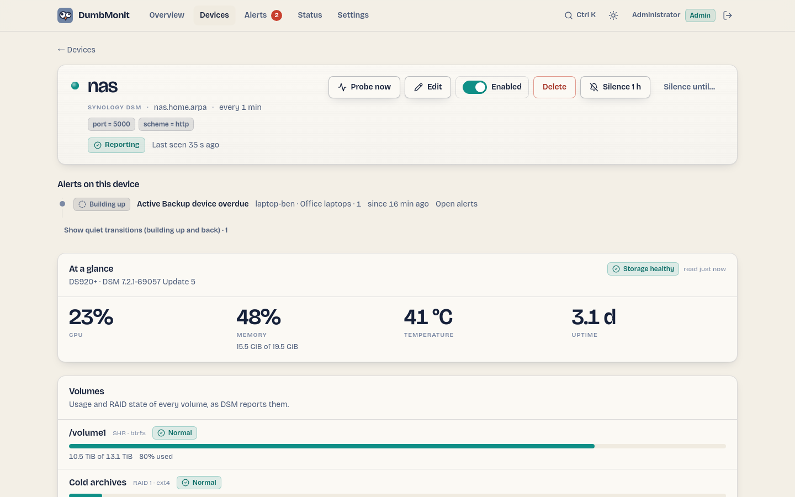

# Synology DSM

Un NAS Synology tramite l'API web DSM: volumi, pool di storage, salute
dei dischi, temperatura, task Hyper Backup, task Active Backup for
Business, e Synology Drive e Photos. Il primo motivo per monitorare un
NAS sono i suoi dischi: un disco che si riscalda o il cui stato SMART si
degrada annuncia un guasto molto prima che un volume cada.

## Cosa controlla

Tutte le metriche hanno il prefisso `dumbmonit_synology_`.

| Famiglia | Metriche | Etichette |
|---|---|---|
| Sistema | `system_info` (modello, versione DSM, firmware…), `uptime_seconds`, `temperature_celsius`, `temperature_warning`, `system_crashed`, `system_need_repair`, `storage_health` | `model`, `dsm_version`, `firmware` |
| CPU e memoria | `cpu_usage_percent`, `cpu_user/system/other_percent`, `cpu_cores`, `memory_total/used/available/installed_bytes`, `memory_usage_percent`, `swap_usage_percent` | |
| Rete | `network_rx_bytes_per_second`, `network_tx_bytes_per_second` | `interface` |
| Volumi | `volume_status`, `volume_total/used/available_bytes`, `volume_used_percent`, `volume_used_warning_percent`, `volume_used_critical_percent` | `volume`, `fs_type`, `raid_type` |
| Pool di storage e cache SSD | `pool_status`, `pool_failed_disks`, `pool_total/used_bytes`, e gli stessi quattro sotto `ssd_cache_` | `pool` o `ssd_cache`, `name`, `raid_type` |
| Dischi | `disk_status`, `disk_smart_status`, `disk_temperature_celsius`, `disk_size_bytes`, `disk_bad_sector_exceeded`, `disk_life_below_threshold`, `disk_remaining_life_percent` (solo SSD: la vita che il drive dice di avere rimasto), `disk_unc_count` (il contatore dei settori illeggibili di DSM, quello che controlla rispetto alla sua soglia di settori danneggiati), `disk_info` | `disk`, `name`; su `disk_info`: `model`, `serial`, `vendor`, `firmware`, `type`, `ssd` |
| Hyper Backup | `backup_tasks`, `backup_running`, `backup_last_result`, `backup_last_run_age_seconds`, `backup_last_success_age_seconds`, `backup_next_run_in_seconds` | per task |
| Synology Drive | `drive_up`, `drive_team_folders`, `drive_team_folder_info`, `drive_connections` (vedi sotto) | `drive_team_folder_info`: `name` |
| Synology Photos | `photos_installed` (vedi sotto) | |
| Raccolta | `up`, `scrape_errors`, `scrape_duration_seconds` | |

Le metriche di Active Backup for Business sono l'eccezione: hanno il
prefisso `dumbmonit_abb_` (vedi sotto).

`volume_status`, `disk_status` e `disk_smart_status` portano la parola
propria di DSM in un'etichetta (`status`, `smart_status`) e un valore
su una scala: `0` normale, `1` attenzione (uno stato transitorio come
`repairing` o `checking`, oppure una parola che DSM ha introdotto e che
DumbMonit non conosce ancora), `2` critico (`degrade`, `crashed`,
`failed`…). Lo sconosciuto conta deliberatamente come `1`, mai `0`.

Un fallimento parziale resta una sonda riuscita: se l'inventario di
storage fallisce, lo stato del sistema e l'utilizzo vengono comunque
pubblicati e il fallimento viene contato in `scrape_errors`. Solo un
fallimento sulla chiamata di scoperta API o sulla connessione condanna
l'intera sonda.

!!! note "Cosa le righe dei dischi non possono mostrare"
    I conteggi di settori riallocati vivono nella tabella degli
    attributi SMART per disco, che DSM serve solo tramite una chiamata
    non documentata la cui forma DumbMonit non è stato in grado di
    confermare. Le righe mostrano quindi ciò che dà `load_info`: il
    verdetto di DSM sui settori danneggiati, il suo contatore di
    settori illeggibili (e la sua crescita), e la vita rimanente
    dell'SSD.

!!! note "Cosa cambia tra le versioni DSM"
    La stessa chiamata non risponde con i medesimi campi su ogni DSM,
    e DumbMonit legge entrambe le forme invece di presumere una:

    * `disk_bad_sector_exceeded` proviene da `exceed_bad_sector_thr`
      fino a DSM 7.1 e da `sb_days_left_critical` — la stima di DSM
      dei giorni rimanenti prima che il drive raggiunga la sua soglia
      di settori danneggiati — su DSM 7.2 e successivi, dove il primo
      campo è scomparso. Lo stesso per `disk_life_below_threshold` e
      `remain_life_danger`;
    * `disk_remaining_life_percent` è un numero semplice su DSM più
      vecchio e un oggetto che porta il valore e se DSM si fida di
      esso su DSM 7.2 e successivi. Un valore che DSM marca come non
      fidato non viene pubblicato;
    * `volume_used_warning_percent` e `volume_used_critical_percent`
      ripetono le soglie impostate in DSM. DSM 7.4 non le restituisce
      più, quindi su un NAS recente quelle due serie semplicemente non
      esistono — nulla viene inventato al loro posto.

## La pagina del dispositivo

{ loading=lazy }

Un dispositivo Synology ottiene un proprio pannello sopra i grafici:

* **At a glance** — CPU, memoria (usata del totale), temperatura e
  uptime, con il verdetto di storage proprio di DSM come targhetta
  (sano, attenzione, bloccato, riparazione necessaria);
* **Volumes** — una riga per volume: barra di utilizzo, usato del
  totale, tipo RAID e file system, lo stato del volume nella parola di
  DSM (normale, degradato, bloccato, in riparazione…);
* **Storage pools** — una riga per pool: tipo RAID, lo stato del pool
  nella parola di DSM, quanti dei suoi dischi DSM riporta come
  falliti, e quanto di esso è già consegnato ai volumi. È qui che vive
  la ridondanza: un RAID 5 che perde un disco mantiene il volume
  sopra di esso a `normal` mentre ricostruisce, quindi la riga del
  volume non dice nulla e questa dice tutto. Un pool completamente
  allocato ai suoi volumi è lo stato finale normale, non un avviso,
  quindi questo valore è una frase invece di un gauge colorato;
* **SSD cache** — una riga per cache: il suo tipo RAID, il suo stato e
  la sua dimensione. La sezione è assente su un NAS senza una cache.
  `load_info` di DSM non porta alcuna modalità cache o tasso di hit,
  quindi nessuno dei due viene mostrato;
* **Disks** — una riga per vano: modello, dimensione, temperatura,
  verdetto SMART, verdetto di settori danneggiati di DSM, il contatore
  di settori illeggibili e, su un SSD, la vita rimanente come una
  piccola barra;
* **Active Backup for Business** — i task, poi ogni dispositivo
  sottoposto a backup con il suo ritmo e una striscia su trenta giorni
  (vedi sotto).

Tutto proviene da ciò che la sonda ha memorizzato: aprire la pagina non
interroga mai il NAS.

### Regole integrate per il NAS

| Regola | Severità | Si attiva quando |
|---|---|---|
| Synology disk SMART warning | advisory | DSM non riporta più lo stato SMART del disco come `normal`, per 15 minuti. |
| Synology disk failed | warning | DSM riporta il disco come bloccato o fallito, per 5 minuti. |
| Synology disk bad sectors | warning | Il conteggio di settori danneggiati supera la soglia impostata in DSM, per 15 minuti. |
| Synology disk bad sectors growing | advisory | Sono apparsi nuovi settori illeggibili nelle ultime 24 ore (`delta(…disk_unc_count[24h]) > 0`). |
| Synology SSD wearing out | advisory | Un SSD ha meno del 10% della sua vita nominale rimasta, per un'ora. |
| Synology volume degraded | warning | Un volume è degradato o bloccato, per 5 minuti. |
| Synology storage pool degraded | warning | Un pool di storage o una cache SSD è degradato o bloccato, per 5 minuti. Un RAID 5 che perde un disco appare qui per primo: DSM mantiene il volume sopra di esso a `normal` mentre ricostruisce. |
| Synology volume almost full | advisory | Un volume è pieno al 90% o più, per 15 minuti. |
| Synology temperature high | advisory | Un disco è sopra i 55 °C, oppure DSM ha generato il suo avviso di temperatura, per 15 minuti. |
| Synology memory high | advisory | Utilizzo di memoria sopra il 95% per 15 minuti. |

## Active Backup for Business

Active Backup for Business (ABB) sottopone a backup PC, server
fisici, macchine virtuali e file server verso il NAS. Se il pacchetto
è installato e in esecuzione, DumbMonit legge i suoi task a ogni
sonda; se non lo è, il NAS semplicemente non pubblicizza l'API e nulla
viene chiesto. L'opzione `abb` disattiva l'intera famiglia.

Lo stesso vale per Hyper Backup: DSM elenca le API di un pacchetto solo
mentre quel pacchetto è in esecuzione, quindi un NAS il cui Hyper
Backup è fermo — oppure che riceve backup solo tramite Hyper Backup
Vault — non pubblica alcuna metrica `backup_*` e non segnala nemmeno
un errore. DumbMonit chiede al NAS quali API possiede prima di
chiamarne una, così un pacchetto mancante è silenzio, mai una sonda
fallita.

| Metrica | Valore | Etichette |
|---|---|---|
| `dumbmonit_abb_tasks` | Numero di task. | |
| `dumbmonit_abb_task_last_status` | Ultima esecuzione: `1` successo, `0` fallito, `2` in corso, `-1` sconosciuto (mai eseguito, annullato, nessun backup). Un successo *parziale* conta come fallito: almeno un dispositivo non è stato sottoposto a backup. | `task`, `task_id`, `source_type`, `result` |
| `dumbmonit_abb_task_last_success_seconds` | Età dell'ultima esecuzione di backup riuscita, in secondi. Assente per un task che non è mai riuscito. | `task`, `task_id`, `source_type` |
| `dumbmonit_abb_task_enabled` | `1` se il task ha una pianificazione e non è in pausa, `0` se funziona solo manualmente. | `task`, `task_id`, `source_type` |
| `dumbmonit_abb_task_device_count` | Dispositivi collegati al task. | `task`, `task_id`, `source_type` |

`task` è il nome del task come mostrato in ABB; `source_type` è `pc`,
`vm`, `physical_server`, `file_server` o `nas`; `result` è il
risultato grezzo dell'ultima esecuzione (`success`, `partial_success`,
`fail`, `cancel`, `no_backup`, `running`, `none`).

L'età viene presa dalla cronologia dei task filtrata sulle esecuzioni
di backup riuscite, non dal "ultimo risultato" del task: dopo una
pulizia notturna delle versioni, l'ultimo risultato è la pulizia, non
il backup. Questo costa una richiesta per task, limitata a venti task.

Regole integrate sui task:

| Regola | Severità | Si attiva quando |
|---|---|---|
| Active Backup task failed | warning | L'ultima esecuzione è fallita, oppure è stato un successo parziale, per 10 minuti. La notifica nomina il task. |
| Active Backup too old | advisory | Nessuna esecuzione riuscita per più di due giorni. |
| Active Backup task disabled | info | Il task non ha pianificazione, oppure il suo backup continuo è in pausa, per un'ora. |

### Dispositivi e il loro ritmo

Una regola a livello di task è giusta per un server e sbagliata per un
laptop: le persone non lasciano i loro laptop accesi, e "nessun backup
da 24 ore" è lunedì mattina per ogni PC d'ufficio. DumbMonit quindi
osserva anche ABB **dispositivo per dispositivo**, rispetto alle
abitudini proprie del dispositivo.

A ogni sonda, il collector legge le esecuzioni per dispositivo che ABB
mantiene (`SYNO.ActiveBackup.Overview` `list_device_transfer_size`,
una chiamata per tutti i dispositivi, solo ciò che è cambiato dalla
sonda precedente) e le copia nel proprio database — limitato a
novanta giorni per NAS — così che il modello sopravviva a un riavvio
senza rileggere un mese di cronologia. Poi, per ogni dispositivo,
guarda gli ultimi trenta giorni.

| Metrica | Valore | Etichette |
|---|---|---|
| `dumbmonit_abb_device_state` | `0` ok, `1` idle, `2` learning, `3` running, `4` overdue, `5` failing, `6` never. | `device`, `device_id`, `task`, `task_id`, `state` |
| `dumbmonit_abb_device_overdue` | `1` mentre il dispositivo è in ritardo, `0` altrimenti. | `device`, `device_id`, `task`, `task_id` |
| `dumbmonit_abb_device_consecutive_failures` | Tentativi falliti di fila dall'ultimo successo (un'esecuzione annullata non conta come nessuno dei due). | stessi |
| `dumbmonit_abb_device_last_success_seconds` | Età dell'ultima esecuzione riuscita di questo dispositivo. Assente se non è mai riuscita. | stessi |
| `dumbmonit_abb_device_typical_interval_seconds` | Gap mediano tra due successi, giorni liberi esclusi. Assente mentre apprende. | stessi |

#### Come viene giudicato "overdue" {#how-overdue-is-judged}

In parole semplici, per ogni dispositivo:

1. **Quali giorni è attivo?** Un giorno della settimana in cui il
   dispositivo ha tentato almeno un backup negli ultimi trenta giorni
   — riuscito o no; un fallimento prova che la macchina era accesa
   tanto quanto un successo — è un *giorno attivo*. Una volta che ci
   sono almeno due settimane di cronologia, un giorno della settimana
   senza alcun tentativo è un *giorno libero*. Un laptop usato da
   lunedì a venerdì ottiene sabato e domenica come giorni liberi; un
   server non ne ha nessuno.
2. **Quanto spesso fa backup?** I gap tra successi consecutivi vengono
   raccolti in *tempo attivo*: i giorni liberi completi che un gap
   contiene non vengono contati (venerdì sera a lunedì sera è un
   giorno di tempo attivo, non tre). La loro mediana è l'*intervallo
   tipico* del dispositivo; il loro 90° percentile è come appare "una
   settimana lenta".
3. **Quanto tempo è concesso?** La tolleranza è
   `max(1.5 × gap p90, 2 × intervallo tipico, 36 h)`. Un desktop
   notturno ottiene 48 h; una macchina sottoposta a backup ogni tre
   giorni ottiene circa sei; nessuno riceve meno di un giorno e mezzo.
   Mentre esistono meno di due gap utilizzabili (un dispositivo
   aggiunto questa settimana), la tolleranza è 72 h — abbastanza per
   attraversare un weekend senza un falso allarme.
4. **Quanto tempo attivo è passato?** Il tempo dall'ultimo successo,
   meno i giorni liberi completi che contiene. Un laptop sottoposto a
   backup l'ultima volta venerdì alle 20:00 ha, il lunedì alle 08:00,
   dodici ore di tempo attivo dietro di sé, non sessanta.
5. **Il verdetto**, in questo ordine: *running* (un backup è in
   corso); *failing* (gli ultimi due o più tentativi sono falliti —
   un successo parziale è un fallimento, un'esecuzione annullata non è
   né uno né l'altro); *never* (nessun successo registrato);
   *overdue* (il tempo attivo supera la tolleranza); *idle* (oggi è
   uno dei suoi giorni liberi: spento, come al solito); *learning*
   (ritmo non ancora conosciuto); *ok*.

Solo *overdue* genera `dumbmonit_abb_device_overdue`, e solo
*failing* alimenta la regola di fallimento. Un laptop idle di domenica
non genera nulla; lo stesso laptop ancora silenzioso martedì notte sì.

I giorni e le ore sono espressi nell'ora locale del server (`TZ` del
container), dove vive la persona che legge la pagina. La pagina del
dispositivo mostra, per dispositivo: lo stato in una parola, l'ultimo
successo e l'ultimo risultato, il ritmo in parole ("weekdays, around
20:00", "every ~3 days, on Mon, Wed, Fri, around 03:00", "still
learning (2 runs in 30 days)") e una striscia su trenta giorni — verde
acqua per un giorno con un successo, rosso per un fallimento, ambra per
un'esecuzione annullata, grigio per nessuna esecuzione.

Regole integrate sui dispositivi:

| Regola | Severità | Si attiva quando |
|---|---|---|
| Active Backup device overdue | advisory | `dumbmonit_abb_device_overdue > 0` per 30 minuti. |
| Active Backup device failing | warning | Due o più tentativi falliti di fila, per 10 minuti. |

!!! warning "Permessi"
    ABB risponde solo a un account nel gruppo `administrators` con il
    pacchetto consentito nei suoi permessi applicazione, oppure a un
    account a cui il pacchetto è stato delegato (DSM 7: Active Backup
    for Business → Settings → Privileges). Un account a cui
    l'applicazione è negata non può leggere i task ABB: la chiamata
    viene rifiutata (codice 105) e contata in `scrape_errors`. O
    consenti o delega il pacchetto all'account di monitoraggio, oppure
    deseleziona "Watch Active Backup for Business" (`abb = false`) per
    fermare la richiesta.

!!! note "Un'API non documentata"
    Synology non documenta l'API web di ABB. DumbMonit segue la forma
    registrata da progetti della community (`SYNO.ActiveBackup.Task`
    `list`, `SYNO.ActiveBackup.Log` `list_result` e
    `SYNO.ActiveBackup.Overview` `list_device_transfer_size`, tutte
    versione 1) e scopre il loro percorso tramite `SYNO.API.Info`. Un
    DSM le cui risposte differiscono produce metriche mancanti, mai
    una sonda fallita; un ABB troppo vecchio per offrire la panoramica
    per dispositivo mantiene le sue metriche di task e semplicemente
    non ha un ritmo per dispositivo.

    La versione 1 è deliberata. DSM 7.4 pubblicizza queste API come
    versioni 1 a 2, ma solo la versione 1 porta i metodi di lettura:
    richieste alla versione 2 rispondono tutte "the requested method
    does not exist", il che appare come una differenza di firmware e
    non lo è. La stessa risposta ritorna anche quando il token CSRF
    manca, quindi DumbMonit chiede a DSM uno al login e lo invia a
    ogni chiamata.

## Synology Drive

DSM non documenta l'API web di Synology Drive. DumbMonit legge tre
chiamate il cui nome e forma provengono dalla libreria della community
`N4S4/synology-api`, che le chiama dalle stesse schermate della
console di amministrazione di Synology Drive, e segue la stessa regola
di Active Backup for Business: un'API che un NAS non pubblicizza è un
pacchetto non installato, mai un fallimento.

| Metrica | Valore | Etichette |
|---|---|---|
| `dumbmonit_synology_drive_up` | `1` mentre il servizio risponde a `get_status`. Assente se il pacchetto non è installato. | |
| `dumbmonit_synology_drive_team_folders` | Numero di cartelle di team. | |
| `dumbmonit_synology_drive_team_folder_info` | Valore `1` per cartella di team (al massimo 32). | `name` |
| `dumbmonit_synology_drive_connections` | Numero di connessioni attive (client desktop e mobile attualmente sincronizzati). | |

!!! note "Perché le connessioni sono solo un conteggio"
    La pagina "Client list" della console di amministrazione mostra il
    nome del dispositivo, l'utente, il tipo di applicazione, lo stato
    online, l'indirizzo IP e la posizione di ogni connessione, ma
    quella è una descrizione della pagina, non dei campi JSON
    dell'API: né Synology né alcun progetto della community documenta
    come `SYNO.SynologyDrive.Connection` nomina effettivamente i suoi
    campi. Invece di indovinare il nome di un dispositivo o la data di
    ultima sincronizzazione da una chiave non confermata, DumbMonit
    pubblica solo il conteggio delle connessioni. I dispositivi
    individuali si collegheranno alla stessa tabella
    [dispositivi client](../alerting/rules.md) usata da Immich, Proxmox
    Backup Server e Veeam una volta che quella forma sia confermata
    dalla risposta di un NAS reale.

L'opzione `drive` (attiva per impostazione predefinita) disattiva
l'intera famiglia.

## Synology Photos

Synology Photos fornisce un'API di navigazione ben documentata, ma né
Synology né le librerie della community espongono un elenco a livello
amministrazione dei dispositivi di backup mobile o del loro ultimo
backup — l'app mobile mostra il proprio stato di backup localmente, e
nulla lo centralizza sul lato NAS tramite un'API. DumbMonit quindi
riporta solo che il pacchetto è installato:
`dumbmonit_synology_photos_installed` (valore `1`), letto dal catalogo
API senza alcuna richiesta extra al NAS — lo stesso catalogo
`SYNO.API.Info` che già risponde per ogni altro pacchetto. L'opzione
`photos` (attiva per impostazione predefinita) la disattiva.

## Cosa preparare sul NAS

I passaggi seguenti sono quelli mostrati dalla nota accanto al modulo.
Il principio: un account riservato al monitoraggio, privato di tutto
ciò di cui l'API di DSM non ha bisogno — mai l'account con cui accedi.

1. In DSM, apri Control Panel → User & Group → User e clicca Create. Dai all'account il nome seguente e dagli una password lunga usata in nessun altro posto.

    ```
    dumbmonit
    ```

2. Unisciti ai gruppi: spunta administrators. DSM risponde alle chiamate di storage, volume e SMART dei dischi solo a quel gruppo; senza di esso il NAS appare vivo ma non dice nulla sui suoi dischi. I prossimi due passaggi riprendono tutto il resto.
3. Assegna i permessi delle cartelle condivise: No access su ogni cartella condivisa. Assegna i permessi delle applicazioni: Deny tutto tranne DSM, più Active Backup for Business se vuoi che i suoi task vengano letti. Salta le pagine di quota e limite di velocità.
4. La verifica in due passaggi deve restare disattivata per questo account: nessun monitor automatico può digitare un codice temporaneo. Se Control Panel → Security → Account la impone, limita la regola a gruppi di cui questo utente non fa parte, oppure esentalo.
5. I pacchetti di backup vengono letti solo mentre sono installati e in esecuzione: DSM non pubblicizza affatto l'API di un pacchetto fermo, quindi i task Hyper Backup diventano allora silenziosi invece di fallire, e un NAS che riceve solo backup (Hyper Backup Vault) non ha task propri da mostrare. Active Backup for Business risponde inoltre solo a un account autorizzato a usarlo (Active Backup for Business → Settings → Privileges); altrimenti deseleziona l'opzione "Watch Active Backup for Business" di DumbMonit per fermare la richiesta.
6. In DumbMonit, inserisci l'indirizzo del NAS (HTTPS, porta 5001 per impostazione predefinita), poi il nome utente e la password di questo account.

!!! warning
    Il gruppo administrators è richiesto dall'API di storage di DSM, non da DumbMonit. Per questo questo account non riceve cartella condivisa, nessuna applicazione e una password usata in nessun altro posto: può leggere il NAS, non toccare i tuoi file.

!!! note "Quali diritti danno quali metriche"
    L'API di DSM non richiede gli stessi diritti per ogni chiamata. Lo
    stato del sistema (modello, versione, temperatura, uptime) risponde
    a qualsiasi account. CPU, memoria, volumi e, soprattutto, lo stato
    SMART dei dischi richiedono il gruppo `administrators`. Su DSM 7,
    la delega "System monitoring" (Control Panel → User & Group →
    Delegation) è sufficiente per l'utilizzo ma non per l'inventario di
    storage. Un account senza diritti particolari dà quindi un NAS che
    è "vivo", ma nulla sui suoi dischi.

Documentazione del fornitore: [Create a user in DSM](https://kb.synology.com/en-global/DSM/help/DSM/AdminCenter/file_user_create).

## Credenziali

| Credenziale | Campi |
|---|---|
| DSM account | **User name**: l'account creato sopra. **Password**: la sua password. La verifica in due passaggi deve essere disattivata per questo account: nessun monitor automatico può digitare un codice temporaneo. |

Indirizzo: `192.168.1.30`, `nas.lan` oppure `nas.lan:5001`. Senza una
porta, viene usata 5001 su HTTPS e 5000 su HTTP.

## Opzioni

| Chiave | Etichetta | Predefinito | Aiuto |
|---|---|---|---|
| `scheme` | Protocol | `https` | HTTPS si adatta a un NAS appena installato. HTTP solo se DSM ascolta solo in chiaro. Scelte: `https`, `http`. |
| `port` | DSM port | *(vuoto)* | Usata se l'indirizzo non fornisce una porta. Vuoto: 5001 su HTTPS, 5000 su HTTP. |
| `insecure_tls` | Accept an unverifiable certificate | `false` | Un NAS fornisce un certificato autofirmato per impostazione predefinita: abilita questo se la connessione viene rifiutata per questo motivo. |
| `request_timeout_seconds` | Timeout per request (seconds) | `15` | Tempo consentito per ogni chiamata API, da 1 a 120. L'inventario di storage può risvegliare dischi in sospensione. |
| `abb` | Watch Active Backup for Business | `true` | Legge i task Active Backup for Business. Richiede il pacchetto installato e un account autorizzato a usarlo; un NAS senza il pacchetto viene semplicemente saltato. |
| `drive` | Watch Synology Drive | `true` | Legge se il servizio Synology Drive risponde, le sue cartelle di team e il suo conteggio di connessioni attive. Un NAS senza il pacchetto viene semplicemente saltato. |
| `photos` | Watch Synology Photos | `true` | Mostra se il pacchetto Synology Photos è installato, senza alcuna richiesta extra al NAS. Synology non espone un elenco di dispositivi di backup mobile tramite alcuna API. |

## Errori comuni

| Sintomo | Causa probabile |
|---|---|
| Errore di autenticazione | Password errata, oppure la verifica in due passaggi è richiesta per questo account. DSM risponde HTTP 200 anche in caso di fallimento; il codice di errore nel corpo JSON è ciò che conta, e DumbMonit lo legge. |
| Errore di certificato | Certificato autofirmato: abilita `insecure_tls`. Questo è un errore di configurazione, mai "unreachable": un NAS che risponde non viene mostrato come spento. |
| Nessuna metrica di disco o volume | L'account non è nel gruppo `administrators` (vedi la nota sopra). |
| Nessuna metrica `dumbmonit_abb_*`, `scrape_errors` a 1 | L'account non può usare Active Backup for Business: delegagli il pacchetto, oppure disattiva l'opzione `abb`. Senza il pacchetto installato non c'è né errore né metrica. |
| Metriche di task ma nessuna riga di dispositivo sulla pagina | Il NAS non pubblicizza `SYNO.ActiveBackup.Overview` (ABB più vecchio), oppure il dispositivo viene sondato tramite un agent relay, che mantiene la cronologia in memoria sul suo lato: le metriche esistono, il calendario no. |
| Un laptop mostra "Overdue" il giorno dopo essere stato aggiunto | Meno di tre successi: il modello sta ancora apprendendo e consente 72 ore tra i backup; si stabilizza una volta conosciute due settimane di abitudini. |
| I dischi si risvegliano a ogni sonda | L'inventario di storage risveglia i dischi in sospensione. Allunga l'intervallo di controllo. |
