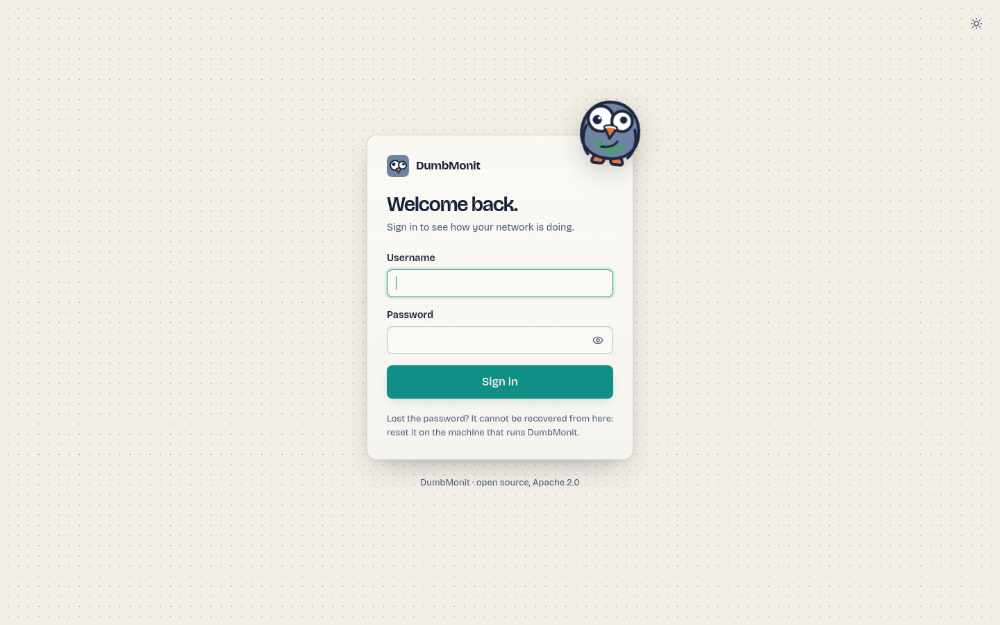

# 使用 Docker 安装 {#install-with-docker}

DumbMonit 以单个容器运行：`dumbmonit` 服务器（采集、API、
告警、Web UI）会启动自己的 VictoriaMetrics 来存储时间序列；该
二进制文件已包含在镜像中。配置和状态存放在内嵌的 SQLite
数据库中。一个卷 `/data` 保存数据库、实例密钥和
时间序列。

!!! note "Alpha 镜像"
    `ghcr.io/laupernoe/dumbmonit:latest` 是最近一次打标签的 alpha 构建（amd64；
    arm64 镜像暂时停止发布）；`:edge` 跟随 `main` 上的最新提交。若要从源码运行，
    `docker compose -f docker-compose.yml -f docker-compose.dev.yml up -d
    --build` 会在本地构建同一个镜像（第一次约需十分钟；只需要 Docker）。

## 前提条件 {#prerequisites}

- 带有 Compose 插件的 Docker Engine（`docker compose version` 可正常运行）。
- 一台能够访问你要监控的设备的机器。设备不需要能访问
  这台机器，[代理](../devices/agent.md)除外，它们会通过 HTTP 将
  测量数据推送到服务器。
- 主机上的 `8080` 端口空闲，或者使用你选择的其他端口（[见下文](#advanced-options)）。

## Compose 文件 {#the-compose-file}

这是完整的 `docker-compose.yml`（不需要 `.env` 文件）；请将它保存在
单独的目录中：

```yaml
services:
  dumbmonit:
    image: ghcr.io/laupernoe/dumbmonit:latest
    ports:
      - "8080:8080"
    volumes:
      - dumbmonit-data:/data
    restart: unless-stopped
    stop_grace_period: 30s
    read_only: true
    tmpfs: [/tmp]
    cap_drop: [ALL]
    security_opt: ["no-new-privileges:true"]
    sysctls:
      net.ipv4.ping_group_range: "0 2147483647"

volumes:
  dumbmonit-data:
    name: dumbmonit-data
```

然后启动它：

```bash
docker compose up -d
```

会拉取已发布的镜像；只读文件系统、被移除的 capability 以及 `ping_group_range`
sysctl 的作用，参见[以非 root 用户运行](#runs-as-a-non-root-user)和
[无需 capability 的 ICMP ping](#icmp-ping-without-a-capability)。各项选项（端口、
密钥、保留期、外部 VictoriaMetrics、截图）都是
[由你自己添加的环境变量](#advanced-options)。

!!! tip "自己构建镜像"
    在仓库的克隆目录中，`docker compose -f docker-compose.yml -f
    docker-compose.dev.yml up -d --build` 会在本地构建同一个镜像（冷启动约十分钟；
    主机上不需要 Rust 或 Node 工具链）。需要从源码或某个分支运行时，请使用这种方式。

## 内嵌的 VictoriaMetrics {#embedded-victoriametrics}

镜像中包含 VictoriaMetrics 二进制文件（`/victoria-metrics-prod`，来自
`victoriametrics/victoria-metrics:v1.152.0`）。当未设置 `DUMBMONIT_VM_URL` 时，
服务器会将它作为子进程启动，监听 `127.0.0.1:8428`，
把时间序列存放在 `/data/vm` 下，将其日志行转发到自己的日志中，
在它崩溃时以退避方式重启，并在关闭时停止它。不会发布任何端口：
该端口只存在于容器内部。

有两个变量值得了解：`DUMBMONIT_VM_RETENTION`（默认 `12` 个月；
`30d` 或 `2y` 也可以）和 `DUMBMONIT_VM_MEMORY`（`256MB`，
其缓存的预算；数百台主机时请调大）。其余内容见
[配置参考](../reference/configuration.md#embedded-victoriametrics)。

若要使用你已有的 VictoriaMetrics，请将 `DUMBMONIT_VM_URL` 设置为其
地址（`http://host:8428`）：此时不会启动内嵌的那个，
`/data/vm` 保持为空。

## 首次启动 {#first-start}

打开 `http://<your-host>:8080`。全新的实例会显示 `/setup` 界面，
你可以在这里创建第一个管理员账户（密码至少 12
个字符）。

该界面首先会要求输入**设置码**。在尚不存在管理员时，
服务器会在启动时于日志中打印一次性代码：

```sh
docker compose logs dumbmonit | grep -A1 "setup code"
```

```
  First-run setup code: K7XQ4-M9PRT
```

它用来证明创建管理员账户的人正在运行这台服务器，这样网络上的其他人就无法
抢先占用一个全新的实例。该代码只保存在内存中，在存在管理员之前每次重启都会
变化，输错会受到速率限制。对于自动化部署，可设置
`DUMBMONIT_SETUP_CODE` 来自行指定。

{ loading=lazy }

然后添加你的第一台设备：参见[添加第一台设备](first-device.md)。

## 环境变量 {#environment-variables}

一切都通过环境变量完成；没有任何一个是必需的。把需要的变量添加到服务的
`environment:` 下，如[高级选项](#advanced-options)所示。

| 变量 | 默认值 | 作用 |
|---|---|---|
| `DUMBMONIT_BIND` | `0.0.0.0:8080` | 容器内的监听地址。 |
| `DUMBMONIT_DATA_DIR` | `/data` | SQLite 数据库（`dumbmonit.db`）、实例密钥（`secret.key`）以及内嵌 VictoriaMetrics 的数据（`vm/`）。 |
| `DUMBMONIT_VM_URL` | *（未设置）* | 外部 VictoriaMetrics 的 URL。设置后不会启动内嵌的那个。 |
| `DUMBMONIT_VM_RETENTION` | `12` | 内嵌 VictoriaMetrics 的保留期：以月为单位，或 `30d`、`2y`。 |
| `DUMBMONIT_VM_MEMORY` | `256MB` | 内嵌 VictoriaMetrics 缓存的内存预算。 |
| `DUMBMONIT_VM_LISTEN` | `127.0.0.1:8428` | 内嵌 VictoriaMetrics 的监听地址，位于容器内部。 |
| `DUMBMONIT_SECRET` | *（自动生成）* | 用于加密设备凭据和令牌的实例密钥。 |
| `DUMBMONIT_MAX_CONCURRENT_PROBES` | `64` | 并发探测数，所有采集器合计。 |
| `DUMBMONIT_PROBE_TIMEOUT_SECS` | `10` | 单次探测的最长持续时间。 |
| `DUMBMONIT_FLUSH_INTERVAL_SECS` | `5` | 写入 VictoriaMetrics 的周期。 |
| `DUMBMONIT_LOG` | `info` | 日志过滤器（`tracing` 语法，例如 `debug`、`dumbmonit=trace`）。 |
| `DUMBMONIT_AGENT_DIR` | `/agents` | 通过 `/download/…` 提供的代理二进制文件。 |
| `DUMBMONIT_RESET_PASSWORD` | *（空）* | 设为 `1` 可在启动时清除密码和所有会话。 |
| `DUMBMONIT_SETUP_CODE` | *（自动生成）* | 在尚无管理员时，`/setup` 要求输入的设置码。未设置时，每次启动都会在日志中打印一个随机代码。 |
| `DUMBMONIT_COOKIE_SECURE` | *（关闭）* | 在 TLS 反向代理之后设为 `1`，可将会话 cookie 标记为 `Secure`。 |
| `DUMBMONIT_ALERT_INTERVAL_SECS` | `30` | 告警评估周期（不得低于 10）。 |
| `DUMBMONIT_ALERT_HISTORY_DAYS` | 90 天 | 告警历史的保留期。关于其单位的注意事项，请参见[配置参考](../reference/configuration.md)。 |
| `DUMBMONIT_BACKUP_ENABLED` | 开启 | 将数据库按计划本地备份到 `/data/backups/`。可用 `DUMBMONIT_BACKUP_DIR`、`_INTERVAL_HOURS`（24）和 `_KEEP`（7）调整；参见[备份与恢复](backup.md)。 |

完整列表及详细说明见[配置参考](../reference/configuration.md)。
更名之前的 `EZYMONIT_*` 名称仍会作为后备被读取；参见
[升级](#upgrading)。

## 备份密钥 {#back-up-the-secret-key}

SNMP 团体名、密码和 API 令牌使用 AES-256-GCM 加密，密钥
由实例密钥派生。首次启动时，DumbMonit 会在 `/data/secret.key`
（位于 `dumbmonit-data` 卷内）中生成该密钥。

!!! danger "请将 `secret.key` 与数据库一起备份"
    没有它，设备凭据将无法恢复：单独恢复数据库
    得到的实例无法与任何设备通信。服务器会在启动时检测到
    密钥缺失或已更改，并给出明确的提示后拒绝继续运行，
    而不是在每次探测时悄悄失败。计划备份
    会为你复制它——参见[备份与恢复](backup.md)。

如果你更愿意自己掌管密钥，可以改在 Compose 文件中设置 `DUMBMONIT_SECRET`
（[示例](#advanced-options)；32 个或更多随机字符）。请把它保存在你的密码管理器中。

## 升级 {#upgrading}

```bash
docker compose pull
docker compose up -d
```

数据库迁移会在启动时运行。VictoriaMetrics 的数据不受影响。

!!! tip "先做备份"
    **Settings → Backup → Back up now** 会在几秒内把数据库
    和 `secret.key` 的一致性副本写入 `/data/backups/`，
    如果升级出了问题，你就从它来恢复。参见
    [备份与恢复](backup.md)。

### 从 0.1.0-alpha.1 升级 {#from-010-alpha1}

自 0.1.0-alpha.2 起，容器以用户 65532 而不是 root 运行。由
alpha.1 创建的卷仍然属于 root，服务器会拒绝
启动（`/data is not writable by the server`）。请一次性移交该卷的所有权：

```bash
docker compose down
docker run --rm -v dumbmonit-data:/data alpine chown -R 65532:65532 /data
docker compose up -d
```

或者保持文件原样，让容器以其所有者身份运行，在 `docker-compose.yml`
的服务下设置
`user: "0:0"`（或绑定挂载所属的 uid）。

### 从 EzyMonit 以及双容器部署升级 {#from-ezymonit-and-from-the-two-container-setup}

DumbMonit 在 2026 年 9 月之前叫作 EzyMonit，并以两个容器运行，
即服务器和一个单独的 `victoriametrics` 服务。升级需要把旧项目的数据
一次性迁移到新卷中。旧项目名为
`ezymonit`（其卷为 `ezymonit_ezymonit-data` 和 `ezymonit_vm-data`；
可用 `docker volume ls` 确认）。在旧目录中执行：

```bash
docker compose down
```

然后，使用新的 `docker-compose.yml`：

```bash
docker volume create dumbmonit-data
docker run --rm -v ezymonit_ezymonit-data:/from -v dumbmonit-data:/to alpine cp -a /from/. /to/
docker run --rm -v ezymonit_vm-data:/from -v dumbmonit-data:/to alpine sh -c 'mkdir -p /to/vm && cp -a /from/. /to/vm/'
docker compose up -d
```

旧的 VictoriaMetrics 数据目录与内嵌版本使用的布局相同：
无需转换。另一种做法是继续使用外部的 VictoriaMetrics，
并让 `DUMBMONIT_VM_URL` 指向它。

服务器在首次启动时会自行处理以下内容：

- `EZYMONIT_*` 变量仍会作为后备被读取，每个变量在启动时
  产生一条警告（`EZYMONIT_X is deprecated, use DUMBMONIT_X`）。
- `/data/ezymonit.db` 会被重命名为 `dumbmonit.db`。
- 代理令牌 `ezym_…` 继续有效；新令牌为 `dmon_…`。代理会继续
  推送数据；方便时在每台机器上重新运行安装命令，它会
  [原地迁移旧服务](../devices/agent.md#upgrade)。
- 会话 cookie 的名称已更改：所有人需要重新登录一次。浏览器的
  主题偏好会被保留。

它不会处理的内容：指标前缀从 `ezymonit_` 改为
`dumbmonit_`，不提供兼容。旧的序列会以旧名称留在 VictoriaMetrics 中，
并随保留期过期；图表和内置规则从升级时起重新开始。
引用 `ezymonit_…` 指标的自定义告警规则必须手动修改。

## 备份与恢复 {#backup-and-restore}

一个命名卷 `dumbmonit-data` 保存了所有内容：

| 路径 | 内容 |
|---|---|
| `dumbmonit.db` | 设备、规则、渠道、告警状态、会话。 |
| `secret.key` | 实例密钥。 |
| `backups/` | 计划的本地备份：数据库和密钥的副本，默认每天一次，保留七份。 |
| `vm/` | VictoriaMetrics 时间序列（默认保留 12 个月）。 |

DumbMonit 会按计划备份自己的数据库，也可以将整个
配置——设备、凭据、规则、渠道——导出为一个用你自选的密码短语
加密的文件，并可恢复到全新的实例上。
两者都在**[备份与恢复](backup.md)**中介绍，其中还包括升级前该做什么，
以及那条值得读两遍的关于 `secret.key` 的规则。

若要归档卷本身（包括图表），请停止整个栈并将其打包：

```bash
docker compose stop
docker run --rm -v dumbmonit-data:/data -v "$PWD:/backup" alpine \
  tar czf /backup/dumbmonit-data.tgz -C /data .
docker compose start
```

恢复时，创建卷，用同样的方式把归档解压到其中，然后执行
`docker compose up -d`。

如果空间紧张，`--exclude=./vm` 可以让归档保持较小：数据库和
密钥就是全部设置，`vm/` 只是图表。

## 高级选项 {#advanced-options}

上面的 Compose 文件有意不含任何变量。要更改某项设置，请在 `docker-compose.yml`
的 `dumbmonit:` 下添加一个 `environment:` 块（或在其中加一行），然后再次运行
`docker compose up -d`。容器会被重新创建；数据卷保持不变。

**更改端口。** 修改映射的左侧；容器内仍监听 8080：

```yaml
    ports:
      - "8099:8080"
```

**自己的密钥**，代替 `/data/secret.key` 中生成的那个。它用于加密设备凭据：
丢失它意味着要重新输入每一个凭据。

```yaml
    environment:
      DUMBMONIT_SECRET: replace-me-with-32-random-characters
```

内嵌 VictoriaMetrics 的**保留期与内存**（月数，或 `30d` / `2y`；几十台设备的
homelab 用 256 MB 就够）：

```yaml
    environment:
      DUMBMONIT_VM_RETENTION: "24"
      DUMBMONIT_VM_MEMORY: 512MB
```

**外部 VictoriaMetrics**；此时不会启动内嵌的那个：

```yaml
    environment:
      DUMBMONIT_VM_URL: http://victoriametrics:8428
```

**忘记密码。** 添加下面这一行，运行 `docker compose up -d`，在界面中重新创建
第一个管理员（设备、规则和渠道都会保留），然后删除这一行，再运行一次
`docker compose up -d`：

```yaml
    environment:
      DUMBMONIT_RESET_PASSWORD: "1"
```

**网站变化的截图**：在服务器旁边放一个无头 Chromium。只有 DumbMonit 通过
Compose 网络与它通信；没有任何东西发布它的端口。

```yaml
services:
  dumbmonit:
    environment:
      DUMBMONIT_BROWSER_URL: http://browser:9222
  browser:
    image: chromedp/headless-shell:stable
    shm_size: 256m   # Chromium 在 /dev/shm 中渲染；64 MB 对长页面太小
    restart: unless-stopped
```

更多变量：[配置参考](../reference/configuration.md)。

## 反向代理 {#reverse-proxy}

UI 和 API 通过同一个端口以纯 HTTP 提供服务。不使用 WebSocket：
界面通过轮询 API 获取数据，因此任何反向代理都无需特殊
配置即可使用。

=== "Caddy"

    ```
    monit.example.com {
        reverse_proxy 127.0.0.1:8080
    }
    ```

=== "nginx"

    ```nginx
    server {
        listen 443 ssl;
        server_name monit.example.com;
        # ssl_certificate / ssl_certificate_key …

        location / {
            proxy_pass http://127.0.0.1:8080;
            proxy_set_header Host $host;
            proxy_set_header X-Forwarded-Proto $scheme;
            # 代理在故障后会发送补传的批量数据：
            client_max_body_size 16m;
        }
    }
    ```

当代理终止 TLS 时，请设置 `DUMBMONIT_COOKIE_SECURE: "1"`，使会话
cookie 只通过 HTTPS 发送。纯 HTTP 部署中不要设置它：
浏览器将永远不会回传该 cookie，导致无法登录。

!!! note "代理之后的代理"
    创建代理令牌时显示的安装命令使用的是
    你的浏览器访问 UI 时所用的 URL。如果那是经过反向代理的 URL，代理也会
    使用它：请确保 `/install.sh`、`/install.ps1`、`/download/…` 和 `/api/ingest`
    能通过反向代理。

## 以非 root 用户运行 {#runs-as-a-non-root-user}

容器以用户 `65532:65532` 运行服务器（使用数字形式：`scratch`
镜像中没有 `/etc/passwd`），丢弃所有 capability，启用 `no-new-privileges`
并使用只读的根文件系统；`/data`（卷）和 `/tmp`（tmpfs）
是仅有的可写路径。这一切都已包含在上面的 Compose 文件中。

由 Docker 在首次启动时创建的命名卷会从镜像继承 `/data` 的所有者：
无需任何操作。有两种情况需要执行一条命令：

- **由早期版本创建的卷**（服务器过去以 root 运行，
  因此文件属于 root）。请在栈停止时一次性移交所有权：

  ```bash
  docker compose stop
  docker run --rm -v dumbmonit-data:/data alpine chown -R 65532:65532 /data
  docker compose up -d
  ```

  否则的症状是容器立即退出，并显示
  `creating directory /data … Permission denied`（或 `unable to open database
  file`）。

- **绑定挂载**（`./data:/data`）会保留主机目录的所有权。
  要么执行 `chown -R 65532:65532 ./data`，要么让容器以该目录的
  所有者身份运行：在服务下设置 `user: "1000:1000"`，任何 uid 都可以。

## 无需 capability 的 ICMP ping {#icmp-ping-without-a-capability}

[ping 监控](../devices/services.md#ping)会发送 ICMP echo。它没有使用
原始套接字——那需要 `NET_RAW`，而授予非 root
容器用户的 capability 本来也用不了——而是使用 ICMP echo 套接字，Linux
允许 `net.ipv4.ping_group_range` 中列出的组使用它。Compose 文件
在容器自己的网络命名空间内设置了该 sysctl：

```yaml
    sysctls:
      net.ipv4.ping_group_range: "0 2147483647"
```

主机上不会有任何改变。Docker 20.10 及更高版本会自行在每个
容器中设置此范围；显式写出这几行是为了让它在较旧的引擎和
Podman 上同样生效。没有它时，检查会报告配置错误（显示在
设备上，不会发送通知），而绝不会误报“主机宕机”。使用 `docker run` 时，请传入
`--sysctl net.ipv4.ping_group_range="0 2147483647"`。

## 无硬件测试 {#testing-without-hardware}

添加一台[演示设备](../devices/demo.md)：它无需任何准备就能产生模拟
测量数据，因此可以立即试用图表、规则和通知。若要获得真实的 SNMP 数据，
运行 Docker 的这台机器通常就足够了——在上面安装
`snmpd`（`apt install snmpd`，在 `/etc/snmp/snmpd.conf` 中允许 Docker
网桥上的 `public` 团体名），然后添加一台 SNMP 设备，地址填该主机在该网桥上的
地址（默认为 `172.17.0.1`）：配置档案会被自动检测，
接口、内存和进程随即出现。

开发者可以加上 `docker-compose.dev.yml` 覆盖文件，把内嵌的
VictoriaMetrics 发布到主机的 `:8428`，以便直接进行 MetricsQL 查询：

```bash
docker compose -f docker-compose.yml -f docker-compose.dev.yml up -d
```
