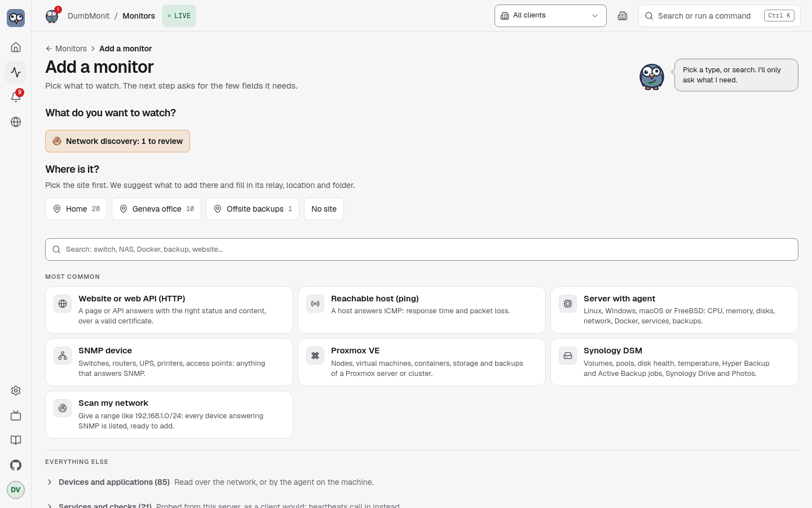

# Add your first monitor

This page takes you from a fresh install to a first alert in your inbox. Each
step says what you should see on screen. If it does not match, go to
[When something goes wrong](#when-something-goes-wrong).

You need about ten minutes and the address of one thing to watch: a server, a
NAS, a switch or a website.

## 1. First launch

1. Start DumbMonit (see [Docker](docker.md)) and open `https://<your-host>:8080`.
2. Your browser warns about the certificate. This is expected: DumbMonit makes a
   self-signed one at first start. Accept it once. To replace it, see
   [HTTPS and encryption](https.md).
3. You see **Let's create your account.** Fill in:
    - **Setup code**: printed in the server logs. Run
      `docker compose logs dumbmonit | grep -A1 "setup code"` and copy the
      code (for example `K7XQ4-M9PRT`).
    - **Username** (no spaces) and a **password** of at least 12 characters. A
      whole phrase is safer than a complicated word.
4. Click **Create account and continue**. You are signed in.

!!! warning "Write the password down"
    It cannot be recovered from the screen. If you lose it, it is reset on the
    machine that runs DumbMonit: see the [FAQ](../faq.md#i-lost-the-password).

!!! note "Setup code refused?"
    The code changes at every restart until an administrator exists. Copy the
    latest one from the logs.

## 2. The setup wizard

Right after sign-in, a short wizard can walk you through the basics. Every step
can be skipped, and everything is changeable later in **Settings**. Use
**Continue**, **Skip this step**, or **Skip setup** to leave. It covers: the
instance name, language and time zone; an agent; your first monitors; a
notification channel; an optional on-call rotation; optional single sign-on;
and data retention. You can reopen it from **Settings → System**.

## The three first steps {#the-three-first-steps}

On a brand-new instance the overview shows a short guide instead of an empty
page: **add your first monitor**, **connect a way to be told**, **check a
message arrives**. Each step is one button, and each turns green on its own.
The third only counts a message that really left a channel, so creating a
channel and never testing it does not tick it.

The guide is kept on the instance, not in the browser. Skipping a step or the
whole guide skips it for every user. It disappears for good once the three
steps are settled, and it never appears on an instance that already had
monitors and a channel.

## 3. Add a monitor

1. Open **Monitors** and click **Add a monitor** (or press ++ctrl+k++ and type
   "add").
2. **Where is it?** DumbMonit first asks for a site, which is a place on the
   [world map](../using/world-map.md). Pick one of your locations, or **No
   site**. There is no default site: a monitor with **No site** is simply not
   tied to a place on the map. Sites are optional, so with no location at all
   you go straight to the list of types.
3. Pick a type. The most common ones come first; use the search box
   (*Search: switch, NAS, Docker, backup, website…*) for the rest.
4. A notice on the right (or above on a phone) lists what to prepare on the
   device. The form only shows the fields that matter for that type.
5. Fill in the form and click **Add monitor**.

You land on the monitor. A grey light means it is waiting for its first answer.
Within a minute it turns to **Reporting** and the first values appear.

!!! tip "Unsure which type?"
    A website: *HTTP* in [Services](../devices/services.md). A server you can
    install software on: *Server with the agent*. A switch, router, printer or
    UPS: [SNMP](../devices/snmp.md). A NAS: see below.

### A server with the agent {#server-with-the-agent}

The agent is a small program that runs on the machine and sends its readings to
DumbMonit. No address or password to type: the machine introduces itself with a
token.

1. **Add a monitor**, choose a site, then **Server with the agent**.
2. Choose the machine's system: **Linux / macOS**, **Windows** or **Docker**.
   For a machine behind a firewall at another site, choose to reach the server
   **through a relay** instead of **Directly** (see
   [Monitor a remote site](remote-site.md)).
3. Click **Create the install command**. You see the command, the token and a
   **Shown once** label. Copy the command now: the token is not displayed again.
4. The page checks that machines can reach the encrypted agent channel (TCP
   8443). You should see *Encrypted agent channel reachable at … (TLS 1.3)*. If
   not, see the troubleshooting below.
5. On the machine, run the command with elevated rights: `sudo` on Linux and
   macOS, an administrator PowerShell on Windows. For Docker, copy the Docker
   command or the two Compose lines.
6. Back on the page, *Waiting for the agent's first report…* turns into
   *`host` is connected (`os`)* within seconds.
7. Give the machine a **Name**, optionally a **Folder** and a **Site**, then
   **Save**. **Open the machine** shows its page.

To tune the agent later, open the monitor and click the **gear** (settings):
the agent settings, relay mode, log collection, the services to watch and
re-enrolment are there. Details: [the agent](../devices/agent.md).

??? info "Several machines with the same command"
    Tick **Several machines with this command** before creating the command to
    get a reusable token for a playbook or an image. Revoke it in
    **Settings → Monitoring → Agents** when you are done.

### A Synology NAS

Two ways, and you can combine them on the same NAS (see
[Package or API?](../devices/synology.md#package-or-api)).

- **DumbMonit Agent package** (DSM 7 only): you install a `.spk` on the NAS,
  which connects out to DumbMonit. No port is opened and no DSM password is
  stored.
- **DSM API credentials** (DSM 6 and 7): DumbMonit logs into DSM with a
  read-only account.

Step by step for each: [Synology agent](../devices/synology-agent.md) and
[Synology DSM](../devices/synology.md).

## Add an SNMP device

SNMP is the most universal type: almost every piece of network hardware speaks
it. Switches, routers, NAS, UPS and printers are the usual suspects.

1. On the device, enable SNMP v2c and note the read-only community (`public` by
   default on many devices). If the device filters by address, allow the
   DumbMonit server's address.
2. In DumbMonit, click **Add a monitor** and pick a site (or **No site**).
3. Pick **SNMP device**. The form shows the SNMP fields.
4. Enter a **name**, the **address** (IP or host name) and the **community**.
   For SNMP v3, switch the credential to *SNMP v3* and fill in the user name and
   the authentication and privacy passphrases.
5. Click **Add monitor**. You should see the monitor page, then interfaces and,
   on servers and NAS, CPU, memory and storage within a minute.

{ loading=lazy }

The collection profile is detected automatically from the device's
`sysObjectID`, in the background, so the form never waits for an unreachable
device. Interfaces, and on servers and NAS the CPU, memory and storage, appear
within a minute.

!!! warning "Communities travel in clear text"
    An SNMP v1/v2c community is not encrypted on the network. On a shared
    network, prefer SNMP v3, which authenticates and encrypts.

## Scan a network

Rather than typing monitors one by one, scan a range:

1. On **Add a monitor**, open the **Scan my network** panel.
2. Enter a network in CIDR notation, for example `192.168.1.0/24` (up to 4096
   addresses per scan), and the community to try on every address (`public` by
   default).
3. Every address that answers is listed with its `sysName`, description and the
   profile that would be applied. Monitors already in DumbMonit are marked
   *Already added*, and everything new is ticked for you.
4. Untick what you do not want, then click **Add *n* monitors**. They are created
   one by one, each row showing its own outcome, so one failure never stops the
   rest.

## Add a Proxmox VE server

The same flow, with a credential in two fields rather than one:

1. In Proxmox, create a user reserved for monitoring, a read-only role and an
   API token — the four `pveum` commands are in the notice next to the form,
   with a copy button each, and on the [Proxmox VE page](../devices/proxmox.md).
   Never reuse the account you log in with.
2. In DumbMonit, **Add a monitor** → **Proxmox VE**.
3. Enter a **name** and the **address** of any node (port 8006 by default).
4. Copy the token's **full-tokenid** (`dumbmonit@pve!monitor`) into **Token
   ID** and its **value** (the UUID) into **Secret**. Pasted the whole
   `user@pve!name=secret` string into Token ID by mistake? The form splits it
   and says so.
5. Proxmox ships with a self-signed certificate: tick **Accept an unverifiable
   certificate** under *More options* if the first probe complains about it.
6. Click **Add monitor**.

[Proxmox Backup Server](../devices/pbs.md) works the same way with
`proxmox-backup-manager`; a [Synology NAS](../devices/synology.md) takes a
dedicated DSM account (user name and password); a
[server with the agent](../devices/agent.md) needs no credential at all, only
the enrollment token shown once the monitor is saved.

## 4. Get notified

Built-in alert rules apply as soon as a monitor exists: monitor unreachable,
CPU saturated, disk almost full and so on. Nothing to configure. They only reach
you once a channel exists.

1. Open **Settings → Notifications** (or use the *Connect a way to be told*
   step of the guide).
2. Click **Add a channel** and pick a type: email, ntfy, Discord, Telegram,
   PagerDuty and more. Fill in the fields it asks for.
3. Click **Send a test**. You should see *Test sent*, and the message should
   arrive. Built-in rules notify every enabled channel.
4. To see a real alert, pause the monitored device or unplug it. After the
   delay of the rule the alert appears under **Alerts → Now**, and the channel
   gets the message.

All channel types and their settings: [Notifications](../notifications.md).
The alerts page: [Alerts](../using/alerts.md).

## When something goes wrong

| What you see | What to do |
|---|---|
| The monitor stays grey after a minute | Open it and click **Probe now** (pulse icon). It reports how many samples it got. |
| A red message under the address | Read it: wrong community, refused certificate, missing permission. Fix it with the **gear**; leaving the secret empty keeps the stored one. |
| *Unreachable* | The device did not answer: check the address, a firewall, and that the device is on. |
| Agent: *Port 8443 is not published* | Publish the port: under `ports:` in `docker-compose.yml`, add `"8443:8443"`, then `docker compose up -d`. Open TCP 8443 in the server firewall. |
| Agent: *No answer on port 8443* | A firewall drops the traffic, or the address is wrong. Open the page with the address the machine uses to reach the server. |
| Agent: the machine never appears | Check the service on the machine: `journalctl -u dumbmonit-agent -f` (Linux). See [Common errors](../devices/agent.md#common-errors). |
| Test message does not arrive | Check the channel's fields and your spam folder, then send the test again. |

More in the [FAQ](../faq.md#no-data-after-adding-a-device).

## The setup notice

Every type carries its own notice, written by the server and shown next to the
form: numbered steps to do on the device (create a read-only user, create an
API token, allow the address…), with the exact menu path in the product and a
copy button on every command or value, then a common pitfall and a link to the
vendor's documentation when there is one. The per-kind pages in this
documentation carry the same steps word for word — a test in the server keeps
them identical: [SNMP](../devices/snmp.md), [Proxmox VE](../devices/proxmox.md),
[Proxmox Backup Server](../devices/pbs.md), [Synology DSM](../devices/synology.md),
[agent](../devices/agent.md), [services](../devices/services.md).

The principle behind every notice: a dedicated read-only account, never the
one you log in with. A leaked monitoring secret must not be able to change
anything.

## Common fields

Whatever the type, the form has:

| Field | Meaning |
|---|---|
| Name | How the monitor appears in lists and alerts. |
| Address | IP, host name, `host:port` or URL depending on the type; the placeholder shows the expected shape. |
| Credential | The families the type accepts, each with its own fields: community, SNMP v3 user and passphrases, Proxmox token (Token ID + Secret), user name and password. Secrets have a show/hide eye and pasted values are cleaned of stray spaces, quotes and line breaks. Stored encrypted, never returned by the API: on edit, blank fields keep what is saved. |
| Check interval | How often DumbMonit reads the monitor. Default 60 s, minimum 10 s. |
| Parent monitor | If the parent goes down, alerts from this monitor are suppressed instead of sent. See [dependency suppression](../alerting/index.md#dependency-suppression). |
| Enabled | A paused monitor is not checked and raises no alerts. |
| Tags | Free key/value labels, copied on every series as `tag_<key>`. Type-specific options live here too, under **More options**. |

## What happens next

- The monitor shows up on the **Monitors** page: status light, name, kind,
  address, last seen.
- Measurements are written to VictoriaMetrics every 5 seconds
  (`DUMBMONIT_FLUSH_INTERVAL_SECS`), so the first graph appears after the first
  probe plus a few seconds. **Probe now** on the monitor page forces a probe and
  reports how many samples and series it produced: it is the main diagnostic tool.

!!! tip "No data after a minute?"
    Open the monitor page: a configuration error (wrong community, refused
    certificate, missing capability) is shown in red under the address, with the
    reason. See the [FAQ](../faq.md#no-data-after-adding-a-device).
