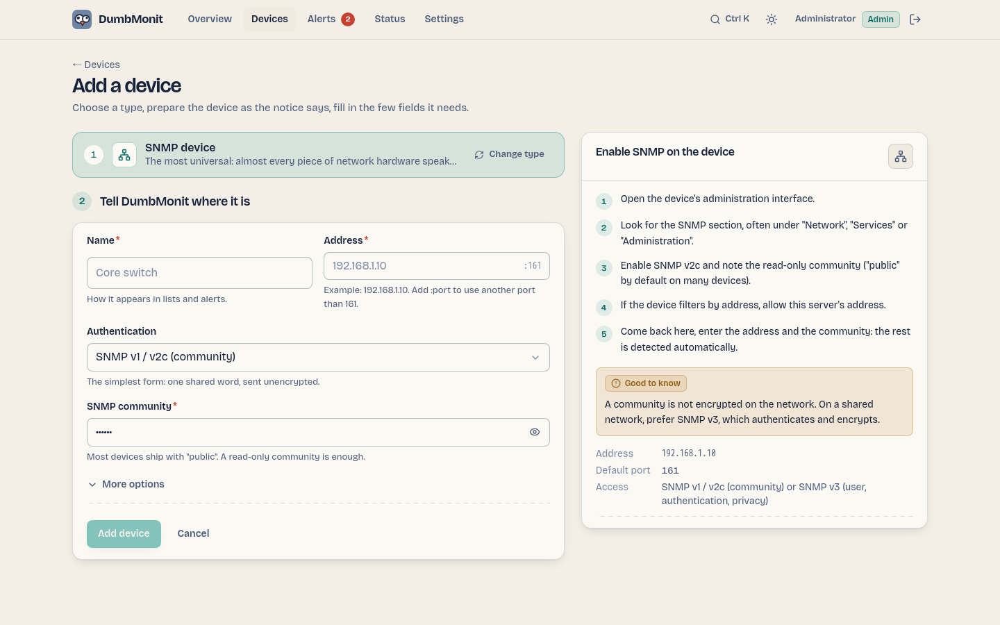

# Добавьте первое устройство

Добавление чего угодно всегда работает одинаково: выберите тип из списка,
справка справа объясняет, что подготовить на устройстве, и форма показывает
только поля, важные для этого типа.

## Три первых шага {#the-three-first-steps}

На совершенно новом инстансе обзорная страница не показывает пустую сводку:
она показывает короткое руководство — **добавьте первое устройство**,
**подключите способ получать уведомления**, **проверьте, что сообщение
доходит**. Каждый шаг — это один клик, и каждый сам становится зелёным.
Третий засчитывает только сообщение, которое действительно ушло из канала,
поэтому создание канала без его проверки не отмечает этот шаг.

Руководство хранится на инстансе, а не в браузере: пропуск шага, или всего
руководства, пропускает его в каждом браузере и для каждого пользователя. Оно
навсегда исчезает, как только все три шага выполнены, и никогда не
появляется на инстансе, у которого уже были устройства и канал — обновление
не вручает устоявшейся домашней лаборатории учебник.

## Добавление устройства SNMP

SNMP — самый универсальный тип: почти всё сетевое оборудование говорит по
нему. Коммутаторы, маршрутизаторы, NAS, ИБП и принтеры — обычные кандидаты.

1. На устройстве включите SNMP v2c и запомните community только для чтения
   (`public` по умолчанию на многих устройствах). Если устройство фильтрует
   по адресу, разрешите адрес сервера DumbMonit.
2. В DumbMonit откройте **Devices** и нажмите **Add a device** (либо
   ++ctrl+k++ и введите «add»).
3. Выберите **SNMP device**. Селектор сворачивается в одну строку, и форма
   показывает поля для SNMP.
4. Введите **имя**, **адрес** (IP или имя хоста) и **community**. Для SNMP
   v3 переключите учётные данные на *SNMP v3* и заполните имя пользователя и
   парольные фразы аутентификации и шифрования.
5. Нажмите **Add device**.

{ loading=lazy }

Профиль сбора определяется автоматически по `sysObjectID` устройства, в
фоне, так что форма никогда не ждёт недоступное устройство. Интерфейсы, а на
серверах и NAS — CPU, память и хранилище, появляются в течение минуты.

!!! warning "Community передаётся в открытом виде"
    Community SNMP v1/v2c не шифруется в сети. В общей сети предпочитайте
    SNMP v3, который аутентифицирует и шифрует.

## Сканирование сети

Вместо того чтобы вводить устройства по одному, просканируйте диапазон:

1. На **Add a device** откройте панель **Scan my network**.
2. Введите сеть в нотации CIDR, например `192.168.1.0/24` (до 4096 адресов
   за сканирование), и community для проверки каждого адреса (`public` по
   умолчанию).
3. Каждый отвечающий адрес перечисляется с его `sysName`, описанием и
   профилем, который был бы применён. Устройства, уже в DumbMonit, помечены
   *Already added*, а всё новое отмечено за вас.
4. Снимите отметку с того, что не нужно, затем нажмите **Add *n* devices**.
   Они создаются по одному, каждая строка показывает свой собственный
   результат, так что один отказ никогда не останавливает остальные.

## Добавление сервера Proxmox VE

Тот же поток, с учётными данными в двух полях вместо одного:

1. В Proxmox создайте пользователя, зарезервированного для мониторинга,
   роль только для чтения и токен API — четыре команды `pveum` есть в
   справке рядом с формой, с кнопкой копирования для каждой, и на
   [странице Proxmox VE](../devices/proxmox.md). Никогда не используйте
   повторно учётную запись, которой вы сами входите.
2. В DumbMonit: **Add a device** → **Proxmox VE**.
3. Введите **имя** и **адрес** любого узла (порт 8006 по умолчанию).
4. Скопируйте **full-tokenid** токена (`dumbmonit@pve!monitor`) в **Token
   ID** и его **значение** (UUID) в **Secret**. Вставили всю строку
   `user@pve!name=secret` в Token ID по ошибке? Форма разделяет её и
   сообщает об этом.
5. Proxmox поставляется с самоподписанным сертификатом: отметьте **Accept an
   unverifiable certificate** в *More options*, если первая проверка на это
   жалуется.
6. Нажмите **Add device**.

[Proxmox Backup Server](../devices/pbs.md) работает так же с
`proxmox-backup-manager`; [NAS Synology](../devices/synology.md) требует
выделенную учётную запись DSM (имя пользователя и пароль); [сервер с
агентом](../devices/agent.md) вообще не требует учётных данных, только токен
регистрации, показываемый один раз после сохранения устройства.

## Справка по настройке

Каждый тип несёт собственную справку, написанную сервером и показываемую
рядом с формой: пронумерованные шаги для выполнения на устройстве (создать
пользователя только для чтения, создать токен API, разрешить адрес…), с
точным путём в меню продукта и кнопкой копирования для каждой команды или
значения, затем распространённая ошибка и ссылка на документацию
производителя, когда она есть. Страницы для каждого типа в этой документации
несут те же шаги слово в слово — тест на сервере держит их идентичными:
[SNMP](../devices/snmp.md), [Proxmox VE](../devices/proxmox.md),
[Proxmox Backup Server](../devices/pbs.md), [Synology DSM](../devices/synology.md),
[агент](../devices/agent.md), [сервисы](../devices/services.md).

Принцип, стоящий за каждой справкой: выделенная учётная запись только для
чтения, никогда та, которой вы сами входите. Утёкший секрет мониторинга не
должен быть способен что-либо изменить.

## Общие поля

Независимо от типа, форма содержит:

| Поле | Значение |
|---|---|
| Name | Как устройство отображается в списках и оповещениях. |
| Address | IP, имя хоста, `host:port` или URL в зависимости от типа; плейсхолдер показывает ожидаемую форму. |
| Credential | Семейства, которые принимает тип, каждое со своими полями: community, пользователь SNMP v3 и парольные фразы, токен Proxmox (Token ID + Secret), имя пользователя и пароль. У секретов есть глаз показать/скрыть, а вставленные значения очищаются от случайных пробелов, кавычек и разрывов строк. Хранится в зашифрованном виде, никогда не возвращается API: при редактировании пустые поля сохраняют то, что записано. |
| Check interval | Как часто DumbMonit читает устройство. По умолчанию 60 с, минимум 10 с. |
| Parent device | Если родитель становится недоступен, оповещения этого устройства подавляются, а не отправляются. См. [подавление по зависимости](../alerting/index.md#dependency-suppression). |
| Enabled | Устройство на паузе не проверяется и не вызывает оповещений. |
| Tags | Свободные метки ключ/значение, копируются на каждый ряд как `tag_<key>`. Специфичные для типа опции тоже здесь, под **More options**. |

## Что происходит дальше

- Устройство появляется на странице **Devices** как лицевая панель стойки:
  светодиод состояния, имя, тип, адрес, когда было замечено последний раз, и
  спарклайн.
- Измерения записываются в VictoriaMetrics каждые 5 секунд
  (`DUMBMONIT_FLUSH_INTERVAL_SECS`), так что первый график появляется после
  первой проверки плюс несколько секунд. **Probe now** на странице
  устройства форсирует проверку и сообщает, сколько образцов и рядов она
  произвела: это основной инструмент диагностики.
- [Встроенные правила оповещений](../alerting/rules.md) применяются сразу:
  устройство недоступно, CPU насыщен, диск почти заполнен, и так далее.
  Ничего настраивать не нужно.
- Чтобы получать уведомления, добавьте [канал уведомлений](../notifications.md)
  в **Alerts → Notifications**. Встроенные правила уведомляют каждый
  включённый канал.

!!! tip "Нет данных через минуту?"
    Откройте страницу устройства: ошибка конфигурации (неверное community,
    отклонённый сертификат, отсутствующая возможность) показывается красным
    под адресом, с причиной. См. [FAQ](../faq.md#no-data-after-adding-a-device).
