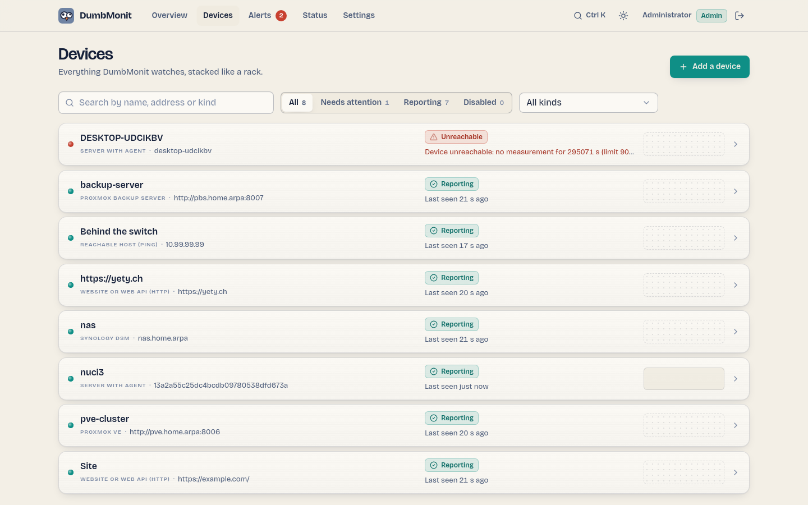
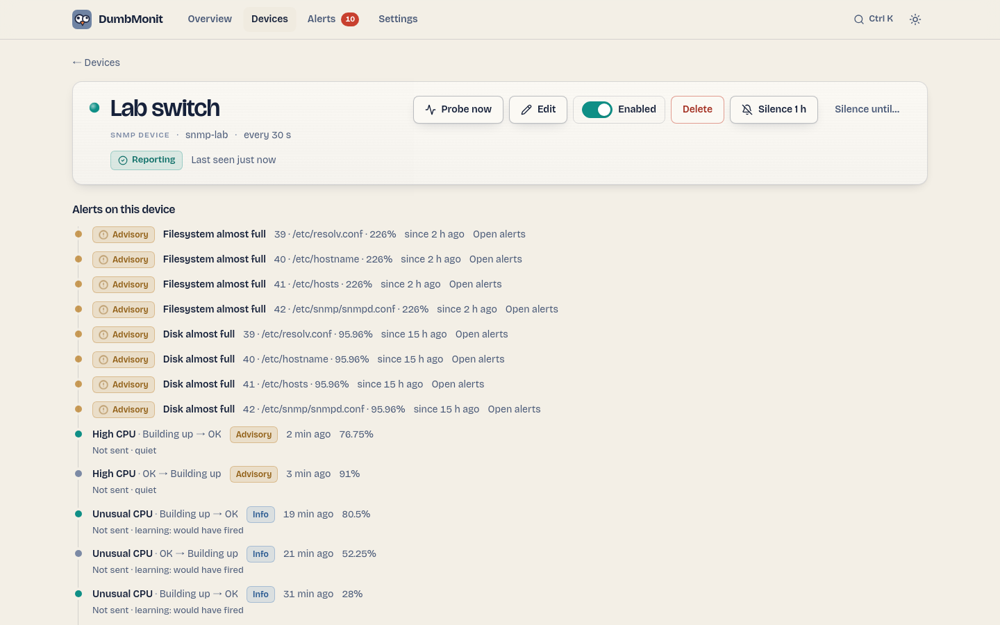

# Die Geräteseite

{ loading=lazy }

## Das Rack {#the-rack}

Jedes Gerät ist eine 1U-Rack-Frontblende: eine Status-LED, der Name, der
Art-Stempel, die Adresse, wann es zuletzt gesehen wurde, und eine
Sparkline einer repräsentativen Metrik. Kinder stapeln sich unter ihrem
Elternteil und werden abgedunkelt, wenn dieser nicht erreichbar ist.

| Zustand | Bedeutung |
|---|---|
| Reporting | Die letzte Abfrage gelang, innerhalb von drei Zeiträumen. |
| Unreachable | Das Gerät hat nicht geantwortet (Timeout, Verbindung abgelehnt), oder seit mehr als drei Zeiträumen keine Abfrage (mindestens 90 s). |
| Misconfigured | Die letzte Abfrage ist auf unserer Seite fehlgeschlagen: falsche Credentials, ungültige Adresse oder Option, unerwartete Antwort. In der Advisory-Farbe mit dem Fehler angezeigt; löst keinen Alarm aus. |
| Waiting | Hinzugefügt, noch nicht abgefragt. |
| Disabled | Pausiert: nicht geprüft, löst keinen Alarm aus. |

Filter: ein Suchfeld, ein Zustandssegment (All, Needs attention,
Reporting, Disabled) und ein Art-Filter. **Add a device** ist die
primäre Aktion.

## Ein Gerät {#a-device}

{ loading=lazy }

Die Geräteseite zeigt ihre Zustandsanzeige, Adresse, Art, erkanntes
Profil, Tags, letzte Abfrage, und für Services den Zertifikatsstatus.
Aktionen:

| Aktion | Wirkung |
|---|---|
| Probe now | Führt sofort eine Abfrage aus und meldet, wie viele Samples und Zeitreihen sie erzeugte. Das Erste, was man ausprobiert, wenn ein Gerät keine Daten zeigt. |
| Edit | Öffnet dasselbe Formular wie beim Hinzufügen, vorausgefüllt. Das Credential-Feld leer zu lassen behält das gespeicherte. |
| Silence 1 h / Silence until… | Ein einmaliges Wartungsfenster für dieses Gerät. |
| Delete | Fragt fünf Sekunden lang inline "Delete for good?", löscht dann das Gerät. Seine Zeitreihen bleiben in VictoriaMetrics, bis die Aufbewahrung abläuft. |

Darunter: **Alerts on this device** — jeder aktive Alarm bietet *Ack*,
*Snooze* und *Ignore*, und eine auf diesem Gerät ignorierte Regel wird
separat mit **Stop ignoring** aufgeführt — dann **Metrics** über einen
Zeitraum (1 h, 6 h, 24 h, 7 Tage), ein Diagramm pro Metrikname mit einer
Linie pro Zeitreihe. Siehe
[Einen Alarm loswerden](alerts.md#getting-rid-of-an-alert).

Services (HTTP, TCP, DNS, Ping, TLS) erhalten stattdessen Instrumente:
**Availability** über die letzten 24 Stunden oder 7 Tage, **Response
time**, die Anzahl der **Checks**, und einen **History**-Balken aus
Slots (ältester links), der zeigt, wann der Dienst down war.

## Container-Richtlinien {#container-policies}

Auf einer Maschine mit Agent und Docker sitzt ein **Docker**-Streifen
unter der Kopfzeile: Containeranzahl, wie viele laufen, verfügbare
Updates, und wie viele Container eine Richtlinie haben. **Manage
containers** öffnet die Liste; **Policies…** öffnet eine Tabelle mit
zwei Schaltern pro Container und einer "Apply to all"-Zeile:

- **Restart if down** — der Server startet den Container innerhalb einer
  Minute nach seinem Stopp neu (höchstens einmal alle zehn Minuten);
- **Auto-update in maintenance windows** — wenn die Registry ein neueres
  Image für denselben Tag hat, wird der Container während eines
  geplanten Wartungsfensters (Alerts-Seite → Scheduled) neu erstellt und
  zurückgerollt, falls er seinen Healthcheck nicht besteht.

Jeder Schalter speichert für sich. Details und Sicherheitsregeln:
[Docker-Container](../devices/agent.md#docker-containers).

## Hinzufügen und Bearbeiten {#adding-and-editing}

Siehe [Ihr erstes Gerät hinzufügen](../install/first-device.md) für das
Formular und die [Gerätearten](../devices/index.md) für das, was jede Art
braucht. Beim Bearbeiten öffnet das Formular **More options** von selbst,
wenn das Gerät bereits eine davon nutzt.

## Löschen {#deleting}

Das Löschen eines Geräts entfernt es aus der Konfiguration, löscht seine
Alarme sofort — es wird nichts benachrichtigt, die Historie behält eine
`device removed or disabled`-Zeile — und löscht seine Zeitreihen ein paar
Sekunden später aus dem eingebetteten VictoriaMetrics (Best Effort: ein
Fehlschlag wird nur protokolliert, und die Zeitreihen altern dann mit der
12-monatigen Aufbewahrung aus). Das Pausieren eines Geräts löscht seine
Alarme auf dieselbe Weise; seine Zeitreihen bleiben.
