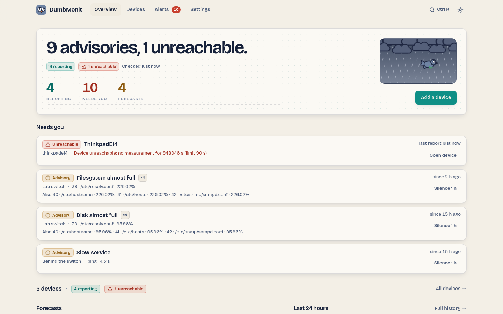
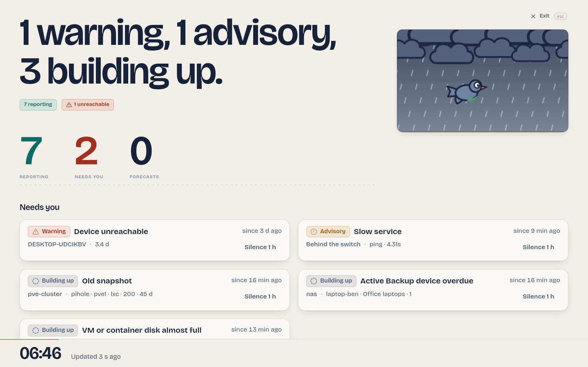

# Die Übersichtsseite

Die Startseite beantwortet "ist alles in Ordnung?" in etwa einer
Sekunde, und lässt Sie dann auf Wunsch tiefer graben.

{ loading=lazy }

## Das Bulletin

Das Band oben ist ein Wetterbericht für Ihr Netzwerk. Ein Satz
beschreibt den Himmel: "Clear skies." wenn nichts Ihre Aufmerksamkeit
braucht, sonst eine Zählung dessen, was sie braucht ("9 advisories, 1
unreachable."). Darunter zählen Anzeigen melde Geräte und nicht
erreichbare, mit der Zeit der letzten Prüfung, und drei Anzeigen:
**Reporting**, **Needs you**, **Forecasts**.

Das Wetterfenster rechts folgt dem Netzwerk: klar, bewölkt, bedeckt oder
Sturm, je danach, wie viele Alarme feuern und wie schwer sie sind, mit
der über den Himmel fliegenden Taube. Unter
`prefers-reduced-motion` steht alles still.

Die einzige primäre Aktion der Seite ist **Add a device**.

## Die Erstlauf-Anleitung

Auf einer neuen Instanz ist die Seite unter dem Bulletin nicht leer: Es
ist eine dreistufige Anleitung — ein Gerät hinzufügen, eine Art,
benachrichtigt zu werden, verbinden, prüfen, dass eine Nachricht
ankommt. Jeder Schritt ist ein Klick, jeder kann für sich weggewischt
werden, und **Skip the guide** räumt alle drei weg. Die Wahl wird auf
der Instanz gespeichert, sodass ein zweiter Browser die Anleitung nicht
neu beginnt. Siehe
[Ihr erstes Gerät hinzufügen](../install/first-device.md#the-three-first-steps).

## Needs you

Die Liste dessen, was jetzt Ihre Aufmerksamkeit braucht, am schwersten
zuerst: nicht erreichbare Geräte, dann feuernde Alarme nach Schweregrad.
Jede Zeile benennt die Regel, das Gerät, den aktuellen Wert, wie lange
es schon geht, und ob es mehrere Zeitreihen gruppiert ("×4" für vier
Dateisysteme auf demselben Gerät). Vier Aktionen: **Ack** (diesen
Alarm für 1 h, 4 h, 24 h oder bis zur Behebung bestätigen — Erinnerungen
pausieren, die Behebung wird trotzdem gemeldet), **Snooze** (nur diesen
Alarm für 1 h, 8 h, 1 Tag oder bis zur Behebung ausblenden), **Ignore**
(diese Regel davon abhalten, je wieder auf diesem Gerät zu alarmieren,
reversibel), und **Open device**.

Bestätigte und stummgeschaltete Alarme wandern in ihre eigene ruhigere
Gruppe unter der Liste und verlassen die *Needs you*-Zählung. Ein
ignorierter Alarm verschwindet ganz — er ist nicht "bekannt", er ist
für dieses Gerät abgeschaltet. Siehe
[Einen Alarm loswerden](alerts.md#getting-rid-of-an-alert).

## Geräteübersicht

Eine Zeile: wie viele Geräte, wie viele melden, wie viele nicht
erreichbar sind, und ein Link zur vollständigen Devices-Seite. Die
Übersicht listet nie Geräte: Das Rack lebt auf [Devices](devices.md).

## Vorhersagen und letzte 24 Stunden

**Forecasts** zeigt, was vorhergesagt statt beobachtet wird: die
saisonale Baseline-Anomalie, die "voll innerhalb von vier Tagen"-
Extrapolationen, die PBS-Füllstandsschätzung, und Regeln, deren Name
eine Vorhersage ankündigt. Während eine Baseline lernt, sagen ihre
Einträge das.

**Last 24 hours** listet die feuernden Übergänge des Tages, mit einem
Link zur vollständigen Historie auf der Alerts-Seite.

## Wall-Modus

`/wall` zeigt nur das Bulletin, im Vollbild, für einen Raummonitor: den
Satz, die Zählungen und die *Needs you*-Liste, alle 20 Sekunden
aktualisiert, mit wachgehaltenem Bildschirm. ++esc++ oder **Exit**
führt zur Übersicht zurück. Öffnen Sie es aus der Befehlspalette
("Wall mode") oder durch Eingabe der URL. Es kann auch Musik abspielen,
von Ihrem Telefon gestartet: siehe [Wall-Modus und Musik](wall.md).

{ loading=lazy }

## Auf einem Telefon installieren

Die Oberfläche liefert ein Web-Manifest, sodass ein Telefon sie dem
Homescreen hinzufügen kann: **Share → Add to Home Screen** auf iOS,
**Install app** im Chrome-Menü auf Android. Sie öffnet sich dann ohne
Browser-Chrome, im Theme, auf das das Telefon eingestellt ist.

Es gibt absichtlich **keinen Offline-Modus und keinen Service
Worker**. Ein Überwachungsbildschirm, der eine zwischengespeicherte
Seite zeigt, ist schlimmer als einer, der sagt, dass er den Server
nicht erreichen kann: Der ganze Sinn ist, dass das, was Sie lesen,
aktuell ist. Ohne Worker wird auch ein aktualisierter Server sofort
ausgeliefert, ohne veralteten Build zu löschen.

## Befehlspalette

++cmd+k++ auf macOS, ++ctrl+k++ sonst, öffnet die Befehlspalette: ein
Eingabefeld, Ergebnisse in drei Gruppen.

| Gruppe | Einträge |
|---|---|
| Pages | Overview, Devices, Alerts, Notifications, Status pages, Settings, Wall mode, Documentation |
| Actions | Add a device, Scan my network, Schedule maintenance, Add notification channel, New status page, Announce an incident, Toggle theme |
| Devices | Jedes Gerät, mit seiner Zustands-LED; ++enter++ öffnet es |

## Navigation

Die obere Leiste hat Overview, Devices, Alerts (mit der Anzahl dessen,
was Ihre Aufmerksamkeit braucht), Status und Settings, den Paletten-
Shortcut und den Theme-Umschalter. Auf einem Telefon wird sie zu einer
unteren Tab-Leiste mit denselben fünf Einträgen.

- **Overview** — das Bulletin: ist alles in Ordnung, und was Ihre
  Aufmerksamkeit braucht.
- **Devices** — das Rack; jede überwachte Quelle. Siehe
  [Devices-Seite](devices.md).
- **Alerts** — was feuert, geplante Wartung, die Regeln, und die
  Benachrichtigungskanäle und -richtlinie. Siehe
  [Alerts-Seite](alerts.md).
- **Status** — die öffentlichen Statusseiten und ihre Ankündigungen.
  Siehe [Statusseiten](status-pages.md).
- **Settings** — Ihr Konto, Benutzer und Single Sign-On, Agent- und
  Assistant-Tokens, Erscheinungsbild, About. Siehe
  [Settings](settings.md). Nichts auf der Oberfläche vermittelt Status
  allein durch Farbe: Eine Anzeige oder LED kommt immer mit einem Wort
  (Reporting, Unreachable, Advisory, Warning, Suppressed by parent,
  Building up).
