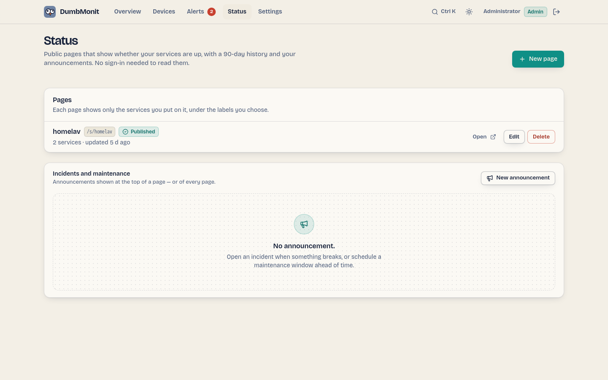

# Pages d'état

{ loading=lazy }

Une page d'état est le visage public de votre surveillance : une page
que n'importe qui peut ouvrir — sans connexion, sans cookie — qui dit si
vos services tournent, montre jusqu'à 90 jours d'historique quotidien
pour chacun, porte vos annonces d'incident et de maintenance, et laisse
les visiteurs les suivre par RSS ou email. Des badges mettent la même
réponse dans un README ; une vue compacte tient dans une page intranet.

Elle ne montre que ce que vous y mettez : le libellé que vous donnez à
chaque service, son état, sa disponibilité et son temps de réponse. Noms
d'appareil, adresses, types et identifiants ne quittent jamais le
serveur — ni dans la page, ni dans un badge, ni dans un email.

## 1. Créer une page

**État** dans la barre du haut → **Nouvelle page**. Cette page liste vos
pages d'état (ouvrir, modifier, supprimer) avec les annonces en
dessous ; l'éditeur s'ouvre sur sa propre route (`/status/new`,
`/status/<id>`). Le rendu public est à `/s/<adresse>`.

| Champ | Ce qu'il fait |
| --- | --- |
| **Titre** | Le titre de la page (« Homelab »). |
| **Adresse** | La dernière partie de l'URL, `/s/<adresse>`. Suggérée depuis le titre ; lettres minuscules, chiffres et tirets, de 2 à 40 caractères. |
| **Description** | Une phrase sous le titre. Optionnel. |
| **Thème** | Jour, nuit, ou suivre le système du visiteur. |
| **Historique** | La fenêtre la plus longue que la barre d'historique couvre (30, 60 ou 90 jours). La barre s'adapte à l'ancienneté des données de la page : elle montre autant de jours que le service le plus ancien a été surveillé, de 7 jours jusqu'à ce réglage. Une page ne dit jamais plus que ça — voir [Badges](#badges). |
| **Mode simple** | Une page nue : pas de scène, pas de mascotte, pas d'animation et pas d'easter eggs. Clair ou sombre suit le système du visiteur, avec un interrupteur dans l'en-tête ; le réglage Thème de la page est ignoré. |
| **Publiée** | Désactivé = brouillon : la page, ses badges et son logo répondent « not found » aux visiteurs jusqu'à ce que vous l'activiez. |

Puis cochez les appareils à montrer. Pour chacun, réglez le **libellé**
que les visiteurs liront (il vaut par défaut le nom de l'appareil — vous
préférerez peut-être « Site web » à « nginx-front-01 ») et,
optionnellement, un **groupe** (« Réseau », « Stockage »). Les groupes
deviennent des blocs sur la page, dans l'ordre où vous arrangez les
services.

Enregistrez, et le lien est prêt à copier. La page se rafraîchit
elle-même chaque minute.

### Apparence

La section **Apparence** de l'éditeur habille la page de vos couleurs
sans l'ouvrir à du code arbitraire :

| Réglage | Ce qu'il fait |
| --- | --- |
| **Logo** | PNG, JPEG ou WebP, jusqu'à 256 Kio, montré à côté du titre. Carré fonctionne mieux. SVG est refusé : il peut porter du script, et la page est servie depuis la même adresse que l'administration. Le fichier est vérifié par son contenu, stocké sous `/data/status-pages/`, et servi comme image seulement. |
| **Accent** | Encre (défaut), bleu, teal, violet, rose ou ambre — la règle du haut, les liens et le bouton d'abonnement. Chacun est choisi pour rester lisible de jour comme de nuit. |
| **Site web de l'organisation** | Un lien `http://` ou `https://` montré à côté du titre, comme le nom d'hôte du site. |
| **Texte de pied de page** | Texte brut sous la page, jusqu'à 280 caractères : qui la gère, comment la contacter. Les retours à la ligne sont gardés ; rien n'est interprété comme HTML ou Markdown. |

### Scène

Le réglage **Scène** dessine une silhouette de ville derrière la
bannière. Les nouvelles pages démarrent avec Paris, et les pages
existantes qui n'avaient pas de scène la montrent aussi maintenant ;
décochez-la pour une bannière nue, ou activez **Mode simple** pour
abandonner les scènes complètement. Choisissez-en autant que vous
voulez, dans l'ordre que vous voulez. Villes : Venise, Paris, Tokyo, New
York, Londres, Rome, Sydney, Dubaï, San Francisco, Barcelone, Amsterdam,
Istanbul et Rio de Janeiro. Les sept nouvelles merveilles : Chichén
Itzá, Machu Picchu, la Grande Muraille, Pétra et le Taj Mahal (le Christ
Rédempteur de Rio est dans la scène Rio). Les merveilles antiques :
Gizeh, Babylone, Éphèse, Olympie, Halicarnasse, Rhodes et Alexandrie,
plus l'Acropole d'Athènes. Avec plus d'une, **Rotation** décide quand la
page passe à la suivante : à chaque visite (défaut), chaque minute,
toutes les dix minutes ou chaque heure. Les scènes sont un ensemble
fermé de dessins fournis avec DumbMonit — rien n'est téléchargé ni
interprété.

Il n'y a délibérément pas de CSS ou HTML personnalisé : une page d'état
est publique et vit sur la même origine que votre interface
d'administration, sous la même
[politique de sécurité du contenu](../reference/api.md).

## 2. Ce que les visiteurs voient

- Une bannière avec la réponse en une seconde, lue depuis les
  services : **Tous les systèmes opérationnels**, **Panne partielle**
  (certains en panne ou dégradés), **Panne majeure** (tous en panne) ou
  **Maintenance planifiée**. Un incident ouvert tandis que chaque
  service répond encore lit **Incident en cours**, teinté par son
  impact.
- Les annonces ouvertes, la mise à jour la plus récente d'abord, avec
  la chronologie des mises à jour sous un pli.
- Chaque service avec sa plaque d'état (Opérationnel, Dégradé, En
  panne, Maintenance, Aucune donnée), sa **barre d'historique** — un
  carré par jour — sa disponibilité sur 24 h, 7 jours, 30 jours et (sur
  une page de 90 jours) 90 jours, et le temps de réponse pour les
  sondes de disponibilité.
- **Incidents passés**, par jour, pour les 30 derniers jours.
- **Recevoir les mises à jour** : le flux RSS, et un formulaire
  d'abonnement email quand vous en configurez un (voir
  [Abonnés email](#email-subscribers)).

### La barre d'historique

Chaque carré est un jour (UTC), teinté par la disponibilité de ce
jour-là : couleur pleine à 99,5 % et plus, ambre à partir de 95 %, rouge
en dessous. **Un jour sans aucune mesure est gris**, pas vert — un
service ajouté la semaine dernière a 83 jours gris, pas 83 parfaits.
Survolez un carré, ou donnez le focus à la barre et déplacez-vous avec
les flèches (Home et End vont aux extrémités), pour lire la date, la
disponibilité, les **minutes d'indisponibilité** et les incidents qui
ont touché ce jour. Les mots sont là pour les lecteurs d'écran aussi :
le statut n'est jamais dit par la couleur seule.

Comment l'état est décidé :

| État | Signification |
| --- | --- |
| Opérationnel | La dernière sonde a réussi (sondes de disponibilité), ou l'appareil a rapporté dans les trois dernières périodes de sondage. |
| Dégradé | Actif maintenant, mais au moins une sonde a échoué dans la dernière heure. |
| En panne | La dernière sonde a échoué, l'appareil a arrêté de rapporter, ou sa configuration est en erreur. |
| Maintenance | Une fenêtre de maintenance est en cours et le service est en panne : attendu, pas une panne. Soit une annonce sur cette page, soit une [fenêtre de maintenance](../alerting/maintenance.md) d'alerte couvrant cet appareil. |
| Aucune donnée | Jamais sondé encore, ou désactivé. |

La disponibilité pour les sondes (`http`, `tcp`, `dns`, `ping`, `tls`,
battements de cœur) est la part de vérifications réussies, depuis
`dumbmonit_probe_success` ; l'indisponibilité d'un jour est ses
vérifications échouées multipliées par l'intervalle de sonde. Pour les
autres appareils (SNMP, agent, Proxmox…) c'est la part de créneaux de
cinq minutes où l'appareil a rapporté au moins une fois
(`dumbmonit_up`), comptée depuis la première mesure — un appareil ajouté
hier n'est pas « en panne » pour les 89 jours avant ça — et
l'indisponibilité d'un jour est ses créneaux silencieux.

## 3. Annoncer des incidents et des maintenances

Sur la page **État**, sous la liste des pages, **Incidents et
maintenance** → **Nouvelle annonce** (aussi ++ctrl+k++ → *Annoncer un
incident*).

- Un **incident** a un titre, un impact (**mineur** montre la page
  dégradée, **majeur** comme une panne) et passe par *En investigation
  → Identifié → Surveillance → Résolu*. Postez des mises à jour au fur et
  à mesure : chacune porte un statut et un message, et devient la
  dernière ligne que les visiteurs lisent. **Résoudre** le termine avec
  un message final ; il passe alors dans « Incidents passés » pendant 30
  jours.
- Une fenêtre de **maintenance** a un début et une fin et passe par
  *Planifiée → En cours → Terminée*. Tandis qu'elle est en cours, la
  bannière dit « Maintenance planifiée » et les services en panne se
  montrent comme *Maintenance*.

Une [fenêtre de maintenance planifiée dans Alertes](../alerting/maintenance.md)
fait la même chose pour le seul appareil qu'elle couvre, sans annonce :
ce service lit *Maintenance* au lieu de rouge tandis que la fenêtre est
ouverte, et l'état global de la page dit *Maintenance* quand rien
d'autre n'est en panne ou dégradé. Seules les fenêtres qui nomment un
appareil se montrent ainsi ; le nom et le commentaire de la fenêtre
restent privés.

Une annonce est montrée sur une page ou sur **toutes les pages**.

### Abonnés email {#email-subscribers}

Les visiteurs peuvent s'abonner à vos annonces par email une fois que
vous choisissez un **canal email (SMTP)** dans l'éditeur, sous
**Abonnés email**. Le canal est un que vous avez déjà configuré sous
[Notifications](../alerting/notifications.md) ; son serveur et son
expéditeur sont réutilisés, pas ses propres destinataires. Sans ça, la
page n'offre que son flux RSS.

- **Double opt-in.** Un visiteur saisit une adresse ; DumbMonit envoie
  un lien de confirmation, et rien d'autre n'est envoyé jusqu'à ce qu'il
  soit suivi. Une demande jamais confirmée est oubliée après deux
  jours. Le formulaire répond la même phrase que l'adresse soit
  nouvelle, en attente ou déjà abonnée, il ne dit donc à personne qui
  suit votre page.
- **Ce qui est envoyé.** Un email quand une annonce est créée, quand
  une mise à jour est postée, et quand son statut change — pour les
  incidents comme pour les maintenances, sur cette page (ou sur toutes
  les pages, pour une annonce montrée sur toutes).
- **Se désabonner.** Chaque email se termine par un lien pour se
  désabonner, et porte les en-têtes `List-Unsubscribe` et
  `List-Unsubscribe-Post`, pour que Gmail, Apple Mail et d'autres
  offrent leur propre bouton en un clic.
- **Limites.** Le point de terminaison public d'abonnement accepte cinq
  requêtes par adresse client et soixante en tout par 15 minutes, et une
  adresse en attente n'est pas mailée deux fois en dix minutes : la page
  ne peut pas être transformée en canon à mail.
- L'éditeur liste les abonnés (confirmés ou en attente) et en supprime
  n'importe lequel.

Les liens dans ces emails pointent vers le
[domaine personnalisé](#custom-domain) de la page quand elle en a un
(`https://status.example.com/`). Sinon ils sont construits depuis
l'**URL publique** de la [politique de notification](../alerting/notifications.md)
(ou `DUMBMONIT_PUBLIC_URL`) ; sans ça, depuis l'adresse que vous avez
utilisée la dernière fois que vous avez enregistré la page — jamais
depuis la requête d'un visiteur.

## 4. Partager le lien

La page vit à `https://votre-serveur/s/<adresse>`. Tout sous `/s/` et
`/api/public/` est servi sans authentification ; le reste de DumbMonit
reste derrière la connexion.

Le panneau **Partager** de l'éditeur construit les extraits ci-dessous
pour vous, avec un aperçu.

### Badges {#badges}

Chaque page publiée sert des badges SVG — plats, texte blanc sur
couleur unie, lisibles sur les thèmes clair et sombre d'un README
GitHub :

| Badge | URL |
| --- | --- |
| Statut de la page | `/api/public/status/<adresse>/badge.svg` |
| Disponibilité de la page | `/api/public/status/<adresse>/uptime.svg?days=30` |
| Temps de réponse de la page | `/api/public/status/<adresse>/response.svg` |
| Statut du service | `/api/public/status/<adresse>/components/<service>/badge.svg` |
| Disponibilité du service | `/api/public/status/<adresse>/components/<service>/uptime.svg?days=30` |
| Temps de réponse du service | `/api/public/status/<adresse>/components/<service>/response.svg` |

`<service>` est le libellé du service sous forme d'URL : « API
Publique » devient `api-publique` (une seconde « API Publique » serait
`api-publique-2`). C'est aussi la `key` de chaque service dans le
document JSON. `days` est `1`, `7`, `30` (défaut) ou `90`, et jamais
plus que l'historique de la page : une page de 30 jours refuse un badge
de 90 jours. La disponibilité et le temps de réponse de la page sont la
moyenne sur ses services. Un service sans aucune mesure dit **aucune
donnée**, en gris.

Dans un README :

```markdown
[](https://your-server/s/home-lab)
[](https://your-server/s/home-lab)
[](https://your-server/s/home-lab)
```

Les badges sont mis en cache une minute (`Cache-Control: public,
max-age=60`), le proxy d'images de GitHub et vos visiteurs ne coûtent
donc rien à la base de séries temporelles.

### Intégrer

`/s/<adresse>/embed` est une vue compacte pour une iframe : l'état
global et une ligne par service avec son état et 30 jours d'historique,
et un lien vers la page complète dans un nouvel onglet.

```html
<iframe src="https://your-server/s/home-lab/embed"
        title="Home lab status" width="100%" height="320" style="border:0"></iframe>
```

Ajoutez `?theme=light` ou `?theme=dark` pour correspondre à la page
hôte, et `?history=0` pour cacher les barres. La page d'état et son
embed sont les seules adresses de DumbMonit qu'une page tierce peut
mettre dans une frame ; tout le reste (les pages de confirmation et de
désabonnement incluses) répond avec `frame-ancestors 'none'` et
`X-Frame-Options: DENY`.

### Domaine personnalisé {#custom-domain}

Une page peut avoir sa propre adresse, comme `status.example.com`, à la
manière d'Uptime Kuma. Saisissez le nom dans le champ **Domaine public**
de l'éditeur (le **i** à côté résume les étapes) et enregistrez. Quand
une requête atteint DumbMonit avec ce nom dans son en-tête `Host`,
DumbMonit montre la page à la racine `/`, et rien d'autre : sur ce nom,
l'écran de connexion, les réglages, l'API, les points de terminaison des
agents, les métriques et les autres pages d'état répondent tous `404 Not
found`, même pour quelqu'un connecté, et aucun cookie de session n'est
lu ni réglé. Seuls la page, son embed, ses pages de confirmation et de
désabonnement, ses badges, flux et document JSON, et les propres
fichiers de l'interface (`/_app/`, icônes) sont servis.

Le nom est stocké en minuscules, sans `https://` ni barre oblique
finale ; un port, un chemin ou une adresse IP sont refusés. Deux pages
ne peuvent pas partager un nom, et l'adresse que vous utilisez pour
atteindre DumbMonit lui-même (ou son URL publique) ne peut pas être le
domaine d'une page — l'enregistrer vous enfermerait dehors. Videz le
champ pour retirer le domaine ; la page reste à `/s/<adresse>` dans tous
les cas.

Pour le configurer :

1. **DNS.** Créez l'enregistrement pour le nom (ou le nom d'hôte public
   d'un Cloudflare Tunnel), pointant vers votre reverse proxy.
2. **Proxy.** Envoyez le nom vers l'adresse de DumbMonit, par exemple
   `http://dumbmonit:8080`, **sans réécrire le chemin** : le proxy
   transfère `/`, pas `/s/<adresse>`.
3. **En-tête Host.** Transmettez l'en-tête `Host` original : c'est
   comment DumbMonit distingue le domaine de la page de sa propre
   adresse. DumbMonit ne lit que `Host` ; `X-Forwarded-Host` ne compte
   que depuis un proxy listé dans `DUMBMONIT_TRUSTED_PROXIES`.
4. **HTTPS** est géré par le proxy. DumbMonit crée des liens vers
   `https://<domain>/` dans les emails d'abonné, le flux RSS et le
   panneau **Partager** de l'éditeur.

Traefik (labels Docker) — l'en-tête `Host` est transmis par défaut :

```yaml
labels:
  - traefik.enable=true
  - traefik.http.routers.status.rule=Host(`status.example.com`)
  - traefik.http.routers.status.entrypoints=websecure
  - traefik.http.routers.status.tls.certresolver=letsencrypt
  - traefik.http.services.status.loadbalancer.server.port=8080
```

Nginx Proxy Manager — ajoutez un **Proxy Host** avec le domaine
`status.example.com`, schéma `http`, nom d'hôte de transfert
`dumbmonit`, port `8080`, et un certificat SSL. Rien d'autre : il
transmet `Host` par défaut. Laissez les **Custom locations** vides.

Cloudflare Tunnel — ajoutez un **Public hostname**
`status.example.com` avec le service `http://dumbmonit:8080` et aucun
chemin. Le tunnel garde le `Host` du visiteur ; laissez **HTTP Host
Header** vide dans les réglages avancés.

Caddy — `reverse_proxy` transmet `Host` et Caddy récupère le
certificat :

```caddyfile
status.example.com {
    reverse_proxy dumbmonit:8080
}
```

Nginx — `proxy_pass` envoie le nom de l'upstream sauf indication
contraire, réglez donc l'en-tête :

```nginx
server {
    listen 443 ssl;
    server_name status.example.com;
    # ssl_certificate … ;

    location / {
        proxy_pass http://dumbmonit:8080;
        proxy_set_header Host $host;
        proxy_set_header X-Forwarded-For $proxy_add_x_forwarded_for;
        proxy_set_header X-Forwarded-Proto $scheme;
    }
}
```

**Dépannage.**

- *Le domaine montre l'écran de connexion ou le tableau de bord de
  DumbMonit* : l'en-tête `Host` n'a pas atteint DumbMonit — le proxy l'a
  remplacé par le nom de l'upstream (`dumbmonit:8080`). Ajoutez
  `proxy_set_header Host $host;` (Nginx), retirez un **HTTP Host
  Header** personnalisé (Cloudflare Tunnel), ou retirez un middleware
  de réécriture de `Host` (Traefik). Rien de privé n'est exposé : le
  tableau de bord demande quand même un mot de passe.
- *Un simple `Not found` sur le domaine* : le proxy réécrit le chemin
  (il envoie `/s/<adresse>` ou ajoute un préfixe), ou le domaine dans
  l'éditeur ne correspond pas exactement au nom dans le navigateur.
  Transférez le chemin intact.
- *La page dit qu'elle n'existe pas* : la page est encore un brouillon
  — publiez-la.
- *Vous ne pouvez plus atteindre l'interface de DumbMonit* : vous
  naviguez via le domaine de la page. Utilisez la propre adresse de
  DumbMonit, ou videz le **Domaine public** de la page.

### Derrière un reverse proxy

Un [domaine personnalisé](#custom-domain) est la façon la plus simple
d'exposer seulement la page d'état. Si vous préférez garder le chemin
`/s/<adresse>` sur un nom public, filtrez les chemins dans le proxy à
la place. Avec Caddy, par exemple :

```caddyfile
status.example.com {
    @public path /s/* /api/public/* /_app/* /favicon.svg
    reverse_proxy @public dumbmonit:8080
    respond 404
}
```

Avec nginx :

```nginx
location ~ ^/(s/|api/public/|_app/|favicon\.svg) {
    proxy_pass http://dumbmonit:8080;
    proxy_set_header Host $host;
    proxy_set_header X-Forwarded-Proto $scheme;
}
location / { return 404; }
```

`/_app/` porte les scripts et styles de l'interface : la page en a
besoin pour s'afficher. Transférez `X-Forwarded-Proto` et
`X-Forwarded-Host` pour que le flux RSS pointe vers la bonne adresse, et
réglez l'URL publique (voir ci-dessus) pour que les emails d'abonné le
fassent aussi.

### Flux et document

- `GET /api/public/status/<adresse>/rss` — un flux RSS des incidents
  et fenêtres de maintenance, un élément par annonce avec sa dernière
  mise à jour.
- `GET /api/public/status/<adresse>` — le document JSON dont la page
  est construite, si vous voulez construire la vôtre : le titre, la
  description et l'apparence de la page, l'état global, la `key`, le
  `label`, le `state`, la disponibilité (`uptime_24h`, `uptime_7d`,
  `uptime_30d`, `uptime_90d`), le `latency_ms` et l'`history` (`date`,
  `uptime_pct`, `down_minutes`, `incidents` par jour) de chaque
  service, et les annonces.

N'importe quel site peut lire ce document depuis le navigateur (il est
envoyé avec `Access-Control-Allow-Origin: *` et sans cookies). `GET
/api/public/status/<adresse>/banner.js` est un script prêt à l'emploi
qui le transforme en bannière : voir
[Bandeau pour site web](../integrations/website-banner.md).

Le document est mis en cache 30 secondes sur le serveur ; les badges,
le flux et l'embed lisent tous ce même document mis en cache, aucun ne
peut donc dire plus que la page.
